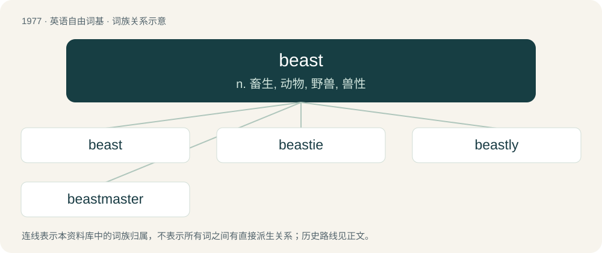

# 2094 · beast — n. 畜生, 动物, 野兽, 兽性

[总目录](../00_总目录_按常用程度.md)

**类型**：英语自由词基　｜　**来源语言**：见词源记录

## 核心含义与来源

- 核心含义：n. 畜生, 动物, 野兽, 兽性
- 英文含义：Any four-footed land mammal.
- 词形：beast

**来源记录 1**（名词；Any four-footed land mammal.）

From Middle English beeste, beste, from Old French beste (French bête), from Latin bēstia (“animal, beast”); many cognates – see bēstia.

## 词族图

## 单词速览（常用到不常用）

| 单词 | 音标 | 释义 |
|---|---|---|
| [beast](#w-1) | 英 /biːst/ | n. 畜生, 动物, 野兽, 兽性 |
| [beastie](#w-2) | /ˈbiːsti/ | n. 动物,小动物 |
| [beastly](#w-3) | /ˈbiːstli/ | a. 野兽的, 残忍的, 令人厌憎的 |
| [beastmaster](#w-4) |  | 【英文】A character in video games who fights monsters and other creatures. |

## 逐词详解

### 1. beast

**词性**：名词　｜　**音标**：英 /biːst/

**中文释义**：n. 畜生, 动物, 野兽, 兽性

**英文义项**：Any four-footed land mammal. / All non-human animals seen as a group.

**词源与演化**：

From Middle English beeste, beste, from Old French beste (French bête), from Latin bēstia (“animal, beast”); many cognates – see bēstia.

**例句**：

> The subwoofer that comes with this set of speakers is a beast.

该用例对应义项：Anything regarded as larger or more powerful than one of its normal size or strength.

### 2. beastie

**词性**：名词　｜　**音标**：/ˈbiːsti/

**中文释义**：n. 动物,小动物

**英文义项**：Beast, animal.

**构词拆分**：From beast + -ie.

**词源与演化**：

From beast + -ie.

### 3. beastly

**词性**：形容词　｜　**音标**：/ˈbiːstli/

**中文释义**：a. 野兽的, 残忍的, 令人厌憎的

**英文义项**：Pertaining to, or having the form, nature, or habits of, a beast. / Similar to the nature of a beast; contrary to the nature and dignity of human beings.

**构词拆分**：beast + -ly

**词源与演化**：

From Middle English bestely, bestly, equivalent to beast + -ly. Compare West Frisian bistachtich (“beastly”), Dutch beestachtig (“beastly”), German biestig (“beastly”).

**例句**：

> Stop being so beastly to her!

该用例对应义项：Abominable; very unpleasant; hideous.

### 4. beastmaster

**词性**：名词

**英文义项**：A character in video games who fights monsters and other creatures. / A role-playing video game character of a character class that is able to control beasts or draw upon their aspects or powers.

**构词拆分**：beast + master

**词源与演化**：

From beast + master.
