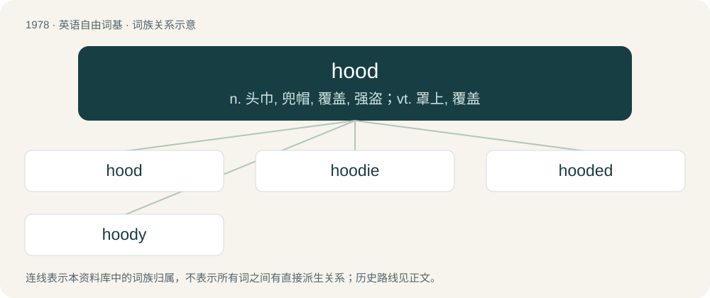

# 2095 · hood — n. 头巾, 兜帽, 覆盖, 强盗；vt. 罩上, 覆盖

[总目录](../00_总目录_按常用程度.md)

**类型**：英语自由词基　｜　**来源语言**：见词源记录

## 核心含义与来源

- 核心含义：n. 头巾, 兜帽, 覆盖, 强盗；vt. 罩上, 覆盖
- 英文含义：A head covering placed on falcons to inhibit their vision.
- 词形：hood

**多个词源／构词路径**：同一拼写可能有不同来源；以下按词性和含义分别列出。

**来源记录 1**（名词；A head covering placed on falcons to inhibit their vision.）

From Middle English hood, hod, from Old English hōd, from Proto-West Germanic \*hōd, from Proto-Germanic \*hōdaz, from Proto-Indo-European \*kadʰ- (“to cover”). See also Saterland Frisian Houd (“hat; hood”), West Frisian and Dutch hoed (“hat”), Cimbrian huat, huut (“hat”), German Hut (“hat”), German Low German Hood (“hat; hood”), Luxembourgish Hutt (“hat”); also Proto-Iranian \*xawdaH (“hat”) (Avestan 𐬑𐬂𐬛𐬀 (xåda), Old Persian 𐎧𐎢𐎭 (x-u-d /⁠xaudā⁠/)). More at hat.

**来源记录 2**（名词；Gangster, thug.）

Clipping of hoodlum.

**来源记录 3**（形容词；Relating to inner-city everyday life, both positive and negative aspects; especially people’s attachment to and love for their neighborhoods.）

Clipping of neighborhood; compare nabe.

**来源记录 4**（名词；Person wearing a hoodie.）

Clipping of hoodie, influenced by existing sense “hoodlum”.

## 词族图

## 单词速览（常用到不常用）

| 单词 | 音标 | 释义 |
|---|---|---|
| [hood](#w-1) | 英 /hʊd/ | n. 头巾, 兜帽, 覆盖, 强盗；vt. 罩上, 覆盖 |
| [hoodie](#w-2) | 英 /ˈhʊdi/ | n. 有冠乌鸦 |
| [hooded](#w-3) | 英 /ˈhʊdɪd/ | a. 有罩盖的, 戴头巾的 |
| [hoody](#w-4) | /ˈhʊdi/ | n. 年轻小混混 |

## 逐词详解

### 1. hood

**词性**：名词　｜　**音标**：英 /hʊd/

**中文释义**：n. 头巾, 兜帽, 覆盖, 强盗；vt. 罩上, 覆盖

**英文义项**：A head covering placed on falcons to inhibit their vision. / A head and neck covering placed on horses to protect against insects and sunlight, to slow coat growth and for warmth.

**词源与演化**：

From Middle English hood, hod, from Old English hōd, from Proto-West Germanic \*hōd, from Proto-Germanic \*hōdaz, from Proto-Indo-European \*kadʰ- (“to cover”). See also Saterland Frisian Houd (“hat; hood”), West Frisian and Dutch hoed (“hat”), Cimbrian huat, huut (“hat”), German Hut (“hat”), German Low German Hood (“hat; hood”), Luxembourgish Hutt (“hat”); also Proto-Iranian \*xawdaH (“hat”) (Avestan 𐬑𐬂𐬛𐬀 (xåda), Old Persian 𐎧𐎢𐎭 (x-u-d /⁠xaudā⁠/)). More at hat.

**例句**：

> Some people describe Tom as a cross between Robin Hood and Zorro.

### 2. hoodie

**词性**：名词　｜　**音标**：英 /ˈhʊdi/

**中文释义**：n. 有冠乌鸦

**英文义项**：A sweatshirt with an integral hood and, sometimes, a large kangaroo pocket at the front. / A young person wearing such a sweatshirt, usually a male, stereotypically associated with antisocial behaviour.

**构词拆分**：hood + -ie (diminutive suffix)

**词源与演化**：

From hood + -ie (diminutive suffix). In sense “person wearing a hoodie”, influenced by sense -ie (“person associated with suffixed noun, often derogatory”); compare townie.

**例句**：

> You can buy hoodies on the cheap in summer.

该用例对应义项：A sweatshirt with an integral hood and, sometimes, a large kangaroo pocket at the front.

### 3. hooded

**词性**：形容词　｜　**音标**：英 /ˈhʊdɪd/

**中文释义**：a. 有罩盖的, 戴头巾的

**英文义项**：Wearing a hood. / Covered with a hood.

**构词拆分**：From hood + -ed.

**词源与演化**：

From hood + -ed.

**用法示例／搭配（非完整句）**：

> A hooded anorak.

该用例对应义项：Fitted with a hood.

### 4. hoody

**词性**：名词　｜　**音标**：/ˈhʊdi/

**中文释义**：n. 年轻小混混

**英文义项**：The hooded crow. / The hooded gull.

**构词拆分**：From hood + -y.

**词源与演化**：

From hood + -y.
