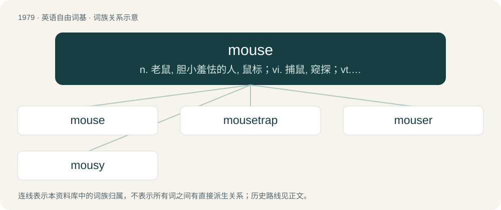

# 2096 · mouse — n. 老鼠, 胆小羞怯的人, 鼠标；vi. 捕鼠, 窥探；vt. 探出

[总目录](../00_总目录_按常用程度.md)

**类型**：英语自由词基　｜　**来源语言**：见词源记录

## 核心含义与来源

- 核心含义：n. 老鼠, 胆小羞怯的人, 鼠标；vi. 捕鼠, 窥探；vt. 探出
- 英文含义：Any mammal of the many rodent families (especially Muridae) that have a small body and a long tail.
- 词形：mouse

**来源记录 1**（名词；Any mammal of the many rodent families (especially Muridae) that have a small body and a long tail.）

Inherited from Middle English mous, from Old English mūs, from Proto-West Germanic \*mūs, from Proto-Germanic \*mūs, from Proto-Indo-European \*múHs. Cognates Germanic cognates include Old Frisian mūs, Old Saxon mūs (German Low German Muus), Dutch muis, Old High German mūs (German Maus), Old Norse mús (Danish, Norwegian Bokmål, Norwegian Nynorsk, and Swedish mus, Faroese and Icelandic mús). Indo-European cognates include Ancient Greek μῦς (mûs), Latin mūs, Spanish mur, Armenian մուկ (muk), Old Church Slavonic мꙑшь (myšĭ) (Russian мышь (myšʹ)), Albanian mi, Persian موش (muš), Northern Kurdish mişk, Sanskrit मूष् (mūṣ). The computing sense was coined by American engineer Bill English in 1965 and first used publicly in a publication titled "Computer-Aided Display Control", in reference to the similarity with the animal.

## 词族图

## 单词速览（常用到不常用）

| 单词 | 音标 | 释义 |
|---|---|---|
| [mouse](#w-1) | 英 /maʊs/ | n. 老鼠, 胆小羞怯的人, 鼠标；vi. 捕鼠, 窥探；vt. 探出 |
| [mousetrap](#w-2) | /ˈmaʊsˌtɹæp/ | n. 捕鼠器, 诡计；vt. 诱捕 |
| [mouser](#w-3) | /ˈmaʊzə(ɹ)/ | n. 捕鼠动物, 爱探听的人 |
| [mousy](#w-4) | /ˈmaʊsi/ | a. 象老鼠的, 多老鼠的, 胆小的 |

## 逐词详解

### 1. mouse

**词性**：名词　｜　**音标**：英 /maʊs/

**中文释义**：n. 老鼠, 胆小羞怯的人, 鼠标；vi. 捕鼠, 窥探；vt. 探出

**英文义项**：Any mammal of the many rodent families (especially Muridae) that have a small body and a long tail. / Such a rodent that is of the genus Mus.

**词源与演化**：

Inherited from Middle English mous, from Old English mūs, from Proto-West Germanic \*mūs, from Proto-Germanic \*mūs, from Proto-Indo-European \*múHs. Cognates Germanic cognates include Old Frisian mūs, Old Saxon mūs (German Low German Muus), Dutch muis, Old High German mūs (German Maus), Old Norse mús (Danish, Norwegian Bokmål, Norwegian Nynorsk, and Swedish mus, Faroese and Icelandic mús). Indo-European cognates include Ancient Greek μῦς (mûs), Latin mūs, Spanish mur, Armenian մուկ (muk), Old Church Slavonic мꙑшь (myšĭ) (Russian мышь (myšʹ)), Albanian mi, Persian موش (muš), Northern Kurdish mişk, Sanskrit मूष् (mūṣ). The computing sense was coined by American engineer Bill English in 1965 and first used publicly in a publication titled "Computer-Aided Display Control", in reference to the similarity with the animal.

**例句**：

> She's probably hiding in her room, she always does when we have company. She's our little mouse.

该用例对应义项：A quiet or shy person.

### 2. mousetrap

**词性**：名词　｜　**音标**：/ˈmaʊsˌtɹæp/

**中文释义**：n. 捕鼠器, 诡计；vt. 诱捕

**英文义项**：A device for capturing or killing mice and other rodents. / A website designed to open another copy of itself when the user tries to close the webpage.

**构词拆分**：mouse + trap

**词源与演化**：

From Middle English mouse-trappe, mous trappe, mouse trape, equivalent to mouse + trap. Cognate with Dutch muizetrap, muizentrap (“mousetrap”), German Low German Muustrappe, Muustrapp (“mousetrap”). In the Internet sense, refers to a computer mouse.

**例句**：

> You can't legally set a mousetrap in California without a hunting license.

### 3. mouser

**词性**：名词　｜　**音标**：/ˈmaʊzə(ɹ)/

**中文释义**：n. 捕鼠动物, 爱探听的人

**英文义项**：A cat that catches mice, kept specifically for the purpose. / A moustache.

**构词拆分**：mouse + -er (agent noun suffix)

**词源与演化**：

From Middle English mousere (“a hunter of mice”), equivalent to mouse + -er (agent noun suffix) or + -er (occupational suffix). The “moustache” sense is apparently an extended usage (i.e., a cat’s whiskers, jocularly transferred to human beings), possibly with influence from moustache.

### 4. mousy

**词性**：形容词　｜　**音标**：/ˈmaʊsi/

**中文释义**：a. 象老鼠的, 多老鼠的, 胆小的

**英文义项**：Resembling a mouse. / Quiet; stealthy.

**构词拆分**：mouse + -y

**词源与演化**：

From mouse + -y (forms adjectives from nouns).

**例句**：

> A mousy brownish-grey color.

该用例对应义项：of something having a drab pale brown color resembling a mouse
