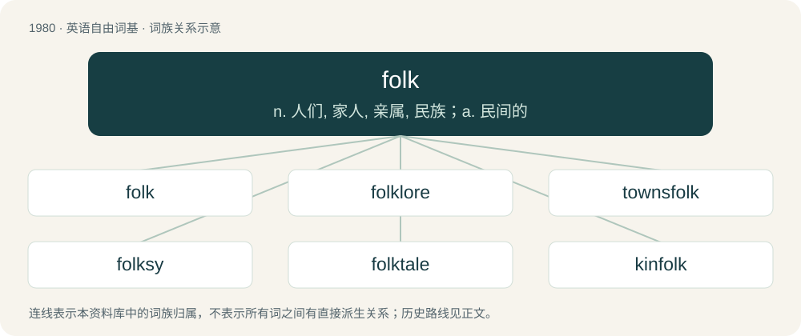

# 2097 · folk — n. 人们, 家人, 亲属, 民族；a. 民间的

[总目录](../00_总目录_按常用程度.md)

**类型**：英语自由词基　｜　**来源语言**：见词源记录

## 核心含义与来源

- 核心含义：n. 人们, 家人, 亲属, 民族；a. 民间的
- 英文含义：People, persons.
- 词形：folk

**来源记录 1**（名词；People, persons.）

From Middle English folk, from Old English folc, from Proto-West Germanic \*folk, from Proto-Germanic \*fulką, possibly from Proto-Indo-European \*pl̥h₁-gós, from \*pleh₁- (“to fill”). Cognate with Saterland Frisian Foulk, West Frisian folk, Dutch volk, German Low German and German Volk, Danish, Norwegian Bokmål, Norwegian Nynorsk, and Swedish folk, Faroese and Icelandic fólk. Doublet of volk.

## 词族图

## 单词速览（常用到不常用）

| 单词 | 音标 | 释义 |
|---|---|---|
| [folk](#w-1) | 英 /fəʊk/；美 /foʊk/ | n. 人们, 家人, 亲属, 民族；a. 民间的 |
| [folklore](#w-2) | 英 /ˈfəʊk.lɔː/；美 /ˈfoʊk.lɔːɹ/ | n. 民俗学, 民间风俗, 民间传说 |
| [townsfolk](#w-3) |  | n. 镇民, 市民, 城里生长的人, 城镇居民 |
| [folksy](#w-4) | 英 /fəʊksi/；美 /foʊksi/ | a. 和气的, 有民间风味的 |
| [folktale](#w-5) | /ˈfoʊkteɪl/ | n. 民间故事 |
| [kinfolk](#w-6) | /ˈkinfəuk/ | \[法\] 家属, 亲属, 亲戚 |
| [menfolk](#w-7) | /ˈmenfəuk/ | n. 男人, 男成员 |
| [folklife](#w-8) | /ˈfəuk,laif/ | n. 民众生活 |

## 逐词详解

### 1. folk

**词性**：名词　｜　**音标**：英 /fəʊk/；美 /foʊk/

**中文释义**：n. 人们, 家人, 亲属, 民族；a. 民间的

**英文义项**：People, persons. / One’s relatives, especially one’s parents.

**词源与演化**：

From Middle English folk, from Old English folc, from Proto-West Germanic \*folk, from Proto-Germanic \*fulką, possibly from Proto-Indo-European \*pl̥h₁-gós, from \*pleh₁- (“to fill”). Cognate with Saterland Frisian Foulk, West Frisian folk, Dutch volk, German Low German and German Volk, Danish, Norwegian Bokmål, Norwegian Nynorsk, and Swedish folk, Faroese and Icelandic fólk. Doublet of volk.

**例句**：

> Young folk, old folk, everybody come / To our little Sunday School, and have a lot of fun.

该用例对应义项：People, persons.

### 2. folklore

**词性**：名词　｜　**音标**：英 /ˈfəʊk.lɔː/；美 /ˈfoʊk.lɔːɹ/

**中文释义**：n. 民俗学, 民间风俗, 民间传说

**英文义项**：The tales, legends, superstitions, and traditions of a particular ethnic population. / The tales, superstitions etc. of any particular group or community.

**构词拆分**：folk + lore

**词源与演化**：

From folk + lore, coined by British writer William Thoms in 1846 to replace terms such as "popular antiquities". Thoms imitated German terms such as Volklehre (“people's customs”) and Volksüberlieferung (“popular tradition”). Compare also Old English folclar (“popular instruction; homily”) and West Frisian folkloare (“folklore”).

**例句**：

> Local folklore tells stories of legendary creatures living in the mountains.

### 3. townsfolk

**词性**：名词

**中文释义**：n. 镇民, 市民, 城里生长的人, 城镇居民

**英文义项**：The people who live in a town, especially the lower and middle classes.

**构词拆分**：From town + -s- + folk.

**词源与演化**：

From town + -s- + folk.

**例句**：

> "Have you seen my pencil?" asked the alien to the flabbergasted townsfolk.

### 4. folksy

**词性**：形容词　｜　**音标**：英 /fəʊksi/；美 /foʊksi/

**中文释义**：a. 和气的, 有民间风味的

**英文义项**：Characteristic of common folk. / Characteristic of simple country life.

**构词拆分**：folks + -y；folk + -sy

**词源与演化**：

From folks + -y or folk + -sy.

**例句**：

> A folksy radio commentator.

该用例对应义项：very informal and familiar

### 5. folktale

**词性**：名词　｜　**音标**：/ˈfoʊkteɪl/

**中文释义**：n. 民间故事

**英文义项**：A tale or story that is part of the oral tradition of a people or a place.

**构词拆分**：folk + tale

**词源与演化**：

From folk + tale.

**例句**：

> A folktale wasn't created by a single known author. It arose among the people.

### 6. kinfolk

**词性**：名词　｜　**音标**：/ˈkinfəuk/

**中文释义**：\[法\] 家属, 亲属, 亲戚

**英文义项**：Relatives, relations.

**构词拆分**：kin + folk

**词源与演化**：

From kin + folk.

### 7. menfolk

**词性**：名词　｜　**音标**：/ˈmenfəuk/

**中文释义**：n. 男人, 男成员

**英文义项**：Male people in general. / The male members of a group.

**构词拆分**：men + folk

**词源与演化**：

From men + folk.

**例句**：

> At our family reunion, the menfolk generally have a ball game, while the womenfolk gossip and trade snapshots.

该用例对应义项：The male members of a group.

### 8. folklife

**词性**：名词　｜　**音标**：/ˈfəuk,laif/

**中文释义**：n. 民众生活

**英文义项**：Folklore; those cultural traditions passed down orally or informally.

**构词拆分**：folk + life

**词源与演化**：

From folk + life.

**例句**：

> A Chinese puppeteer entertains the crowd with the antics of his monkey on a bicycle at the Smithsonian Folklife Festival in Washington.
