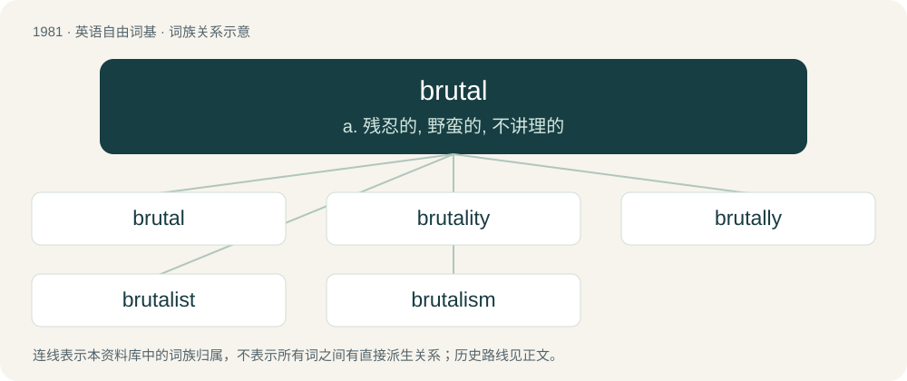

# 2098 · brutal — a. 残忍的, 野蛮的, 不讲理的

[总目录](../00_总目录_按常用程度.md)

**类型**：英语自由词基　｜　**来源语言**：见词源记录

## 核心含义与来源

- 核心含义：a. 残忍的, 野蛮的, 不讲理的
- 英文含义：Savagely violent, vicious, ruthless, or cruel, often in an unintelligent manner.
- 词形：brutal

**来源记录 1**（形容词；Savagely violent, vicious, ruthless, or cruel, often in an unintelligent manner.）

From Medieval Latin brutalis (“savage, stupid”), from Latin brūtus (“dull, stupid”).

## 词族图

## 单词速览（常用到不常用）

| 单词 | 音标 | 释义 |
|---|---|---|
| [brutal](#w-1) | 英 /ˈbɹuːtəl/；美 /ˈbɹu.təl/ | a. 残忍的, 野蛮的, 不讲理的 |
| [brutality](#w-2) | /ˌbɹuːˈtælɪti/ | n. 残忍, 无慈悲, 野蛮的行为 |
| [brutally](#w-3) |  | adv. 残忍地, 蛮横地 |
| [brutalist](#w-4) | /ˈbruːtəlist/ | n. 野兽派(信奉美术、建筑或文学上野兽主义的人) |
| [brutalism](#w-5) | /ˈbruːtəlizm/ | n. 兽性, 残忍 |

## 逐词详解

### 1. brutal

**词性**：形容词　｜　**音标**：英 /ˈbɹuːtəl/；美 /ˈbɹu.təl/

**中文释义**：a. 残忍的, 野蛮的, 不讲理的

**英文义项**：Savagely violent, vicious, ruthless, or cruel, often in an unintelligent manner. / Crude or unfeeling in manner or speech.

**词源与演化**：

From Medieval Latin brutalis (“savage, stupid”), from Latin brūtus (“dull, stupid”).

**例句**：

> The game was brutal, but after a bloodbath he finally won.

该用例对应义项：Savagely violent, vicious, ruthless, or cruel, often in an unintelligent manner.

### 2. brutality

**词性**：名词　｜　**音标**：/ˌbɹuːˈtælɪti/

**中文释义**：n. 残忍, 无慈悲, 野蛮的行为

**英文义项**：The state of being brutal. / A cruel or savage act.

**构词拆分**：brutal + -ity

**词源与演化**：

From brutal + -ity.

**用法示例／搭配（非完整句）**：

> police brutality

该用例对应义项：The use of excessive physical force, often in the form of violence.

### 3. brutally

**词性**：副词

**中文释义**：adv. 残忍地, 蛮横地

**英文义项**：In a brutal manner; viciously, barbarically. / In a direct way that does not attempt to hide, disguise, or mask unpleasantness; directly.

**构词拆分**：brutal + -ly

**词源与演化**：

From brutal + -ly.

**例句**：

> He was not an expert but he was brutally honest by saying he couldn’t help the customer find a solution.

该用例对应义项：In a direct way that does not attempt to hide, disguise, or mask unpleasantness; directly.

### 4. brutalist

**词性**：名词　｜　**音标**：/ˈbruːtəlist/

**中文释义**：n. 野兽派(信奉美术、建筑或文学上野兽主义的人)

**英文义项**：Someone that follows brutalism.

**构词拆分**：brutal + -ist

**词源与演化**：

From brutal + -ist.

### 5. brutalism

**词性**：名词　｜　**音标**：/ˈbruːtəlizm/

**中文释义**：n. 兽性, 残忍

**英文义项**：Brutal, violent behaviour; savagery.

**构词拆分**：brutal + -ism

**词源与演化**：

From brutal + -ism.

**例句**：

> Brutalism is a controversial architectural style.
