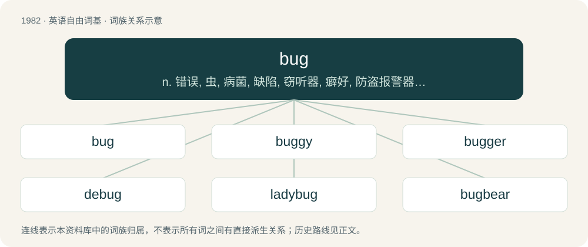

# 2099 · bug — n. 错误, 虫, 病菌, 缺陷, 窃听器, 癖好, 防盗报警器, 双座小汽车, 要人；vt. 装防盗报警器, 装窃听器, 激怒；vi. 捉虫, 暴突

[总目录](../00_总目录_按常用程度.md)

**类型**：英语自由词基　｜　**来源语言**：见词源记录

## 核心含义与来源

- 核心含义：n. 错误, 虫, 病菌, 缺陷, 窃听器, 癖好, 防盗报警器, 双座小汽车, 要人；vt. 装防盗报警器, 装窃听器, 激怒；vi. 捉虫, 暴突
- 英文含义：An insect of the order Hemiptera (the “true bugs”).
- 词形：bug

**来源记录 1**（名词；An insect of the order Hemiptera (the “true bugs”).）

First attested in this form around 1620 (referring to a “bedbug”), from earlier bugge (“beetle”), from Middle English bugge (“scarecrow, hobgoblin”) which is traced alternatively to: \* a Celtic root found in Scots bogill (“goblin, bugbear”) and obsolete Welsh bwg (“ghost, hobgoblin”); compare Welsh bwgwl (“threat, fear”) and Middle Irish bocanách (“supernatural being”). \* Proto-Germanic \*bugja- (“swollen up, thick”), from Proto-Indo-European \*bʰew-, \*bu- (“to swell”); compare Norwegian bugge (“big man”), dialectal Low German Bögge (“goblin, snot”). \* or to a word related to buck and originally referring to a goat-shaped spectre. For the “insect” meaning the assonance with Middle English budde (“beetle”), from Old English budda, from Proto-West Germanic \*buʀdō, from Proto-Germanic \*buzdô, from the same ultimate source as above, might have played a role. Compare Low German Budde (“louse, grub”), Norwegian budda (“newborn domestic animal”), Icelandic budda (“purse”). More at bud. But ultimately this convergence of meaning doesn't prove a conflation of the two terms; they might have existed in parallel since PIE times with similar meanings, even if unnoticed by literary sources. The term is used to refer to technical errors and problems at least as early as the 19th century, predating the commonly known story of a moth being caught in a computer.

## 词族图

## 单词速览（常用到不常用）

| 单词 | 音标 | 释义 |
|---|---|---|
| [bug](#w-1) | 英 /bʌɡ/ | n. 错误, 虫, 病菌, 缺陷, 窃听器, 癖好, 防盗报警器, 双座小汽车, 要人；vt. 装防盗报警器, 装窃听器, 激怒；vi. 捉虫, 暴突 |
| [buggy](#w-2) | 英 /ˈbʌ.ɡi/ | 【英文】Infested with insects. |
| [bugger](#w-3) | 英 /ˈbʌɡə/；美 /ˈbʌɡəɹ/ | 【英文】One who sets a bug (surveillance device); one who bugs. |
| [debug](#w-4) | /diːˈbʌɡ/ | vt. 除错, 改正有毛病部分, 除去窃听器, 调试；\[计\] 调试; DOS外部命令:其功能是对命令文件或执行文件进行调试或测试；也可用于编写小的命令文件 |
| [ladybug](#w-5) | 英 /ˈleɪ.di.bʌɡ/ | n. 瓢虫 |
| [bugbear](#w-6) | 英 /ˈbʌɡ.bɛə(ɹ)/；美 /ˈbʌɡ.bɛɚ/ | n. 怪物；棘手的难题；恐惧或烦恼的原因 |
| [bedbug](#w-7) | 美 /ˈbɛdˌbʌɡ/ | n. 臭虫；\[医\] 臭虫 |
| [jitterbug](#w-8) | /ˈd͡ʒɪtə(ɹ)bʌɡ/ | n. 爵士乐迷, 神经质的人；v. 跳吉特巴舞 |
| [firebug](#w-9) | /ˈfaiəbʌg/ | n. 放火者, 放火狂, 萤火虫 |
| [superbug](#w-10) | /ˈsuːpəbʌg/ | 超级细菌 |

## 逐词详解

### 1. bug

**词性**：名词　｜　**音标**：英 /bʌɡ/

**中文释义**：n. 错误, 虫, 病菌, 缺陷, 窃听器, 癖好, 防盗报警器, 双座小汽车, 要人；vt. 装防盗报警器, 装窃听器, 激怒；vi. 捉虫, 暴突

**英文义项**：An insect of the order Hemiptera (the “true bugs”). / Any motile small terrestrial invertebrate, especially one that is seen as a pest.

**词源与演化**：

First attested in this form around 1620 (referring to a “bedbug”), from earlier bugge (“beetle”), from Middle English bugge (“scarecrow, hobgoblin”) which is traced alternatively to: \* a Celtic root found in Scots bogill (“goblin, bugbear”) and obsolete Welsh bwg (“ghost, hobgoblin”); compare Welsh bwgwl (“threat, fear”) and Middle Irish bocanách (“supernatural being”). \* Proto-Germanic \*bugja- (“swollen up, thick”), from Proto-Indo-European \*bʰew-, \*bu- (“to swell”); compare Norwegian bugge (“big man”), dialectal Low German Bögge (“goblin, snot”). \* or to a word related to buck and originally referring to a goat-shaped spectre. For the “insect” meaning the assonance with Middle English budde (“beetle”), from Old English budda, from Proto-West Germanic \*buʀdō, from Proto-Germanic \*buzdô, from the same ultimate source as above, might have played a role. Compare Low German Budde (“louse, grub”), Norwegian budda (“newborn domestic animal”), Icelandic budda (“purse”). More at bud. But ultimately this convergence of meaning doesn't prove a conflation of the two terms; they might have existed in parallel since PIE times with similar meanings, even if unnoticed by literary sources. The term is used to refer to technical errors and problems at least as early as the 19th century, predating the commonly known story of a moth being caught in a computer.

**例句**：

> He suspected the image was a Web bug used for determining who was visiting the site.

该用例对应义项：A small and usually invisible file (traditionally a single-pixel image) on a World Wide Web page, primarily used to track users.

### 2. buggy

**词性**：形容词　｜　**音标**：英 /ˈbʌ.ɡi/

**英文义项**：Infested with insects. / Containing programming errors.

**构词拆分**：bug + -y

**词源与演化**：

From bug + -y.

**例句**：

> This software is so buggy that I don't know how anyone can use it!

该用例对应义项：Containing programming errors.

### 3. bugger

**词性**：名词　｜　**音标**：英 /ˈbʌɡə/；美 /ˈbʌɡəɹ/

**英文义项**：One who sets a bug (surveillance device); one who bugs.

**构词拆分**：bug + -er

**词源与演化**：

From bug (noun) + -er.

### 4. debug

**词性**：动词　｜　**音标**：/diːˈbʌɡ/

**中文释义**：vt. 除错, 改正有毛病部分, 除去窃听器, 调试；\[计\] 调试; DOS外部命令:其功能是对命令文件或执行文件进行调试或测试；也可用于编写小的命令文件

**英文义项**：To search for and eliminate malfunctioning elements or errors in something, especially a computer program or machinery. / To remove a hidden electronic surveillance device from (somewhere).

**构词拆分**：de- + bug

**词源与演化**：

From de- + bug.

**例句**：

> Please don't touch the debug options unless I tell you to.

### 5. ladybug

**词性**：名词　｜　**音标**：英 /ˈleɪ.di.bʌɡ/

**中文释义**：n. 瓢虫

**英文义项**：Synonym of ladybird.

**构词拆分**：lady + bug

**词源与演化**：

From lady + bug, the “lady” here referring to Virgin Mary, the mother of Jesus. Compare German Marienkäfer, Danish mariehøne, Latvian mārīte, Macedonian бубамара (bubamara) and Spanish mariquita.

**例句**：

> I love how the French spell their word for ladybug.

### 6. bugbear

**词性**：名词　｜　**音标**：英 /ˈbʌɡ.bɛə(ɹ)/；美 /ˈbʌɡ.bɛɚ/

**中文释义**：n. 怪物；棘手的难题；恐惧或烦恼的原因

**英文义项**：An ongoing problem; a recurring obstacle or adversity. / A source of dread; resentment; or irritation.

**构词拆分**：bug (“something terrifying”) + bear

**词源与演化**：

From obsolete meaning of bug (“something terrifying”) + bear. See Middle English bugge, modern bogey.

**例句**：

> Germany was always a bugbear for France.

该用例对应义项：an object of dread or apprehension

### 7. bedbug

**词性**：名词　｜　**音标**：美 /ˈbɛdˌbʌɡ/

**中文释义**：n. 臭虫；\[医\] 臭虫

**英文义项**：A small nocturnal insect pest of humans, of species Cimex lectularius (common bedbug) and Cimex hemipterus (tropical bedbug) that feeds on the blood of humans during sleep. / Any similar insect of family Cimicidae, that feeds on the blood of humans and certain other warm-blooded animals.

**构词拆分**：bed + bug

**词源与演化**：

From bed + bug.

**例句**：

> Fiona rapidly discovered that the hotel was infested with bedbugs.

该用例对应义项：A small nocturnal insect pest of humans, of species Cimex lectularius (common bedbug) and Cimex hemipterus (tropical bedbug) that feeds on the blood of humans during sleep.

### 8. jitterbug

**词性**：名词　｜　**音标**：/ˈd͡ʒɪtə(ɹ)bʌɡ/

**中文释义**：n. 爵士乐迷, 神经质的人；v. 跳吉特巴舞

**英文义项**：A nervous or jittery person. / A jazz musician or aficionado.

**构词拆分**：jitter + bug

**词源与演化**：

From jitter + bug, after the 1934 Cab Calloway song “Jitter Bug”.

### 9. firebug

**词性**：名词　｜　**音标**：/ˈfaiəbʌg/

**中文释义**：n. 放火者, 放火狂, 萤火虫

**英文义项**：Pyrrhocoris apterus, a common red and black insect, that is the type species of the family Pyrrhocoridae. / A pyromaniac or arsonist.

**构词拆分**：fire + bug

**词源与演化**：

From fire + bug.

**例句**：

> Take those matches away from that kid; he's a firebug!

### 10. superbug

**词性**：名词　｜　**音标**：/ˈsuːpəbʌg/

**中文释义**：超级细菌

**英文义项**：A strain of bacteria that is resistant to many antibiotics (e.g., MDR, XDR). / Any pathogen resistant to many, even all, of the biocides or other agents used to treat similar pathogens.

**构词拆分**：super- + bug

**词源与演化**：

From super- + bug.

**例句**：

> Gilmore said scientists are studying the pathogen's genes to identify targets for the development of new weapons to fight the superbug.
