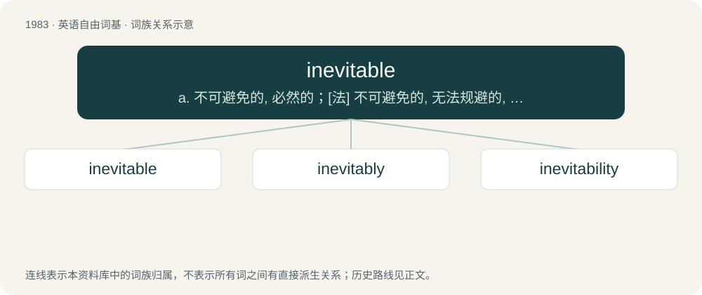

# 2100 · inevitable — a. 不可避免的, 必然的；\[法\] 不可避免的, 无法规避的, 必然的

[总目录](../00_总目录_按常用程度.md)

**类型**：英语自由词基　｜　**来源语言**：见词源记录

## 核心含义与来源

- 核心含义：a. 不可避免的, 必然的；\[法\] 不可避免的, 无法规避的, 必然的
- 英文含义：Impossible to avoid or prevent.
- 词形：inevitable

**来源记录 1**（形容词；Impossible to avoid or prevent.）

From Middle French inevitable, from Latin inēvītābilis (“unavoidable”), from in- + ēvītābilis (“avoidable”), from ēvītāre (“to avoid”), from ē- (“out”) + vītāre (“to shun”).

## 词族图

## 单词速览（常用到不常用）

| 单词 | 音标 | 释义 |
|---|---|---|
| [inevitable](#w-1) | 英 /ɪˈnɛvɪtəbəl/；美 /ɪˈnɛvɪtəbəl/ | a. 不可避免的, 必然的；\[法\] 不可避免的, 无法规避的, 必然的 |
| [inevitably](#w-2) | 英 /ɪˈnɛvɪtəbli/ | adv. 不可避免地 |
| [inevitability](#w-3) | /ɪˌnɛvɪtəˈbɪlɪti/ | n. 无法逃避之事, 不可逃避, 必然性；\[法\] 不能避免 |

## 逐词详解

### 1. inevitable

**词性**：形容词　｜　**音标**：英 /ɪˈnɛvɪtəbəl/；美 /ɪˈnɛvɪtəbəl/

**中文释义**：a. 不可避免的, 必然的；\[法\] 不可避免的, 无法规避的, 必然的

**英文义项**：Impossible to avoid or prevent. / Predictable or always happening.

**词源与演化**：

From Middle French inevitable, from Latin inēvītābilis (“unavoidable”), from in- + ēvītābilis (“avoidable”), from ēvītāre (“to avoid”), from ē- (“out”) + vītāre (“to shun”).

**例句**：

> We were going so fast that the collision was inevitable.

该用例对应义项：Impossible to avoid or prevent.

### 2. inevitably

**词性**：副词　｜　**音标**：英 /ɪˈnɛvɪtəbli/

**中文释义**：adv. 不可避免地

**英文义项**：In a manner that is impossible to avoid or prevent. / As usual; predictably; as expected.

**构词拆分**：inevitable + -ly

**词源与演化**：

From inevitable + -ly.

**例句**：

> The inevitably long line of customers queued for the latest 'Harry Potter'.

该用例对应义项：As usual; predictably; as expected.

### 3. inevitability

**词性**：名词　｜　**音标**：/ɪˌnɛvɪtəˈbɪlɪti/

**中文释义**：n. 无法逃避之事, 不可逃避, 必然性；\[法\] 不能避免

**英文义项**：The condition of being inevitable. / An inevitable condition or outcome.

**构词拆分**：inevitable + -ity

**词源与演化**：

From inevitable + -ity.

**例句**：

> Humans worship choices. Alpha doesn't choose. It executes inevitability.
