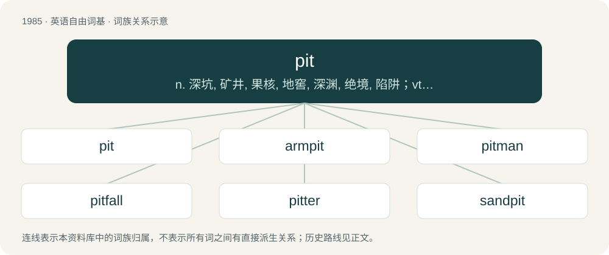

# 2101 · pit — n. 深坑, 矿井, 果核, 地窖, 深渊, 绝境, 陷阱；vt. 窖藏, 使凹下, 使有麻点, 去...之核, 使留疤痕, 使相斗, 使竞争；vi. 起凹点, 凹陷

[总目录](../00_总目录_按常用程度.md)

**类型**：英语自由词基　｜　**来源语言**：见词源记录

## 核心含义与来源

- 核心含义：n. 深坑, 矿井, 果核, 地窖, 深渊, 绝境, 陷阱；vt. 窖藏, 使凹下, 使有麻点, 去...之核, 使留疤痕, 使相斗, 使竞争；vi. 起凹点, 凹陷
- 英文含义：A hole in the ground.
- 词形：pit

**多个词源／构词路径**：同一拼写可能有不同来源；以下按词性和含义分别列出。

**来源记录 1**（名词；A hole in the ground.）

From Middle English pit, pet, püt, from Old English pytt, from Proto-West Germanic \*puti, from Latin puteus (“trench, pit, well”), although there are phonetic difficulties.

**来源记录 2**（名词；A seed inside a fruit; a stone or pip inside a fruit.）

From Dutch pit (“kernel, core”), from Middle Dutch pitte, from Proto-Germanic \*pittan (compare dialectal German Pfitze (“pimple”)), oblique of Proto-Germanic \*piþō. Compare pith.

**来源记录 3**（名词；A pit bull terrier.）

Shortening.

**来源记录 4**（动词；To use the PIT maneuver, especially during a car chase.）

From PIT maneuver.

## 词族图

## 单词速览（常用到不常用）

| 单词 | 音标 | 释义 |
|---|---|---|
| [pit](#w-1) | 英 /pɪt/ | n. 深坑, 矿井, 果核, 地窖, 深渊, 绝境, 陷阱；vt. 窖藏, 使凹下, 使有麻点, 去...之核, 使留疤痕, 使相斗, 使竞争；vi. 起凹点, 凹陷 |
| [armpit](#w-2) | 美 /ˈɑɹmˌpɪt/ | n. 腋窝；\[医\] 腋, 腋窝 |
| [pitman](#w-3) | /ˈpɪt.mən/ | n. 矿工, 煤矿工, 连杆；\[化\] 连杆 |
| [pitfall](#w-4) | 英 /ˈpɪtfɔːl/；美 /ˈpɪtfɔl/ | n. 陷阱, 诱惑, 阴谋, 易犯的错误, 意想不到的困难 |
| [pitter](#w-5) | /ˈpitə/ | n. 去核机；n. (Pitter)人名；(英、德、意、捷)皮特 |
| [sandpit](#w-6) | /ˈsænd.pɪt/ | n. 采沙场, 沙坑 |

## 逐词详解

### 1. pit

**词性**：名词　｜　**音标**：英 /pɪt/

**中文释义**：n. 深坑, 矿井, 果核, 地窖, 深渊, 绝境, 陷阱；vt. 窖藏, 使凹下, 使有麻点, 去...之核, 使留疤痕, 使相斗, 使竞争；vi. 起凹点, 凹陷

**英文义项**：A hole in the ground. / An area at a racetrack used for refueling and repairing the vehicles during a race.

**词源与演化**：

From Middle English pit, pet, püt, from Old English pytt, from Proto-West Germanic \*puti, from Latin puteus (“trench, pit, well”), although there are phonetic difficulties.

**例句**：

> Two drivers have already gone into the pit this early in the race.

该用例对应义项：An area at a racetrack used for refueling and repairing the vehicles during a race.

### 2. armpit

**词性**：名词　｜　**音标**：美 /ˈɑɹmˌpɪt/

**中文释义**：n. 腋窝；\[医\] 腋, 腋窝

**英文义项**：The cavity beneath the junction of the arm and shoulder. / Somewhere or something unpleasant or undesirable.

**构词拆分**：arm + pit

**词源与演化**：

From Middle English armpitt, arme-pitt, armput, equivalent to arm + pit. (something unpleasant): Presumably a reference to underarm body odor.

**用法示例／搭配（非完整句）**：

> the armpit of America

该用例对应义项：Somewhere or something unpleasant or undesirable.

### 3. pitman

**词性**：名词　｜　**音标**：/ˈpɪt.mən/

**中文释义**：n. 矿工, 煤矿工, 连杆；\[化\] 连杆

**英文义项**：One who works in a pit, as in mining, in sawing timber, etc. / A connecting rod in machinery, especially in a sawmill.

**构词拆分**：pit + -man

**词源与演化**：

From pit + -man.

### 4. pitfall

**词性**：名词　｜　**音标**：英 /ˈpɪtfɔːl/；美 /ˈpɪtfɔl/

**中文释义**：n. 陷阱, 诱惑, 阴谋, 易犯的错误, 意想不到的困难

**英文义项**：A type of trap consisting of a concealed pit in the ground, into which the victim is supposed to fall and not be able to get out from. / A potential, unsuspected, hidden problem, hazard, or danger that is easily encountered but not immediately obvious.

**构词拆分**：pit + fall

**词源与演化**：

First recorded use in the 14th century from pit + fall in the sense of "pit trap, pit snare", from Old English fealle (“trap, snare”), from Proto-Germanic \*fallą, \*fallaz (“a fall, trap”), from Proto-Indo-European \*(s)pōl-. Cognate with German Falle (“trap, snare”).

**例句**：

> It's usually a simple task, but you should know the pitfalls before you attempt it yourself.

该用例对应义项：A potential, unsuspected, hidden problem, hazard, or danger that is easily encountered but not immediately obvious.

### 5. pitter

**词性**：名词　｜　**音标**：/ˈpitə/

**中文释义**：n. 去核机；n. (Pitter)人名；(英、德、意、捷)皮特

**英文义项**：A device that removes pits from fruit such as olives or cherries.

**构词拆分**：pit + -er

**词源与演化**：

From pit + -er.

**例句**：

> The pitter patter of the rain on the roof kept me from falling asleep.

### 6. sandpit

**词性**：名词　｜　**音标**：/ˈsænd.pɪt/

**中文释义**：n. 采沙场, 沙坑

**英文义项**：A place or pit from which sand is excavated. / A children’s play area consisting of a large container filled with sand.

**构词拆分**：sand + pit

**词源与演化**：

From Middle English sandpitte, sandpette, sandpütte, from Old English sandpytt (“sandpit”), equivalent to sand + pit.

**例句**：

> Tom and Mary played in the sandpit together and made sand castles.
