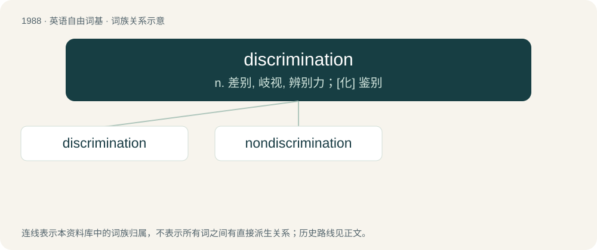

# 2104 · discrimination — n. 差别, 岐视, 辨别力；\[化\] 鉴别

[总目录](../00_总目录_按常用程度.md)

**类型**：英语自由词基　｜　**来源语言**：见词源记录

## 核心含义与来源

- 核心含义：n. 差别, 岐视, 辨别力；\[化\] 鉴别
- 英文含义：Discernment, the act of discriminating, discerning, distinguishing, noting or perceiving differences between things, with the intent to understand rightly and make correct decisions.
- 词形：discrimination

**来源记录 1**（名词；Discernment, the act of discriminating, discerning, distinguishing, noting or perceiving differences between things, with the intent to understand rightly and make correct decisions.）

Learned borrowing from Latin discrīminātiō, discrīminātiōnem, the action noun to discrīminō, discrīmināre (“distinguish”). Equivalent to discriminate + -ion. In English use from the 17th century.

## 词族图

## 单词速览（常用到不常用）

| 单词 | 音标 | 释义 |
|---|---|---|
| [discrimination](#w-1) | 英 /dɪskɹɪmɪˈneɪʃən/；美 /dɪˌskɹɪm.əˈneɪʃən/ | n. 差别, 岐视, 辨别力；\[化\] 鉴别 |
| [nondiscrimination](#w-2) | /ˈnɔndiskrimiˈneiʃən/ | n. 不歧视 |

## 逐词详解

### 1. discrimination

**词性**：名词　｜　**音标**：英 /dɪskɹɪmɪˈneɪʃən/；美 /dɪˌskɹɪm.əˈneɪʃən/

**中文释义**：n. 差别, 岐视, 辨别力；\[化\] 鉴别

**英文义项**：Discernment, the act of discriminating, discerning, distinguishing, noting or perceiving differences between things, with the intent to understand rightly and make correct decisions. / Differential treatment of an individual or group to their disadvantage; treatment or consideration based on class or category rather than individual merit; partiality; prejudice; bigotry.

**构词拆分**：discriminate + -ion

**词源与演化**：

Learned borrowing from Latin discrīminātiō, discrīminātiōnem, the action noun to discrīminō, discrīmināre (“distinguish”). Equivalent to discriminate + -ion. In English use from the 17th century.

**用法示例／搭配（非完整句）**：

> sexual or racial discrimination

该用例对应义项：Differential treatment of an individual or group to their disadvantage; treatment or consideration based on class or category rather than individual merit; partiality; prejudice; bigotry.

### 2. nondiscrimination

**词性**：名词　｜　**音标**：/ˈnɔndiskrimiˈneiʃən/

**中文释义**：n. 不歧视

**英文义项**：An act or policy of not engaging in discrimination.

**构词拆分**：From non- + discrimination.

**词源与演化**：

From non- + discrimination.
