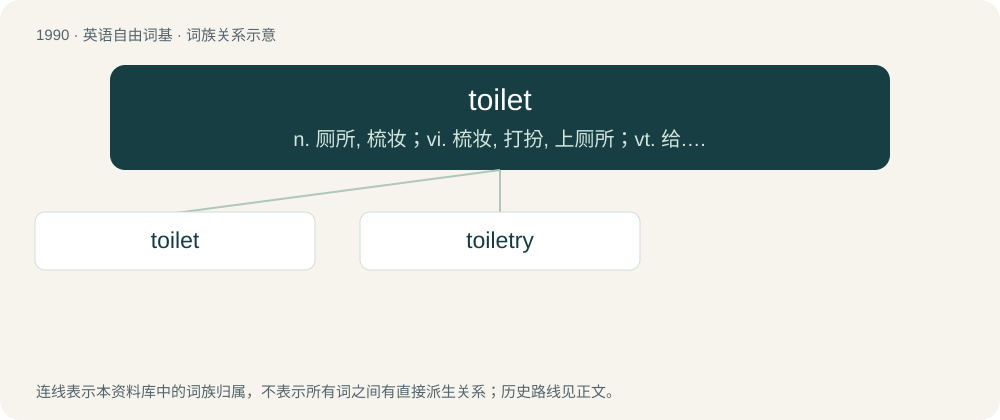

# 2107 · toilet — n. 厕所, 梳妆；vi. 梳妆, 打扮, 上厕所；vt. 给...梳妆打扮

[总目录](../00_总目录_按常用程度.md)

**类型**：英语自由词基　｜　**来源语言**：见词源记录

## 核心含义与来源

- 核心含义：n. 厕所, 梳妆；vi. 梳妆, 打扮, 上厕所；vt. 给...梳妆打扮
- 英文含义：A room, enclosed area or single-purpose building containing a fixture or fixtures used for urination and defecation; a bathroom or water closet.
- 词形：toilet

**来源记录 1**（名词；A room, enclosed area or single-purpose building containing a fixture or fixtures used for urination and defecation; a bathroom or water closet.）

From Middle French toilette, diminutive of toile (“cloth”), from their use to protect clothing while shaving or arranging hair. From its use as a private room, toilet came to refer euphemistically to lavatories and then to its fixtures, beginning in the United States in the late 19th century.

## 词族图

## 单词速览（常用到不常用）

| 单词 | 音标 | 释义 |
|---|---|---|
| [toilet](#w-1) | /ˈtɔɪ.lət/ | n. 厕所, 梳妆；vi. 梳妆, 打扮, 上厕所；vt. 给...梳妆打扮 |
| [toiletry](#w-2) | /ˈtɔɪlɪtɹi/ | n. 化妆用品, 梳妆用具, 化妆用具；\[化\] 化妆用品 |

## 逐词详解

### 1. toilet

**词性**：名词　｜　**音标**：/ˈtɔɪ.lət/

**中文释义**：n. 厕所, 梳妆；vi. 梳妆, 打扮, 上厕所；vt. 给...梳妆打扮

**英文义项**：A room, enclosed area or single-purpose building containing a fixture or fixtures used for urination and defecation; a bathroom or water closet. / A small secondary lavatory having a fixture used for urination and defecation and sink but no bathtub or shower.

**词源与演化**：

From Middle French toilette, diminutive of toile (“cloth”), from their use to protect clothing while shaving or arranging hair. From its use as a private room, toilet came to refer euphemistically to lavatories and then to its fixtures, beginning in the United States in the late 19th century.

**例句**：

> My toilet got clogged. Now the bathroom's flooded.

该用例对应义项：A fixture used for urination and defecation, particularly one with a large bowl and ring-shaped seat which uses water to flush the waste material into a septic tank or sewer system.

### 2. toiletry

**词性**：名词　｜　**音标**：/ˈtɔɪlɪtɹi/

**中文释义**：n. 化妆用品, 梳妆用具, 化妆用具；\[化\] 化妆用品

**英文义项**：Any item used for personal hygiene or grooming (for one's toilet).

**构词拆分**：toilet + -ry

**词源与演化**：

From toilet + -ry.
