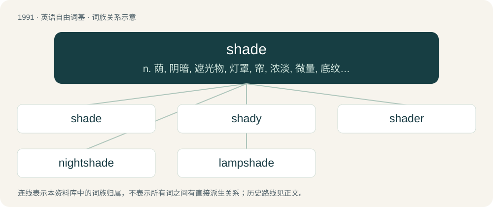

# 2108 · shade — n. 荫, 阴暗, 遮光物, 灯罩, 帘, 浓淡, 微量, 底纹；vi. 渐变；vt. 使阴暗, 使渐变, 遮蔽, 微减

[总目录](../00_总目录_按常用程度.md)

**类型**：英语自由词基　｜　**来源语言**：见词源记录

## 核心含义与来源

- 核心含义：n. 荫, 阴暗, 遮光物, 灯罩, 帘, 浓淡, 微量, 底纹；vi. 渐变；vt. 使阴暗, 使渐变, 遮蔽, 微减
- 英文含义：Darkness where light, particularly sunlight, is blocked.
- 词形：shade

**多个词源／构词路径**：同一拼写可能有不同来源；以下按词性和含义分别列出。

**来源记录 1**（名词；Darkness where light, particularly sunlight, is blocked.）

Inherited from Middle English schade, from Old English sċeadu, from Proto-West Germanic \*skadu, from Proto-Germanic \*skaduz, from Proto-Indo-European \*(s)ḱh₃tús, from \*(s)ḱeh₃-. Doublet of shadow. Cognate with Ancient Greek σκότος (skótos) (whence English scoto-) and σκιά (skiá) (whence English scia-, and uncertainly via σκίουρος (skíouros) English squirrel).

**来源记录 2**（动词；To shield (someone or something) from light.）

Inherited from Middle English schaden, from schade + -en.

## 词族图

## 单词速览（常用到不常用）

| 单词 | 音标 | 释义 |
|---|---|---|
| [shade](#w-1) | /ʃeɪd/ | n. 荫, 阴暗, 遮光物, 灯罩, 帘, 浓淡, 微量, 底纹；vi. 渐变；vt. 使阴暗, 使渐变, 遮蔽, 微减 |
| [shady](#w-2) | /ˈʃeɪdi/ | a. 荫凉的, 成荫的, 阴暗的, 隐蔽的；\[法\] 成问题的, 令人怀疑的 |
| [shader](#w-3) | 美 /ˈʃeɪdɚ/ | n. 著色器；着色程序 |
| [nightshade](#w-4) | /ˈnaɪt.ʃeɪd/ | n. 茄属植物；\[医\] 茄属植物 |
| [lampshade](#w-5) | 英 /ˈlæmp.ʃeɪd/ | n. 灯罩 |

## 逐词详解

### 1. shade

**词性**：名词　｜　**音标**：/ʃeɪd/

**中文释义**：n. 荫, 阴暗, 遮光物, 灯罩, 帘, 浓淡, 微量, 底纹；vi. 渐变；vt. 使阴暗, 使渐变, 遮蔽, 微减

**英文义项**：Darkness where light, particularly sunlight, is blocked. / Something that blocks light, particularly in a window.

**词源与演化**：

Inherited from Middle English schade, from Old English sċeadu, from Proto-West Germanic \*skadu, from Proto-Germanic \*skaduz, from Proto-Indo-European \*(s)ḱh₃tús, from \*(s)ḱeh₃-. Doublet of shadow. Cognate with Ancient Greek σκότος (skótos) (whence English scoto-) and σκιά (skiá) (whence English scia-, and uncertainly via σκίουρος (skíouros) English squirrel).

**例句**：

> Why did you paint your room chartreuse? No shade; I'm genuinely curious.

该用例对应义项：Subtle insults.

### 2. shady

**词性**：形容词　｜　**音标**：/ˈʃeɪdi/

**中文释义**：a. 荫凉的, 成荫的, 阴暗的, 隐蔽的；\[法\] 成问题的, 令人怀疑的

**英文义项**：Abounding in shades. / Causing shade.

**构词拆分**：shade + -y

**词源与演化**：

From shade + -y. Compare Saterland Frisian skaadich, skaddich (“shady”), German schattig (“shady”).

**例句**：

> He is a shady character.

该用例对应义项：Not trustworthy; disreputable.

### 3. shader

**词性**：名词　｜　**音标**：美 /ˈʃeɪdɚ/

**中文释义**：n. 著色器；着色程序

**英文义项**：One who, or that which, shades. / A set of software instructions used to calculate rendering effects on graphics hardware.

**构词拆分**：From shade + -er.

**词源与演化**：

From shade + -er.

### 4. nightshade

**词性**：名词　｜　**音标**：/ˈnaɪt.ʃeɪd/

**中文释义**：n. 茄属植物；\[医\] 茄属植物

**英文义项**：Any of the poisonous plants belonging to the genus Solanum, especially black nightshade or woody nightshade. / Any plant of the wider Solanaceae family, including the nightshades as well as tomato, potato, eggplant, and deadly nightshade.

**构词拆分**：night + shade

**词源与演化**：

From Middle English nyȝtschade, niȝteschode, nyght shade, from Old English nihtsċada, from Proto-West Germanic \*nahtskadō (“nightshade”), corresponding to night + shade. Compare Dutch nachtschade (“nightshade”), German Nachtschatten (“nightshade”).

**例句**：

> Where can I buy a deadly nightshade plant?

### 5. lampshade

**词性**：名词　｜　**音标**：英 /ˈlæmp.ʃeɪd/

**中文释义**：n. 灯罩

**英文义项**：A cover over a lamp to either diffuse the light or to block it in certain directions to avoid glare in the eyes.

**构词拆分**：lamp + shade

**词源与演化**：

From lamp + shade. The verb sense comes from the idea of making something more conspicuous by hanging a lampshade on it.

**例句**：

> We've got ourselves a new, modern lampshade for our living room.
