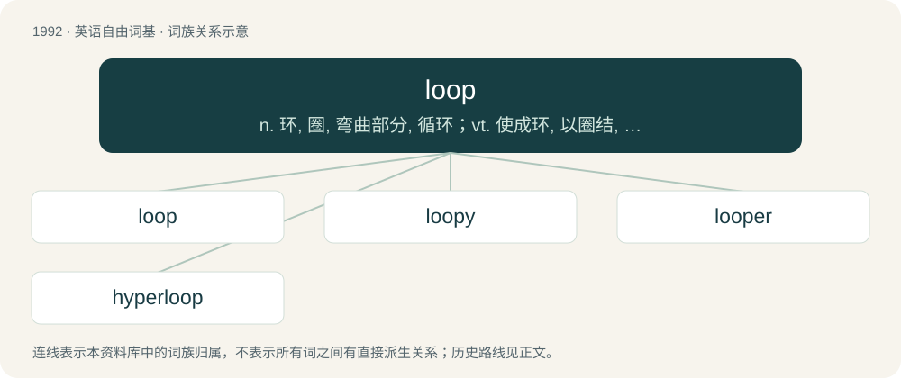

# 2109 · loop — n. 环, 圈, 弯曲部分, 循环；vt. 使成环, 以圈结, 以环连结；vi. 打环, 翻筋斗

[总目录](../00_总目录_按常用程度.md)

**类型**：英语自由词基　｜　**来源语言**：见词源记录

## 核心含义与来源

- 核心含义：n. 环, 圈, 弯曲部分, 循环；vt. 使成环, 以圈结, 以环连结；vi. 打环, 翻筋斗
- 英文含义：A length of thread, line or rope that is doubled over to make an opening.
- 词形：loop

**来源记录 1**（名词；A length of thread, line or rope that is doubled over to make an opening.）

From Middle English loupe (“noose, loop”), earlier lowp-knot (“loop-knot”), of North Germanic origin, from Old Norse hlaup (“a run”), used in the sense of a "running knot", from hlaupa (“to leap”), ultimately from Proto-Germanic \*hlaupaną (“to leap, run”). Compare Swedish löp-knut (“loop-knot”), Danish løb-knude (“a running knot”), Danish løb (“a course”). More at leap. The verb is derived from the noun.

## 词族图

## 单词速览（常用到不常用）

| 单词 | 音标 | 释义 |
|---|---|---|
| [loop](#w-1) | /luːp/ | n. 环, 圈, 弯曲部分, 循环；vt. 使成环, 以圈结, 以环连结；vi. 打环, 翻筋斗 |
| [loopy](#w-2) | /ˈluː.pi/ | a. 多圈的, 呆头呆脑的, 糊涂的 |
| [looper](#w-3) | /ˈluːpə(ɹ)/ | n. 打环的人, 套口机 |
| [hyperloop](#w-4) | /ˈhaipəluːp/ | 超回路, 超回线 |

## 逐词详解

### 1. loop

**词性**：名词　｜　**音标**：/luːp/

**中文释义**：n. 环, 圈, 弯曲部分, 循环；vt. 使成环, 以圈结, 以环连结；vi. 打环, 翻筋斗

**英文义项**：A length of thread, line or rope that is doubled over to make an opening. / The opening so formed.

**词源与演化**：

From Middle English loupe (“noose, loop”), earlier lowp-knot (“loop-knot”), of North Germanic origin, from Old Norse hlaup (“a run”), used in the sense of a "running knot", from hlaupa (“to leap”), ultimately from Proto-Germanic \*hlaupaną (“to leap, run”). Compare Swedish löp-knut (“loop-knot”), Danish løb-knude (“a running knot”), Danish løb (“a course”). More at leap. The verb is derived from the noun.

**例句**：

> Arches, loops, and whorls are patterns found in fingerprints.

该用例对应义项：A shape produced by a curve that bends around and crosses itself.

### 2. loopy

**词性**：形容词　｜　**音标**：/ˈluː.pi/

**中文释义**：a. 多圈的, 呆头呆脑的, 糊涂的

**英文义项**：Having loops. / Idiotic; crazy.

**构词拆分**：From loop + -y.

**词源与演化**：

From loop + -y.

**用法示例／搭配（非完整句）**：

> a loopy rollercoaster

该用例对应义项：Having loops.

### 3. looper

**词性**：名词　｜　**音标**：/ˈluːpə(ɹ)/

**中文释义**：n. 打环的人, 套口机

**英文义项**：An instrument or tool, such as a bodkin, for forming a loop in yarn or cord, etc. / A moth having a caterpillar which arches its body into a loop in order to bring the back part of the body forward as it walks due to having fewer prolegs, including inchworms or measuring worms in the family Geometridae and some species in the family Noctuidae.

**构词拆分**：From loop + -er.

**词源与演化**：

From loop + -er.

### 4. hyperloop

**词性**：名词　｜　**音标**：/ˈhaipəluːp/

**中文释义**：超回路, 超回线

**英文义项**：A theoretical high-speed transportation system, proposed by Elon Musk, in which pressurized capsules ride on an air cushion driven by linear induction motors and air compressors through reduced-pressure tubes. / A control structure in which a loop repeats until either a stopping condition is met or all possible values of the looping index have been checked.

**构词拆分**：hyper- + loop

**词源与演化**：

From hyper- + loop.

**例句**：

> I'm willing to believe Elon Musk designed Hyperloop, but that's about it.
