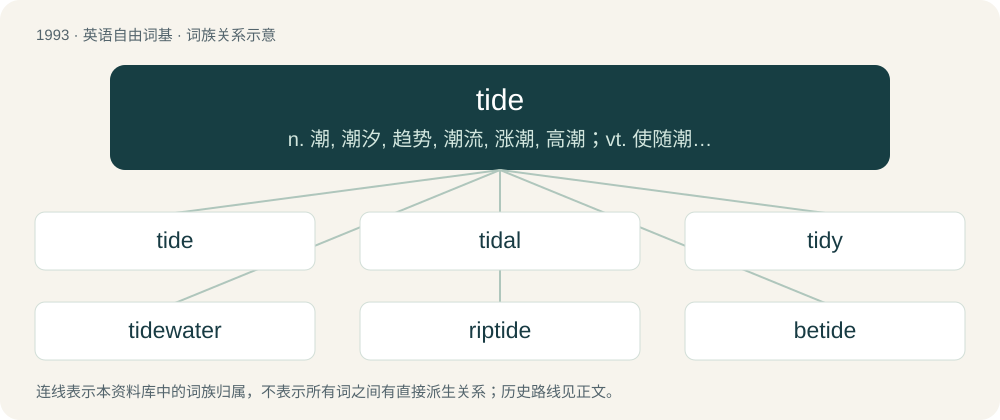

# 2110 · tide — n. 潮, 潮汐, 趋势, 潮流, 涨潮, 高潮；vt. 使随潮漂流；vi. 顺潮行驶

[总目录](../00_总目录_按常用程度.md)

**类型**：英语自由词基　｜　**来源语言**：见词源记录

## 核心含义与来源

- 核心含义：n. 潮, 潮汐, 趋势, 潮流, 涨潮, 高潮；vt. 使随潮漂流；vi. 顺潮行驶
- 英文含义：The daily fluctuation in the level of the sea caused by the gravitational influence of the moon and the sun.
- 词形：tide

**来源记录 1**（名词；The daily fluctuation in the level of the sea caused by the gravitational influence of the moon and the sun.）

Inherited from Middle English tyde, from Old English tīd, from Proto-West Germanic \*tīdi, from Proto-Germanic \*tīdiz, from Proto-Indo-European \*déh₂itis, from \*deh₂y- + \*-tis. Related to time. Cognate with Dutch tijd (“time”), German Zeit (“time”), Danish, Norwegian Bokmål, Norwegian Nynorsk, and Swedish tid (“time”), Faroese and Icelandic tíð (“time”).

## 词族图

## 单词速览（常用到不常用）

| 单词 | 音标 | 释义 |
|---|---|---|
| [tide](#w-1) | 英 /taɪd/ | n. 潮, 潮汐, 趋势, 潮流, 涨潮, 高潮；vt. 使随潮漂流；vi. 顺潮行驶 |
| [tidal](#w-2) | /ˈtaɪ.d(ə)l/ | a. 潮汐的, 受潮汐影响的 |
| [tidy](#w-3) | /ˈtaɪ.di/ | n. 椅子的背罩, 装杂物的容器；a. 整齐的, 有条理的；vt. 弄整齐, 收拾, 整理 |
| [tidewater](#w-4) | /ˈtaidwɒːtə/ | n. 潮水, 有潮水域, 低洼海岸 |
| [riptide](#w-5) | 英 /ˈɹɪp.taɪd/ | n. 洪涛, 急流, 激流 |
| [betide](#w-6) | 英 /bɪˈtaɪd/；美 /bəˈtaɪd/ | vt. 降临于, 预示；vi. 发生 |

## 逐词详解

### 1. tide

**词性**：名词　｜　**音标**：英 /taɪd/

**中文释义**：n. 潮, 潮汐, 趋势, 潮流, 涨潮, 高潮；vt. 使随潮漂流；vi. 顺潮行驶

**英文义项**：The daily fluctuation in the level of the sea caused by the gravitational influence of the moon and the sun. / The associated flow of water.

**词源与演化**：

Inherited from Middle English tyde, from Old English tīd, from Proto-West Germanic \*tīdi, from Proto-Germanic \*tīdiz, from Proto-Indo-European \*déh₂itis, from \*deh₂y- + \*-tis. Related to time. Cognate with Dutch tijd (“time”), German Zeit (“time”), Danish, Norwegian Bokmål, Norwegian Nynorsk, and Swedish tid (“time”), Faroese and Icelandic tíð (“time”).

**例句**：

> By far the largest tides on Europa are those caused by the gravitational attraction of Jupiter.

该用例对应义项：Any similar gravitational effect on Earth or other body.

### 2. tidal

**词性**：形容词　｜　**音标**：/ˈtaɪ.d(ə)l/

**中文释义**：a. 潮汐的, 受潮汐影响的

**英文义项**：Relating to tides.

**构词拆分**：tide + -al

**词源与演化**：

From tide + -al. Probably a hybrid formation within English. Alternatively it might be from an unattested British Medieval Latin \*tīdālis, derived from rare tīda, from Old English tīd. The usual Latin word for “tidal” is aestuālis.

**例句**：

> The tidal mouth of a river is also called an estuary.

### 3. tidy

**词性**：形容词　｜　**音标**：/ˈtaɪ.di/

**中文释义**：n. 椅子的背罩, 装杂物的容器；a. 整齐的, 有条理的；vt. 弄整齐, 收拾, 整理

**英文义项**：Arranged neatly and in order. / Not messy; neat and controlled.

**构词拆分**：tide (“time”) + -y

**词源与演化**：

From Middle English tidy, tydy, tidi (“timely, seasonal, opportune”), from tide (“time”) + -y. Cognate with Saterland Frisian tiedig (“timely, early”), Dutch tijdig (“timely”), German Low German tiedig (“timely”), German zeitig (“seasonal, timely”), Danish tidig (“timely”), Swedish tidig (“timely”).

**例句**：

> She always kept her desk immaculately tidy; nothing was ever out of place.

该用例对应义项：Arranged neatly and in order.

### 4. tidewater

**词性**：名词　｜　**音标**：/ˈtaidwɒːtə/

**中文释义**：n. 潮水, 有潮水域, 低洼海岸

**英文义项**：Water affected by the flow of the tide, especially tidal streams. / The seaboard.

**构词拆分**：tide + water

**词源与演化**：

From tide + water.

### 5. riptide

**词性**：名词　｜　**音标**：英 /ˈɹɪp.taɪd/

**中文释义**：n. 洪涛, 急流, 激流

**英文义项**：A particularly strong tidal current. / A rip current which may carry a swimmer offshore.

**构词拆分**：rip + tide

**词源与演化**：

From rip + tide.

**例句**：

> This beach suffers from a riptide that can easily sweep you out to sea.

该用例对应义项：A rip current which may carry a swimmer offshore.

### 6. betide

**词性**：动词　｜　**音标**：英 /bɪˈtaɪd/；美 /bəˈtaɪd/

**中文释义**：vt. 降临于, 预示；vi. 发生

**英文义项**：Often used in a prediction (chiefly in woe betide) or a wish: to happen to (someone or something); to befall. / Chiefly in the third person: to happen; to take place; to bechance, to befall.

**构词拆分**：be- + tide (“(obsolete) to happen, occur”)

**词源与演化**：

From Middle English bityden \[and other forms\]; from bi- (prefix forming verbs, usually with a completive, figurative, or intensive sense) + tyden (“to come about, happen, occur; to befall, become of, happen to (someone); to be the fate of (someone); to await (someone); to fare, get along”); tyden is derived from Old English tīdan (“to befall, betide, happen”), related to tīd (“time; season; hour”) (both ultimately from Proto-Indo-European \*deh₂- (“to divide, share”) or its extended form \*deh₂-y-, whence \*dh₂ítis (“time”)) + -an (suffix forming the infinitive of most verbs). The English word is analysable as be- + tide (“(obsolete) to happen, occur”).

**例句**：

> Whether good or ill betide you, trust in yourself.

该用例对应义项：Often used in a prediction (chiefly in woe betide) or a wish: to happen to (someone or something); to befall.
