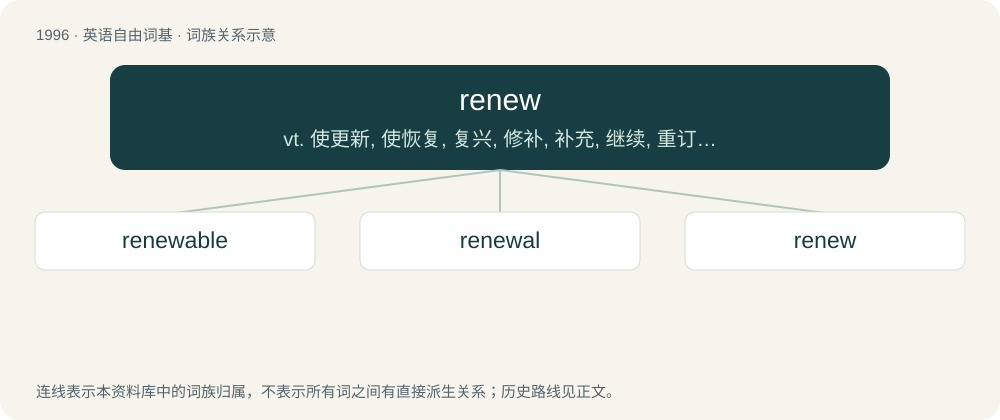

# 2111 · renew — vt. 使更新, 使恢复, 复兴, 修补, 补充, 继续, 重订, 重申, 续借；vi. 更新, 重新开始

[总目录](../00_总目录_按常用程度.md)

**类型**：英语自由词基　｜　**来源语言**：见词源记录

## 核心含义与来源

- 核心含义：vt. 使更新, 使恢复, 复兴, 修补, 补充, 继续, 重订, 重申, 续借；vi. 更新, 重新开始
- 英文含义：To make (something) new again; to restore to freshness or original condition.
- 词形：renew

**来源记录 1**（动词；To make (something) new again; to restore to freshness or original condition.）

From Middle English renewen, an alteration (possibly on analogy with Latin renovāre) of earlier anewen (“to renew”), from Old English nīewian (“to restore; renovate; renew”), equivalent to re- + new. Cognate with Old High German giniuwōn (“to renew”), Middle High German geniuwen (“to renew”), Old Norse nýja (“to renew”).

## 词族图

## 单词速览（常用到不常用）

| 单词 | 音标 | 释义 |
|---|---|---|
| [renewable](#w-1) | 英 /ɹɪˈnjuː.ə.bl̩/；美 /ɹɪˈnu.ə.bl̩/ | a. 可更新的, 可恢复的, 可继续的, 可换新的, 可重复的, 可重说的；\[计\] 可更新, 可再生的 |
| [renewal](#w-2) | /riˈnjuːəl/ | n. 更新, 革新, 复兴, 恢复, 修补, 补充, 继续, 重订, 重申, 续借；\[经\] 更新, 换新, 重申 |
| [renew](#w-3) | 英 /ɹɪˈnjuː/；美 /ɹɪˈnju/ | vt. 使更新, 使恢复, 复兴, 修补, 补充, 继续, 重订, 重申, 续借；vi. 更新, 重新开始 |

## 逐词详解

### 1. renewable

**词性**：形容词　｜　**音标**：英 /ɹɪˈnjuː.ə.bl̩/；美 /ɹɪˈnu.ə.bl̩/

**中文释义**：a. 可更新的, 可恢复的, 可继续的, 可换新的, 可重复的, 可重说的；\[计\] 可更新, 可再生的

**英文义项**：Able to be renewed; capable of renewal. / Sustainable; able to be regrown or renewed; having an ongoing or continuous source of supply.

**构词拆分**：renew + -able

**词源与演化**：

From renew + -able.

**例句**：

> Solar and wind power are renewable, but coal is not.

该用例对应义项：Sustainable; able to be regrown or renewed; having an ongoing or continuous source of supply.

### 2. renewal

**词性**：名词　｜　**音标**：/riˈnjuːəl/

**中文释义**：n. 更新, 革新, 复兴, 恢复, 修补, 补充, 继续, 重订, 重申, 续借；\[经\] 更新, 换新, 重申

**英文义项**：The act of renewing. / An offensive action made immediately after a parried one.

**构词拆分**：renew + -al

**词源与演化**：

From renew + -al.

**例句**：

> The Easter Bunny symbolizes fertility, birth, and the renewal of life.

### 3. renew

**词性**：动词　｜　**音标**：英 /ɹɪˈnjuː/；美 /ɹɪˈnju/

**中文释义**：vt. 使更新, 使恢复, 复兴, 修补, 补充, 继续, 重订, 重申, 续借；vi. 更新, 重新开始

**英文义项**：To make (something) new again; to restore to freshness or original condition. / To replace (something which has broken etc.); to replenish (something which has been exhausted), to keep up a required supply of.

**构词拆分**：re- + new

**词源与演化**：

From Middle English renewen, an alteration (possibly on analogy with Latin renovāre) of earlier anewen (“to renew”), from Old English nīewian (“to restore; renovate; renew”), equivalent to re- + new. Cognate with Old High German giniuwōn (“to renew”), Middle High German geniuwen (“to renew”), Old Norse nýja (“to renew”).

**例句**：

> I'd like to renew these three books. Did you know that you can renew online?

该用例对应义项：To extend a period of loan, especially a library book that is due to be returned.
