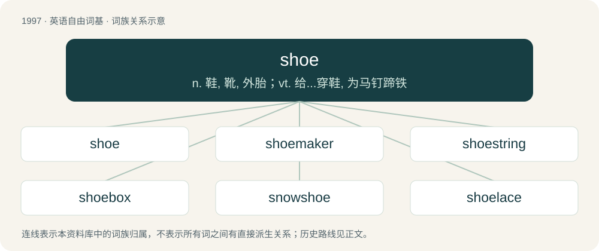

# 2112 · shoe — n. 鞋, 靴, 外胎；vt. 给...穿鞋, 为马钉蹄铁

[总目录](../00_总目录_按常用程度.md)

**类型**：英语自由词基　｜　**来源语言**：见词源记录

## 核心含义与来源

- 核心含义：n. 鞋, 靴, 外胎；vt. 给...穿鞋, 为马钉蹄铁
- 英文含义：A protective covering for the foot, with a bottom part composed of thick leather or plastic sole and often a thicker heel, and a softer upper part made of leather or synthetic material. Shoes generally do not extend above the ankle, as opposed to boots, which do.
- 词形：shoe

**来源记录 1**（名词；A protective covering for the foot, with a bottom part composed of thick leather or plastic sole and often a thicker heel, and a softer upper part made of leather or synthetic material. Shoes generally do not extend above the ankle, as opposed to boots, which do.）

From Middle English scho, sho, from Old English sċōh (“shoe”), from Proto-West Germanic \*skōh, from Proto-Germanic \*skōhaz (“shoe”), of unclear etymology; possibly a derivation from \*skehaną (“to move quickly”), from Proto-Indo-European \*skek- (“to move quickly, jump”). Eclipsed non-native Middle English sabatine, sabatoun (“shoe”) from Medieval Latin sabatēnum, sabatum (“shoe, slipper”) (compare Old Occitan sabatō, Spanish zapato (“shoe”), French sabot (“wooden shoe, clog”), Italian ciabatta). The archaic plural shoon is from Middle English shon, from Old English scōn, scōum (“shoes”, dative plural) and scōna (“shoes'”, genitive plural); it is cognate with Scots shuin (“shoes”). See also Scots shae, West Frisian skoech, Low German Schoh, Dutch schoen, German Schuh, Bavarian Schuach, Danish, Norwegian Bokmål, Norwegian Nynorsk, and Swedish sko, Tocharian B skāk (“balcony”).

## 词族图

## 单词速览（常用到不常用）

| 单词 | 音标 | 释义 |
|---|---|---|
| [shoe](#w-1) | 英 /ˈʃuː/；美 /ˈʃu/ | n. 鞋, 靴, 外胎；vt. 给...穿鞋, 为马钉蹄铁 |
| [shoemaker](#w-2) | 美 /ˈʃuˌmeɪkɚ/ | n. 鞋店营业员, 皮鞋匠 |
| [shoestring](#w-3) | 英 /ˈʃuːstɹɪŋ/；美 /ˈʃustɹɪŋ/ | n. 鞋带, 小额资本 |
| [shoebox](#w-4) | /ˈʃuːbɒks/ | 鞋盒 |
| [snowshoe](#w-5) | 美 /ˈsnoʊʃu/ | n. 雪鞋；vi. 穿雪鞋走路 |
| [shoelace](#w-6) | /ˈʃuːˌleɪs/ | n. 鞋带 |
| [shoeless](#w-7) | /ˈʃuːlis/ | a. 不穿鞋的, 赤脚的, 没有鞋的 |
| [shoegaze](#w-8) | 英 /ˈʃuːˌɡeɪz/；美 /ˈʃuˌɡeɪz/ | 【英文】Synonym of shoegazing. |
| [shoehorn](#w-9) | 英 /ˈʃuːˌhɔːn/；美 /ˈʃuːˌhɔɹn/ | n. 鞋拔；vt. 硬塞进 |
| [gumshoe](#w-10) | 英 /ˈɡʌm.ʃuː/ | n. 套靴, 胶底运动靴, 警察；vi. 悄悄走, 秘密行走；a. 偷偷做的 |
| [shoeshine](#w-11) | 美 /ˈʃuˌʃaɪn/ | n. 擦亮的皮鞋面, 擦皮鞋 |

## 逐词详解

### 1. shoe

**词性**：名词　｜　**音标**：英 /ˈʃuː/；美 /ˈʃu/

**中文释义**：n. 鞋, 靴, 外胎；vt. 给...穿鞋, 为马钉蹄铁

**英文义项**：A protective covering for the foot, with a bottom part composed of thick leather or plastic sole and often a thicker heel, and a softer upper part made of leather or synthetic material. Shoes generally do not extend above the ankle, as opposed to boots, which do. / A piece of metal designed to be attached to a horse's foot as a means of protection; a horseshoe.

**词源与演化**：

From Middle English scho, sho, from Old English sċōh (“shoe”), from Proto-West Germanic \*skōh, from Proto-Germanic \*skōhaz (“shoe”), of unclear etymology; possibly a derivation from \*skehaną (“to move quickly”), from Proto-Indo-European \*skek- (“to move quickly, jump”). Eclipsed non-native Middle English sabatine, sabatoun (“shoe”) from Medieval Latin sabatēnum, sabatum (“shoe, slipper”) (compare Old Occitan sabatō, Spanish zapato (“shoe”), French sabot (“wooden shoe, clog”), Italian ciabatta). The archaic plural shoon is from Middle English shon, from Old English scōn, scōum (“shoes”, dative plural) and scōna (“shoes'”, genitive plural); it is cognate with Scots shuin (“shoes”). See also Scots shae, West Frisian skoech, Low German Schoh, Dutch schoen, German Schuh, Bavarian Schuach, Danish, Norwegian Bokmål, Norwegian Nynorsk, and Swedish sko, Tocharian B skāk (“balcony”).

**例句**：

> Remember to turn the rotors when replacing the brake shoes, or they will wear out unevenly.

该用例对应义项：Something resembling a shoe in form, position, or function, such as a brake shoe.

### 2. shoemaker

**词性**：名词　｜　**音标**：美 /ˈʃuˌmeɪkɚ/

**中文释义**：n. 鞋店营业员, 皮鞋匠

**英文义项**：A person who makes shoes. / The threadfish.

**构词拆分**：shoe + maker

**词源与演化**：

From Middle English shomaker, equivalent to shoe + maker. Compare Dutch schoenmaker, German Schuhmacher, Danish skomager.

**例句**：

> The shoemaker ran after him straight way, shouting, Stop thief, Stop thief!

### 3. shoestring

**词性**：名词　｜　**音标**：英 /ˈʃuːstɹɪŋ/；美 /ˈʃustɹɪŋ/

**中文释义**：n. 鞋带, 小额资本

**英文义项**：The string or lace used to secure a shoe to the foot; a shoelace. / An object that is long and thin, like a shoestring (sense 1).

**构词拆分**：shoe + string

**词源与演化**：

The noun is derived from shoe + string. The adjective is derived from the noun, while the verb is derived from terms such as shoestring catch and shoestring tackle.

**例句**：

> He was able to organize the event on a shoestring.

该用例对应义项：Chiefly in on a shoestring: very little money; a tight budget.

### 4. shoebox

**词性**：名词　｜　**音标**：/ˈʃuːbɒks/

**中文释义**：鞋盒

**英文义项**：The box in which shoes are sold. / A small, cramped residence or similar space.

**构词拆分**：shoe + box

**词源与演化**：

From shoe + box.

**例句**：

> In one shoebox he had a whole collection of seeds he had saved from last year.

该用例对应义项：The box in which shoes are sold.

### 5. snowshoe

**词性**：名词　｜　**音标**：美 /ˈsnoʊʃu/

**中文释义**：n. 雪鞋；vi. 穿雪鞋走路

**英文义项**：A flat item of footwear worn to facilitate walking in deep snow. / Synonym of mukluk

**构词拆分**：snow + shoe

**词源与演化**：

From snow + shoe.

**例句**：

> Kim Asmussen is a 62-year-old Canadian who makes snowshoe art.

### 6. shoelace

**词性**：名词　｜　**音标**：/ˈʃuːˌleɪs/

**中文释义**：n. 鞋带

**英文义项**：A lace used for fastening a shoe.

**构词拆分**：shoe + lace

**词源与演化**：

shoe + lace

**例句**：

> The hiker’s shoelace snapped halfway up the trail.

该用例对应义项：A lace used for fastening a shoe.

### 7. shoeless

**词性**：形容词　｜　**音标**：/ˈʃuːlis/

**中文释义**：a. 不穿鞋的, 赤脚的, 没有鞋的

**英文义项**：Without shoes; not wearing shoes

**构词拆分**：shoe + -less

**词源与演化**：

From Middle English sholes, scholes, equivalent to shoe + -less. Compare Dutch schoenloos (“shoeless”), German schuhlos (“shoeless”), Old Norse skólaus (“shoeless”).

**例句**：

> He ran shoeless from the burning house.

该用例对应义项：Without shoes; not wearing shoes

### 8. shoegaze

**词性**：名词　｜　**音标**：英 /ˈʃuːˌɡeɪz/；美 /ˈʃuˌɡeɪz/

**英文义项**：Synonym of shoegazing.

**构词拆分**：shoe + gaze

**词源与演化**：

From shoe + gaze, see shoegazing.

### 9. shoehorn

**词性**：动词　｜　**音标**：英 /ˈʃuːˌhɔːn/；美 /ˈʃuːˌhɔɹn/

**中文释义**：n. 鞋拔；vt. 硬塞进

**英文义项**：To use a shoehorn. / To force (something) into (a tight space); to squeeze (something) into (a schedule, etc); to exert great effort to insert or include (something); to include (something) despite potent reasons not to.

**构词拆分**：shoe + horn

**词源与演化**：

From shoe + horn.

**例句**：

> I shoehorned his dozen burgeoning bags into the backseat of my tiny car, and off we went.

该用例对应义项：To force (something) into (a tight space); to squeeze (something) into (a schedule, etc); to exert great effort to insert or include (something); to include (something) despite potent reasons not to.

### 10. gumshoe

**词性**：名词　｜　**音标**：英 /ˈɡʌm.ʃuː/

**中文释义**：n. 套靴, 胶底运动靴, 警察；vi. 悄悄走, 秘密行走；a. 偷偷做的

**英文义项**：A sneaker or rubber overshoe. / A detective.

**构词拆分**：gum + shoe

**词源与演化**：

From gum + shoe.

### 11. shoeshine

**词性**：名词　｜　**音标**：美 /ˈʃuˌʃaɪn/

**中文释义**：n. 擦亮的皮鞋面, 擦皮鞋

**英文义项**：The act of polishing shoes. / One who polishes shoes.

**构词拆分**：shoe + shine

**词源与演化**：

From shoe + shine.

**例句**：

> His trousers had a sharp crease and you could see your reflection in his shoeshine.

该用例对应义项：a shiny finish put on shoes with polish and buffing
