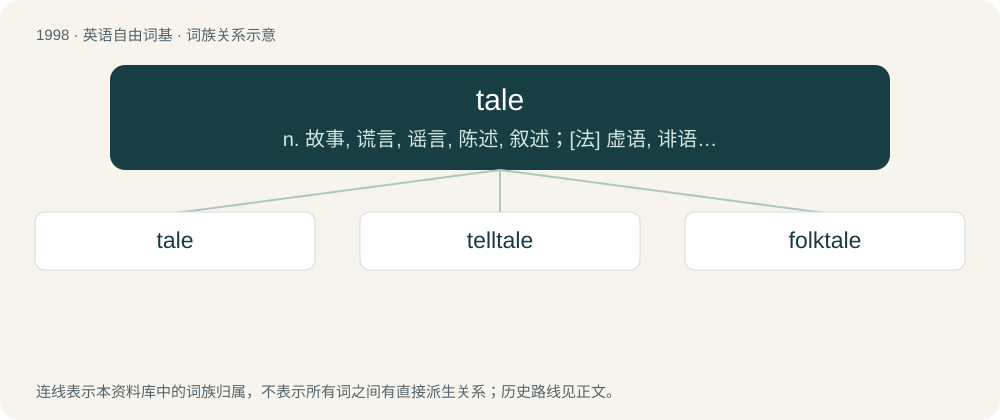

# 2113 · tale — n. 故事, 谎言, 谣言, 陈述, 叙述；\[法\] 虚语, 诽语, 谣言

[总目录](../00_总目录_按常用程度.md)

**类型**：英语自由词基　｜　**来源语言**：见词源记录

## 核心含义与来源

- 核心含义：n. 故事, 谎言, 谣言, 陈述, 叙述；\[法\] 虚语, 诽语, 谣言
- 英文含义：A rehearsal of what has occurred; narrative; discourse; statement; history; story.
- 词形：tale

**多个词源／构词路径**：同一拼写可能有不同来源；以下按词性和含义分别列出。

**来源记录 1**（名词；A rehearsal of what has occurred; narrative; discourse; statement; history; story.）

From Middle English tale, from Old English talu (“tale, series, calculation”), from Proto-West Germanic \*talu, from Proto-Germanic \*talō (“calculation, number”), from Proto-Indo-European \*del- (“to reckon, count”). Cognate with West Frisian taal (“speech, language”), Dutch taal (“language, speech”), German Zahl (“number, figure”), Danish tale (“speech”), Icelandic tala (“speech, talk, discourse, number, figure”), Latin dolus (“guile, deceit, fraud”), Ancient Greek δόλος (dólos, “wile, bait”), Albanian ndjell (“to lure”), Northern Kurdish til (“finger”), Old Armenian տող (toł, “row”). Related to tell, talk.

**来源记录 2**（动词；To reckon; consider (someone) to have something.）

From Middle English talen, from Old English talian (“to count, calculate, reckon”), from Proto-West Germanic \*talōn, from Proto-Germanic \*talōną (“to count”), from Proto-Indo-European \*del- (“to count, reckon, aim, calculate, adjust”). Cognate with Dutch talen (“to long, care”), German zahlen (“to pay”), Swedish tala (“to speak, talk”), Icelandic tala (“to talk”).

## 词族图

## 单词速览（常用到不常用）

| 单词 | 音标 | 释义 |
|---|---|---|
| [tale](#w-1) | 英 /ˈteɪl/ | n. 故事, 谎言, 谣言, 陈述, 叙述；\[法\] 虚语, 诽语, 谣言 |
| [telltale](#w-2) | /ˈtɛlteɪl/ | n. 搬弄是非者, 迹象, 指示器；a. 搬弄是非的, 泄露秘密的, 报警的 |
| [folktale](#w-3) | /ˈfoʊkteɪl/ | n. 民间故事 |

## 逐词详解

### 1. tale

**词性**：名词　｜　**音标**：英 /ˈteɪl/

**中文释义**：n. 故事, 谎言, 谣言, 陈述, 叙述；\[法\] 虚语, 诽语, 谣言

**英文义项**：A rehearsal of what has occurred; narrative; discourse; statement; history; story. / A number told or counted off; a reckoning by count; an enumeration.

**词源与演化**：

From Middle English tale, from Old English talu (“tale, series, calculation”), from Proto-West Germanic \*talu, from Proto-Germanic \*talō (“calculation, number”), from Proto-Indo-European \*del- (“to reckon, count”). Cognate with West Frisian taal (“speech, language”), Dutch taal (“language, speech”), German Zahl (“number, figure”), Danish tale (“speech”), Icelandic tala (“speech, talk, discourse, number, figure”), Latin dolus (“guile, deceit, fraud”), Ancient Greek δόλος (dólos, “wile, bait”), Albanian ndjell (“to lure”), Northern Kurdish til (“finger”), Old Armenian տող (toł, “row”). Related to tell, talk.

**用法示例／搭配（非完整句）**：

> the Canterbury Tales

该用例对应义项：A rehearsal of what has occurred; narrative; discourse; statement; history; story.

### 2. telltale

**词性**：名词　｜　**音标**：/ˈtɛlteɪl/

**中文释义**：n. 搬弄是非者, 迹象, 指示器；a. 搬弄是非的, 泄露秘密的, 报警的

**英文义项**：One who divulges private information with intent to hurt others. / An indicator, such as a warning light, that serves to warn of a hazard or problem.

**构词拆分**：tell + tale

**词源与演化**：

From tell + tale, perhaps dissimilated from earlier taleteller, from Middle English tale tellere (literally “tale teller”).

**例句**：

> The telltale was the lipstick on his shirt collar.

该用例对应义项：Something that serves to reveal something else.

### 3. folktale

**词性**：名词　｜　**音标**：/ˈfoʊkteɪl/

**中文释义**：n. 民间故事

**英文义项**：A tale or story that is part of the oral tradition of a people or a place.

**构词拆分**：folk + tale

**词源与演化**：

From folk + tale.

**例句**：

> A folktale wasn't created by a single known author. It arose among the people.
