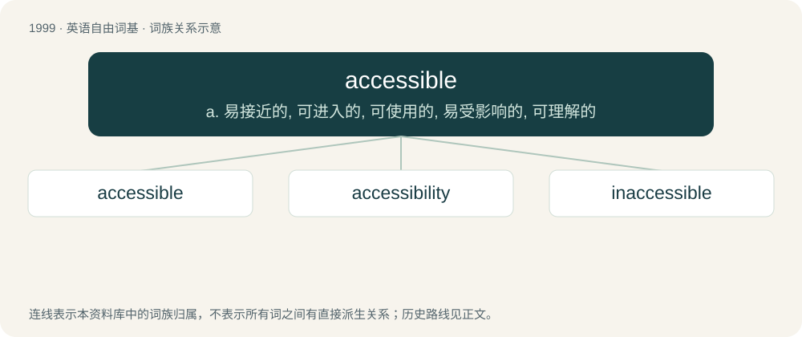

# 2114 · accessible — a. 易接近的, 可进入的, 可使用的, 易受影响的, 可理解的

[总目录](../00_总目录_按常用程度.md)

**类型**：英语自由词基　｜　**来源语言**：见词源记录

## 核心含义与来源

- 核心含义：a. 易接近的, 可进入的, 可使用的, 易受影响的, 可理解的
- 英文含义：Easy of access or approach.
- 词形：accessible

**来源记录 1**（形容词；Easy of access or approach.）

First attested in 1400, from French, from Late Latin accessibilis, from accessus, perfect passive participle of accēdō (“approach”), equivalent to access + -ible.

## 词族图

## 单词速览（常用到不常用）

| 单词 | 音标 | 释义 |
|---|---|---|
| [accessible](#w-1) | 英 /əkˈsɛs.ɪ.bəl/ | a. 易接近的, 可进入的, 可使用的, 易受影响的, 可理解的 |
| [accessibility](#w-2) | 英 /əkˌsɛs.əˈbɪl.ɪ.ti/；美 /əkˌsɛs.əˈbɪl.ə.ti/ | n. 易接近, 可进入；\[化\] 可及性; 可达性; 可接近性; 吸湿性 |
| [inaccessible](#w-3) | /ˌɪnəkˈsɛsɪbl̩/ | a. 难得到的, 难接近的, 难达成的 |

## 逐词详解

### 1. accessible

**词性**：形容词　｜　**音标**：英 /əkˈsɛs.ɪ.bəl/

**中文释义**：a. 易接近的, 可进入的, 可使用的, 易受影响的, 可理解的

**英文义项**：Easy of access or approach. / Built or designed as to be usable by people with disabilities.

**构词拆分**：access + -ible

**词源与演化**：

First attested in 1400, from French, from Late Latin accessibilis, from accessus, perfect passive participle of accēdō (“approach”), equivalent to access + -ible.

**用法示例／搭配（非完整句）**：

> an accessible town or mountain

该用例对应义项：Easy of access or approach.

### 2. accessibility

**词性**：名词　｜　**音标**：英 /əkˌsɛs.əˈbɪl.ɪ.ti/；美 /əkˌsɛs.əˈbɪl.ə.ti/

**中文释义**：n. 易接近, 可进入；\[化\] 可及性; 可达性; 可接近性; 吸湿性

**英文义项**：The quality of being accessible, or of admitting approach; receptiveness. / Features that increase software usability for users with certain impairments.

**构词拆分**：accessible + -ity

**词源与演化**：

From accessible + -ity, after Late Latin accessibilitas, from Latin accessibilis.

**例句**：

> The accessibility of the railroad attracted new residents and made dairy farming profitable.

### 3. inaccessible

**词性**：形容词　｜　**音标**：/ˌɪnəkˈsɛsɪbl̩/

**中文释义**：a. 难得到的, 难接近的, 难达成的

**英文义项**：Not able to be accessed; out of reach; inconvenient. / Not able to be reached; unattainable.

**构词拆分**：in- + accessible

**词源与演化**：

From Middle French inaccessible, from Late Latin inaccessibilis, equivalent to in- + accessible. Piecewise doublet of unaccessible.

**例句**：

> Much of the archive remains inaccessible to the public.

该用例对应义项：Not able to be accessed; out of reach; inconvenient.
