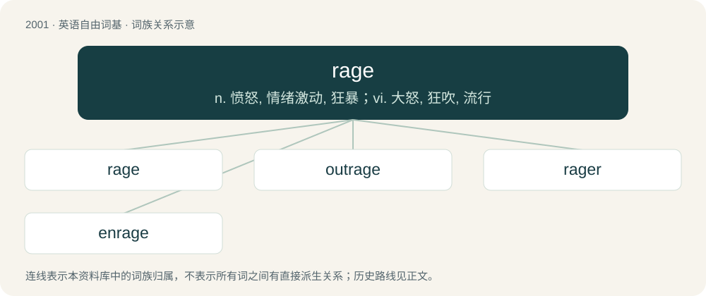

# 2116 · rage — n. 愤怒, 情绪激动, 狂暴；vi. 大怒, 狂吹, 流行

[总目录](../00_总目录_按常用程度.md)

**类型**：英语自由词基　｜　**来源语言**：见词源记录

## 核心含义与来源

- 核心含义：n. 愤怒, 情绪激动, 狂暴；vi. 大怒, 狂吹, 流行
- 英文含义：Violent uncontrolled anger.
- 词形：rage

**多个词源／构词路径**：同一拼写可能有不同来源；以下按词性和含义分别列出。

**来源记录 1**（名词；Violent uncontrolled anger.）

From Middle English rage, from Anglo-Norman rage, from Late Latin rabia, from Classical Latin rabiēs (“anger, fury”). Doublet of rabies. Displaced native Middle English wode, from Old English wōd ("madness, fury, rage"; compare Modern dialectal English wood (“mad, insane, furious, raging”)); and Middle English hotherte (“anger”), from Old English hātheort (“fury, anger, wrath, rage”).

**来源记录 2**（动词；To act or speak in heightened anger.）

From Middle English ragen, from Old French rager, ragier, from the noun (see above). Displaced native Middle English weden (“to rage with anger”), from Old English wēdan (“to rage”), and Old English iersian, among other synonyms.

## 词族图

## 单词速览（常用到不常用）

| 单词 | 音标 | 释义 |
|---|---|---|
| [rage](#w-1) | /ɹeɪd͡ʒ/ | n. 愤怒, 情绪激动, 狂暴；vi. 大怒, 狂吹, 流行 |
| [outrage](#w-2) | /ˈaʊt.ɹeɪd͡ʒ/ | n. 暴行, 侮辱, 愤怒；vt. 凌辱, 虐待, 触犯 |
| [rager](#w-3) | 美 /ˈɹeɪd͡ʒɚ/ | 【英文】One who rages. |
| [enrage](#w-4) | /ɪnˈɹeɪd͡ʒ/ | vt. 激怒, 使暴怒 |

## 逐词详解

### 1. rage

**词性**：名词　｜　**音标**：/ɹeɪd͡ʒ/

**中文释义**：n. 愤怒, 情绪激动, 狂暴；vi. 大怒, 狂吹, 流行

**英文义项**：Violent uncontrolled anger. / A current fashion or fad.

**词源与演化**：

From Middle English rage, from Anglo-Norman rage, from Late Latin rabia, from Classical Latin rabiēs (“anger, fury”). Doublet of rabies. Displaced native Middle English wode, from Old English wōd ("madness, fury, rage"; compare Modern dialectal English wood (“mad, insane, furious, raging”)); and Middle English hotherte (“anger”), from Old English hātheort (“fury, anger, wrath, rage”).

**例句**：

> Miniskirts were all the rage back then.

该用例对应义项：A current fashion or fad.

### 2. outrage

**词性**：动词　｜　**音标**：/ˈaʊt.ɹeɪd͡ʒ/

**中文释义**：n. 暴行, 侮辱, 愤怒；vt. 凌辱, 虐待, 触犯

**英文义项**：To cause or commit an outrage upon; to treat with violence or abuse. / To inspire feelings of outrage in.

**构词拆分**：out- + rage

**词源与演化**：

From Middle English outrage, from Old French outrage, oultrage (“excess”), from Vulgar Latin \*ultrāticum ("a going beyond"), derived from Latin ultrā (“beyond”). Later reanalysed as out- + rage, whence the contemporary pronunciation, though neither of these are etymologically related. The verb is from Middle English outragen, from Old French oultragier.

**例句**：

> Floyd’s death has caused international outrage and days of protests across the nation.

### 3. rager

**词性**：名词　｜　**音标**：美 /ˈɹeɪd͡ʒɚ/

**英文义项**：One who rages. / A boisterous and out of control party.

**构词拆分**：rage + -er

**词源与演化**：

From Middle English rager, raiger, ragere, equivalent to rage + -er.

### 4. enrage

**词性**：动词　｜　**音标**：/ɪnˈɹeɪd͡ʒ/

**中文释义**：vt. 激怒, 使暴怒

**英文义项**：To become angry or wild. / To fill with rage; to outrage; to provoke to frenzy; to make furious.

**构词拆分**：en- + rage

**词源与演化**：

From Old French enrager, enragier, from rage. Equivalent to en- + rage.

**例句**：

> The renomination could enrage anti-government protestors who demand he resign.
