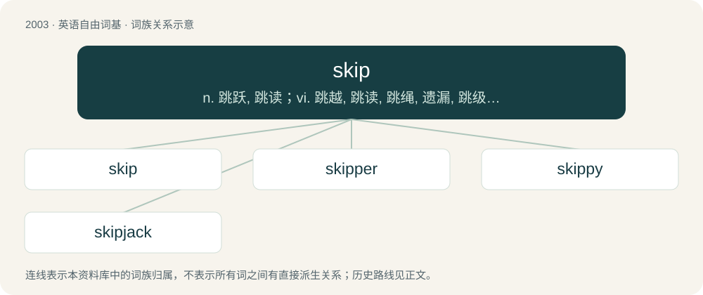

# 2117 · skip — n. 跳跃, 跳读；vi. 跳越, 跳读, 跳绳, 遗漏, 跳级；vt. 跳过, 遗漏

[总目录](../00_总目录_按常用程度.md)

**类型**：英语自由词基　｜　**来源语言**：见词源记录

## 核心含义与来源

- 核心含义：n. 跳跃, 跳读；vi. 跳越, 跳读, 跳绳, 遗漏, 跳级；vt. 跳过, 遗漏
- 英文含义：To move by hopping on alternate feet.
- 词形：skip

**多个词源／构词路径**：同一拼写可能有不同来源；以下按词性和含义分别列出。

**来源记录 1**（动词；To move by hopping on alternate feet.）

From Middle English skippen, skyppen, of North Germanic origin, ultimately from Proto-Germanic \*skupjaną, perhaps related to \*skeubaną (“to drive, push”), iterative \*skuppōną (“to push/move repeatedly, skip”), from Proto-Indo-European \*skewbʰ- (“to push, throw, shake”). Related to Icelandic skopa (“to take a run”), Old Swedish skuppa (“to skip”), modern dialectal Swedish skopa, skimpa (“to skip, leap”), and English shove. See also dialectal English skimp (“to mock”) (Etymology 1), considered by some to be related.

**来源记录 2**（名词；A large container for waste, designed to be lifted onto the back of a truck to remove it along with its contents, or to be picked up by hydraulic arms so that its contents can be dumped into the truck.）

From Middle English skep, skeppe, from Old English sceppe, from Old Norse skeppa, skjappa (“basket, bushel, measure”), perhaps from Middle Low German scheppe (“a unit of weight”), perhaps related to Middle Low German schēpel (“buschel, measurement for grain”), German Scheffel (“bushel”). These could all ultimately be related to \*skap (“shape”).

**来源记录 3**（名词；The player who calls the shots and traditionally throws the last two rocks.）

Late Middle English skipper, borrowed from Middle Dutch and Middle Low German schipper (“captain”), earlier "seaman", from schip (“ship”).

**来源记录 4**（名词；An Australian of Anglo-Celtic descent.）

A reference to the television series Skippy the Bush Kangaroo; coined and used by Australians (particularly children) of non-British descent to counter derogatory terms aimed at them. Ultimately from etymology 1 (above).

**来源记录 5**（名词；A skip-level manager; the boss of one's boss.）

Clipping of skip-level manager.

## 词族图

## 单词速览（常用到不常用）

| 单词 | 音标 | 释义 |
|---|---|---|
| [skip](#w-1) | /skɪp/ | n. 跳跃, 跳读；vi. 跳越, 跳读, 跳绳, 遗漏, 跳级；vt. 跳过, 遗漏 |
| [skipper](#w-2) | 英 /ˈskɪp.ə/；美 /ˈskɪp.ɚ/ | 【英文】A person who skips, or fails to attend class. |
| [skippy](#w-3) | /ˈskipi/ | n. \[美俚\]日本女人（尤其指妓女） |
| [skipjack](#w-4) | /ˈskipdʒæk/ | n. 跳跃玩偶, 飞鱼类(如鲣鱼), 叩头虫 |

## 逐词详解

### 1. skip

**词性**：动词　｜　**音标**：/skɪp/

**中文释义**：n. 跳跃, 跳读；vi. 跳越, 跳读, 跳绳, 遗漏, 跳级；vt. 跳过, 遗漏

**英文义项**：To move by hopping on alternate feet. / To leap about lightly.

**词源与演化**：

From Middle English skippen, skyppen, of North Germanic origin, ultimately from Proto-Germanic \*skupjaną, perhaps related to \*skeubaną (“to drive, push”), iterative \*skuppōną (“to push/move repeatedly, skip”), from Proto-Indo-European \*skewbʰ- (“to push, throw, shake”). Related to Icelandic skopa (“to take a run”), Old Swedish skuppa (“to skip”), modern dialectal Swedish skopa, skimpa (“to skip, leap”), and English shove. See also dialectal English skimp (“to mock”) (Etymology 1), considered by some to be related.

**例句**：

> I will read most of the book, but skip the first chapter because the video covered it.

该用例对应义项：To disregard, miss or omit part of a continuation (some item or stage).

### 2. skipper

**词性**：名词　｜　**音标**：英 /ˈskɪp.ə/；美 /ˈskɪp.ɚ/

**英文义项**：A person who skips, or fails to attend class. / One who jumps rope.

**构词拆分**：skip + -er

**词源与演化**：

From Middle English skippere, skyppare, equivalent to skip + -er.

### 3. skippy

**词性**：形容词　｜　**音标**：/ˈskipi/

**中文释义**：n. \[美俚\]日本女人（尤其指妓女）

**英文义项**：Characterized by skipping movements. / Having an upbeat rhythm, suitable to skip to.

**构词拆分**：skip + -y

**词源与演化**：

From skip + -y.

### 4. skipjack

**词性**：名词　｜　**音标**：/ˈskipdʒæk/

**中文释义**：n. 跳跃玩偶, 飞鱼类(如鲣鱼), 叩头虫

**英文义项**：Several of the genus Euthynnus resembling tuna / A skipjack tuna (Katsuwonus pelamis)

**构词拆分**：skip (verb) + Jack

**词源与演化**：

From skip (verb) + Jack.
