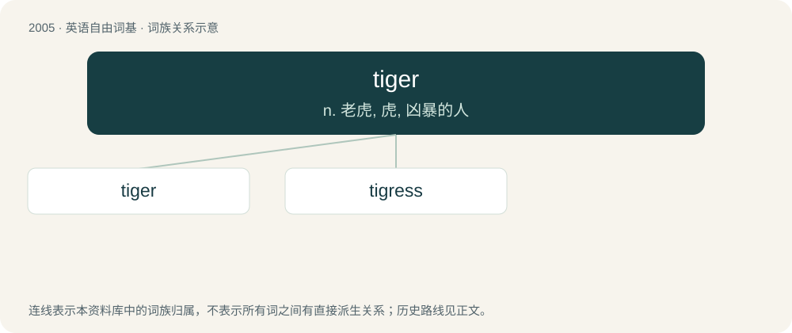

# 2118 · tiger — n. 老虎, 虎, 凶暴的人

[总目录](../00_总目录_按常用程度.md)

**类型**：英语自由词基　｜　**来源语言**：见词源记录

## 核心含义与来源

- 核心含义：n. 老虎, 虎, 凶暴的人
- 英文含义：Panthera tigris, a large predatory mammal of the cat family, indigenous to Asia.
- 词形：tiger

**多个词源／构词路径**：同一拼写可能有不同来源；以下按词性和含义分别列出。

**来源记录 1**（名词；Panthera tigris, a large predatory mammal of the cat family, indigenous to Asia.）

From Middle English tygre, in part from Old English tigras (pl.), in part from Anglo-Norman tigre, both from Latin tigris, from Ancient Greek τίγρις (tígris), from Iranian (compare Avestan 𐬙𐬌𐬔𐬭𐬌 (tigri, “arrow”), 𐬙𐬌𐬖𐬭𐬀 (tiγra, “pointed”)). Ultimately from Proto-Indo-European \*(s)teyg- (“to pierce, prick, be sharp”). Compare English stick.

**来源记录 2**（名词；A final shouted phrase, accompanied by a jump or outstretched arms, at the end of a cheer.）

From the mascot of Princeton (a tiger), which led to early cheerleaders calling out "Tiger" at the end of a cheer for the Princeton team.

## 词族图

## 单词速览（常用到不常用）

| 单词 | 音标 | 释义 |
|---|---|---|
| [tiger](#w-1) | 英 /ˈtaɪɡə/；美 /ˈtaɪɡɚ/ | n. 老虎, 虎, 凶暴的人 |
| [tigress](#w-2) | /ˈtaɪ.ɡɹɪs/ | n. 母虎, 雌虎 |

## 逐词详解

### 1. tiger

**词性**：名词　｜　**音标**：英 /ˈtaɪɡə/；美 /ˈtaɪɡɚ/

**中文释义**：n. 老虎, 虎, 凶暴的人

**英文义项**：Panthera tigris, a large predatory mammal of the cat family, indigenous to Asia. / A male tiger; as opposed to a tigress.

**词源与演化**：

From Middle English tygre, in part from Old English tigras (pl.), in part from Anglo-Norman tigre, both from Latin tigris, from Ancient Greek τίγρις (tígris), from Iranian (compare Avestan 𐬙𐬌𐬔𐬭𐬌 (tigri, “arrow”), 𐬙𐬌𐬖𐬭𐬀 (tiγra, “pointed”)). Ultimately from Proto-Indo-European \*(s)teyg- (“to pierce, prick, be sharp”). Compare English stick.

**例句**：

> It was during the ice age that the saber-toothed tiger became extinct.

### 2. tigress

**词性**：名词　｜　**音标**：/ˈtaɪ.ɡɹɪs/

**中文释义**：n. 母虎, 雌虎

**英文义项**：A female tiger; a she-tiger.

**构词拆分**：tiger + -ess

**词源与演化**：

From French tigresse, corresponding to tiger + -ess.

**例句**：

> You are a tigress in bed.
