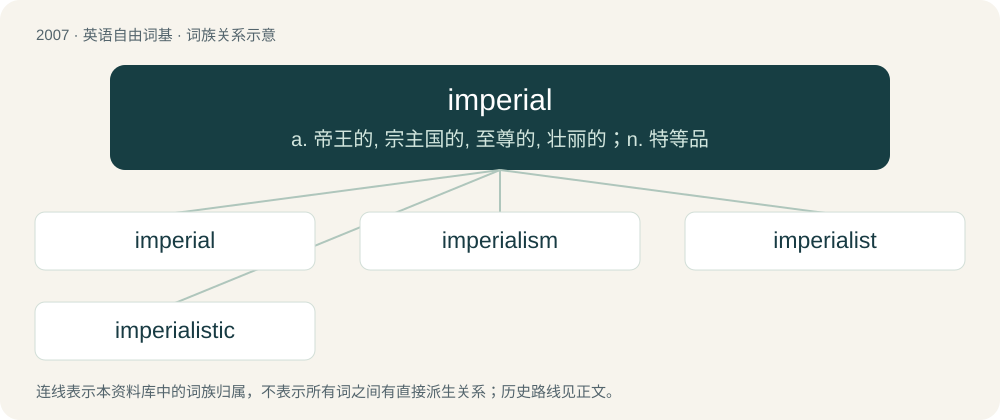

# 2121 · imperial — a. 帝王的, 宗主国的, 至尊的, 壮丽的；n. 特等品

[总目录](../00_总目录_按常用程度.md)

**类型**：英语自由词基　｜　**来源语言**：见词源记录

## 核心含义与来源

- 核心含义：a. 帝王的, 宗主国的, 至尊的, 壮丽的；n. 特等品
- 英文含义：Related to an empire, emperor, or empress.
- 词形：imperial

**来源记录 1**（形容词；Related to an empire, emperor, or empress.）

From Middle English imperial, from Old French imperial, from Latin imperiālis (“of the empire or emperor, imperial”), from imperium (“empire, imperial government”) + -ālis, from imperō (“command, order”), from im- (“form of in”) + parō (“prepare, arrange; intend”). Displaced Old English cāserlīċ.

## 词族图

## 单词速览（常用到不常用）

| 单词 | 音标 | 释义 |
|---|---|---|
| [imperial](#w-1) | 英 /ɪmˈpɪə.ɹi.əl/；美 /ɪmˈpɪɹ.i.əl/ | a. 帝王的, 宗主国的, 至尊的, 壮丽的；n. 特等品 |
| [imperialism](#w-2) | 英 /ɪmˈpɪə.ɹi.ə.lɪ.z(ə)m/；美 /ɪmˈpɪ.ɹi.əˌlɪ.zəm/ | n. 帝国主义, 帝制；\[法\] 帝国主义 |
| [imperialist](#w-3) | /ɪmˈpɪəɹiəlɪst/ | n. 帝国主义者, 皇帝统治的拥护者, 皇帝派的人；a. 帝国主义的 |
| [imperialistic](#w-4) | 英 /ɪmˌpɪəɹi.əlˈɪstɪk/；美 /ɪmˌpɪɹi.əˈlɪstɪk/ | a. 帝国主义的, 拥护帝国主义的 |

## 逐词详解

### 1. imperial

**词性**：形容词　｜　**音标**：英 /ɪmˈpɪə.ɹi.əl/；美 /ɪmˈpɪɹ.i.əl/

**中文释义**：a. 帝王的, 宗主国的, 至尊的, 壮丽的；n. 特等品

**英文义项**：Related to an empire, emperor, or empress. / Relating to the British imperial system of measurement.

**词源与演化**：

From Middle English imperial, from Old French imperial, from Latin imperiālis (“of the empire or emperor, imperial”), from imperium (“empire, imperial government”) + -ālis, from imperō (“command, order”), from im- (“form of in”) + parō (“prepare, arrange; intend”). Displaced Old English cāserlīċ.

**例句**：

> The imperial gallon was standardized legally throughout the British Empire.

该用例对应义项：relating to or associated with an empire

### 2. imperialism

**词性**：名词　｜　**音标**：英 /ɪmˈpɪə.ɹi.ə.lɪ.z(ə)m/；美 /ɪmˈpɪ.ɹi.əˌlɪ.zəm/

**中文释义**：n. 帝国主义, 帝制；\[法\] 帝国主义

**英文义项**：The policy of forcefully extending a nation's authority by territorial gain or by the establishment of economic and political dominance over other nations. / Any undue extension of political, intellectual, or other forms of authority, particularly in regards to systems that benefit the Western world at the cost of the Global South.

**构词拆分**：imperial + -ism

**词源与演化**：

From imperial + -ism.

**例句**：

> Heart of Darkness raises important questions about imperialism, as well as racism.

### 3. imperialist

**词性**：形容词　｜　**音标**：/ɪmˈpɪəɹiəlɪst/

**中文释义**：n. 帝国主义者, 皇帝统治的拥护者, 皇帝派的人；a. 帝国主义的

**英文义项**：Of, or relating to imperialism.

**构词拆分**：imperial + -ist

**词源与演化**：

From imperial + -ist, after French impérialiste.

**例句**：

> Their pseudo-scientific rhetoric serves as justification for America's imperialist foreign policy.

### 4. imperialistic

**词性**：形容词　｜　**音标**：英 /ɪmˌpɪəɹi.əlˈɪstɪk/；美 /ɪmˌpɪɹi.əˈlɪstɪk/

**中文释义**：a. 帝国主义的, 拥护帝国主义的

**英文义项**：Of or pertaining to imperialism or imperialists; favoring imperialism.

**构词拆分**：imperialist + -ic；imperial + -istic

**词源与演化**：

From imperialist + -ic or imperial + -istic.

**例句**：

> Europe wants its imperialistic borders to be south of the Sahara.
