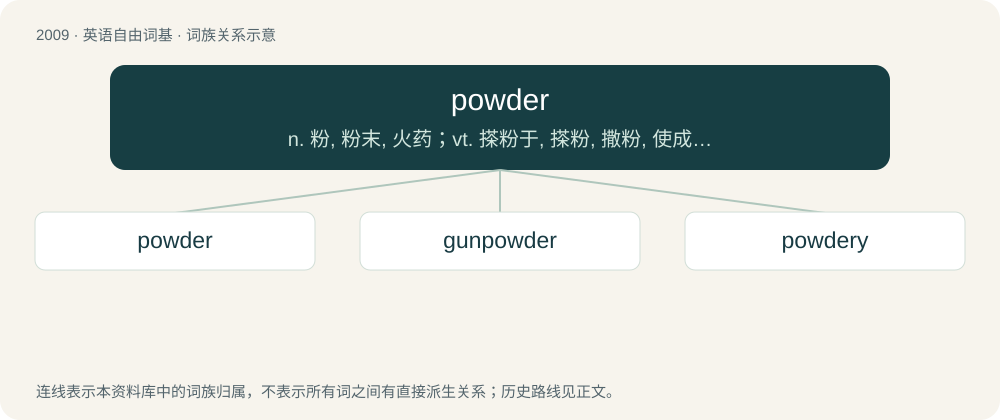

# 2122 · powder — n. 粉, 粉末, 火药；vt. 搽粉于, 搽粉, 撒粉, 使成粉末；vi. 搽粉, 变成粉末

[总目录](../00_总目录_按常用程度.md)

**类型**：英语自由词基　｜　**来源语言**：见词源记录

## 核心含义与来源

- 核心含义：n. 粉, 粉末, 火药；vt. 搽粉于, 搽粉, 撒粉, 使成粉末；vi. 搽粉, 变成粉末
- 英文含义：The fine particles which are the result of reducing a dry substance by pounding, grinding, or triturating, or the result of decay; dust.
- 词形：powder

**来源记录 1**（名词；The fine particles which are the result of reducing a dry substance by pounding, grinding, or triturating, or the result of decay; dust.）

From Middle English poudre, pouder, pouldre, borrowed from Old French poudre, poldre, puldre, from Latin pulverem, accusative singular of Latin pulvis (“dust, powder”). Doublet of pulver. Compare pollen (“fine flour”), polverine, pulverize.

## 词族图

## 单词速览（常用到不常用）

| 单词 | 音标 | 释义 |
|---|---|---|
| [powder](#w-1) | 英 /ˈpaʊ.də(ɹ)/；美 /ˈpaʊ.dɚ/ | n. 粉, 粉末, 火药；vt. 搽粉于, 搽粉, 撒粉, 使成粉末；vi. 搽粉, 变成粉末 |
| [gunpowder](#w-2) | 英 /ˈɡʌnˌpaʊdə/；美 /ˈɡʌnˌpaʊdɚ/ | n. 火药；\[化\] 有烟火药; 火药 |
| [powdery](#w-3) | 美 /ˈpaʊdəɹi/ | a. 粉的, 粉状的 |

## 逐词详解

### 1. powder

**词性**：名词　｜　**音标**：英 /ˈpaʊ.də(ɹ)/；美 /ˈpaʊ.dɚ/

**中文释义**：n. 粉, 粉末, 火药；vt. 搽粉于, 搽粉, 撒粉, 使成粉末；vi. 搽粉, 变成粉末

**英文义项**：The fine particles which are the result of reducing a dry substance by pounding, grinding, or triturating, or the result of decay; dust. / Cocaine in powder form (as opposed to crack).

**词源与演化**：

From Middle English poudre, pouder, pouldre, borrowed from Old French poudre, poldre, puldre, from Latin pulverem, accusative singular of Latin pulvis (“dust, powder”). Doublet of pulver. Compare pollen (“fine flour”), polverine, pulverize.

**例句**：

> If I slap you, the whole city will suffocate from face powder.

### 2. gunpowder

**词性**：名词　｜　**音标**：英 /ˈɡʌnˌpaʊdə/；美 /ˈɡʌnˌpaʊdɚ/

**中文释义**：n. 火药；\[化\] 有烟火药; 火药

**英文义项**：An explosive mixture of saltpetre (potassium nitrate), charcoal and sulfur; formerly used in gunnery but now mostly used in fireworks.

**构词拆分**：gun + powder

**词源与演化**：

From gun + powder.

**例句**：

> We must prevent the fire from reaching the gunpowder at any cost.

### 3. powdery

**词性**：形容词　｜　**音标**：美 /ˈpaʊdəɹi/

**中文释义**：a. 粉的, 粉状的

**英文义项**：Of or pertaining to powder. / Having a lot of powder.

**构词拆分**：From powder + -y.

**词源与演化**：

From powder + -y.

**用法示例／搭配（非完整句）**：

> powdery drink

该用例对应义项：Of or pertaining to powder.
