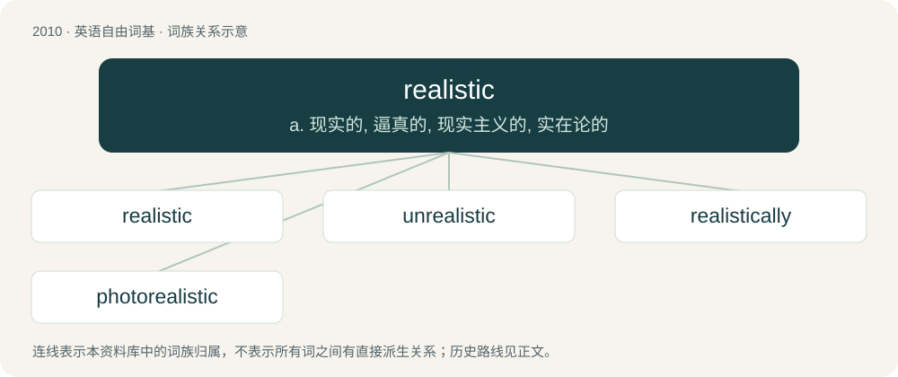

# 2123 · realistic — a. 现实的, 逼真的, 现实主义的, 实在论的

[总目录](../00_总目录_按常用程度.md)

**类型**：英语自由词基　｜　**来源语言**：见词源记录

## 核心含义与来源

- 核心含义：a. 现实的, 逼真的, 现实主义的, 实在论的
- 英文含义：Expressed or represented as being accurate, practicable, or not idealistic.
- 词形：realistic

**来源记录 1**（形容词；Expressed or represented as being accurate, practicable, or not idealistic.）

From realist + -ic.

## 词族图

## 单词速览（常用到不常用）

| 单词 | 音标 | 释义 |
|---|---|---|
| [realistic](#w-1) | /ˌɹɪəˈlɪs.tɪk/ | a. 现实的, 逼真的, 现实主义的, 实在论的 |
| [unrealistic](#w-2) | /.ʌnriəˈlistik/ | a. 不切实际的, 幻想的 |
| [realistically](#w-3) | /riəˈlistikli/ | adv. 写实地, 逼真地, 现实地 |
| [photorealistic](#w-4) | /ˌfoʊ.toʊˌɹiː.əlˈɪs.tɪk/ | n. 逼真；adj. 相片般真实的 |

## 逐词详解

### 1. realistic

**词性**：形容词　｜　**音标**：/ˌɹɪəˈlɪs.tɪk/

**中文释义**：a. 现实的, 逼真的, 现实主义的, 实在论的

**英文义项**：Expressed or represented as being accurate, practicable, or not idealistic. / Relating to the representation of objects, actions or conditions as they actually are or were.

**构词拆分**：realist + -ic

**词源与演化**：

From realist + -ic.

**例句**：

> A realistic novel about the Victorian poor.

该用例对应义项：Relating to the representation of objects, actions or conditions as they actually are or were.

### 2. unrealistic

**词性**：形容词　｜　**音标**：/.ʌnriəˈlistik/

**中文释义**：a. 不切实际的, 幻想的

**英文义项**：Not realistic.

**构词拆分**：un- + realistic

**词源与演化**：

From un- + realistic.

**例句**：

> Prices at unrealistic high levels.

该用例对应义项：not realistic

### 3. realistically

**词性**：副词　｜　**音标**：/riəˈlistikli/

**中文释义**：adv. 写实地, 逼真地, 现实地

**英文义项**：In a realistic manner. / According to what is real or possible.

**构词拆分**：realistic + -ally

**词源与演化**：

From realistic + -ally.

**例句**：

> Try all you want but realistically you've got no hope.

该用例对应义项：According to what is real or possible.

### 4. photorealistic

**词性**：形容词　｜　**音标**：/ˌfoʊ.toʊˌɹiː.əlˈɪs.tɪk/

**中文释义**：n. 逼真；adj. 相片般真实的

**英文义项**：Of or pertaining to photorealism.

**构词拆分**：photo- + realistic

**词源与演化**：

From photo- + realistic.
