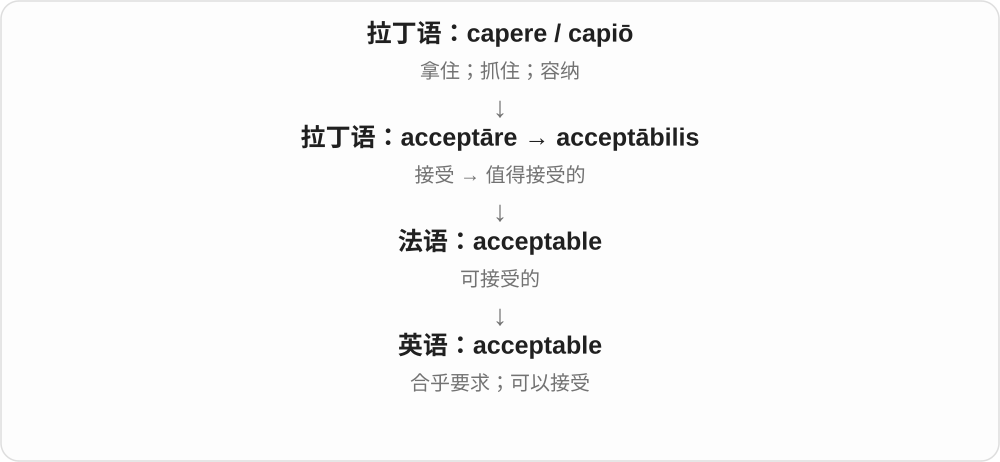

# 2124 · acceptable — 能否被接受、是否达到底线

[逐词精讲目录](../00_逐词精讲目录.md) · [总目录](../00_总目录_按常用程度.md)

## 核心词根与来源

可以接受不等于特别好，不能接受也要看什么标准。实物条件、行为、风险都可以这样评价。

**ACCEPTABLE：先问有没有达到接受标准**

acceptable → acceptably；unacceptable 把它否定，常明确表达拒绝。

- **标准、程度与否定**：acceptable · acceptably · unacceptable

## 词形与演化规律

accept 与 -able 相关 → acceptable；acceptable → acceptably；un- + acceptable。

## 单词速览（按词族由简到繁）

同一基础词的相关扩展放在一起，先读基础形式，再读扩展；各组之间优先读常用的。具体词源关系见各词讲解。

| 单词 | 音标 | 核心意思 |
|---|---|---|
| [acceptable](#w-1) | /əkˈseptəbəl/ | 可以接受的；达标的 |
| [acceptably](#w-3) | /əkˈseptəbli/ | 达到可接受程度地、令人可以接受地 |
| [unacceptable](#w-2) | /ˌʌnəkˈseptəbl/ | 不能接受的、不合格的、不容许的 |

## 逐词讲解

### 1. acceptable — 可以接受的；达标的

**音标**：/əkˈseptəbəl/

**先抓住这个画面**

想象给东西设一条最低标准：过了这条线，虽然未必出色，但能接受。这就是 acceptable。

**怎么拆**

现代分析是 accept + -able“可以被接受的”；英语词形也承接法语和晚期拉丁语 acceptābilis。

**怎么变成今天的意思**

它常用于质量、价格、行为和方案。acceptable 不自动等于 excellent：一个方案可以只是够用，但仍达到了你设定的条件。

**常见搭配与例句**

an acceptable solution；acceptable to someone；an acceptable standard。

> We need to find a solution that is acceptable to both sides.

我们需要找到双方都能接受的方案。

> The room was small, but the price was acceptable.

房间很小，但价格可以接受。

**别混淆**

acceptable 是能否接受；accepted 是已经被接受。一个尚无人采用的方案，也可能本身很合理、可接受。

### 2. acceptably — 达到可接受程度地、令人可以接受地

**音标**：/əkˈseptəbli/

**先抓住这个画面**

没有说做到顶尖，只说过了这件事所需的那条线；设备运行尚可，就是 works acceptably。

**怎么拆**

acceptable + -ly，-able 结尾变 -ably。acceptable 自身有较早借入、构词背景；现代关系可用 accept + -able 记。

**怎么变成今天的意思**

**accept + -able → acceptable**  
能够、愿意接受；达到可接受标准

↓

**性质的副词和否定**  
acceptably 以可接受程度；unacceptable 不可接受

perform acceptably 表现尚可，work acceptably 运转达到要求，acceptably accurate 精度可以接受。

**常见搭配与例句**

perform acceptably；work acceptably；acceptably accurate。

> The old computer still runs acceptably for basic tasks.

处理基本任务时，那台旧电脑运行仍算可以。

> The estimate was acceptably close to the final cost.

估计值与最终费用足够接近，可以接受。

**别混淆**

acceptably 不保证 excellently 极好；可接受程度由场景决定。acceptable 作形容词，acceptably 修饰动作或程度。

### 3. unacceptable — 不能接受的、不合格的、不容许的

**音标**：/ˌʌnəkˈseptəbl/

**先抓住这个画面**

不是还差一点漂亮，而是低于允许的底线，或违背你不能让步的原则。

**怎么拆**

un- 不 + acceptable，可对应较早英语相应形式。否定接受可能或许可，常比 merely poor 差带更强拒绝态度。

**怎么变成今天的意思**

**accept + -able → acceptable**  
能够、愿意接受；达到可接受标准

↓

**性质的副词和否定**  
acceptably 以可接受程度；unacceptable 不可接受

↓

**un- + acceptable → unacceptable**  
不达到接受条件、底线

unacceptable behaviour 不可接受的行为，an unacceptable risk 不可接受的风险，completely unacceptable 完全不能接受。

**常见搭配与例句**

unacceptable behaviour；an unacceptable risk；completely unacceptable。

> The delay was unacceptable to the customers.

顾客无法接受这次延误。

> The manager made it clear that such behaviour was unacceptable.

经理明确表示，这种行为不能接受。

**别混淆**

unacceptable 是按标准、原则作评价，不是 unable to accept 的所有句法替代；The room is unacceptable 是房间条件不行，不是房间不会接受东西。

## 这一组要分清什么

acceptably 不保证极好；unacceptable 侧重底线，常比一般不满意更强。

## 串起来练习

The first version worked acceptably, but the later failures were unacceptable.

第一版运行尚可，后来的故障却让人无法接受。
