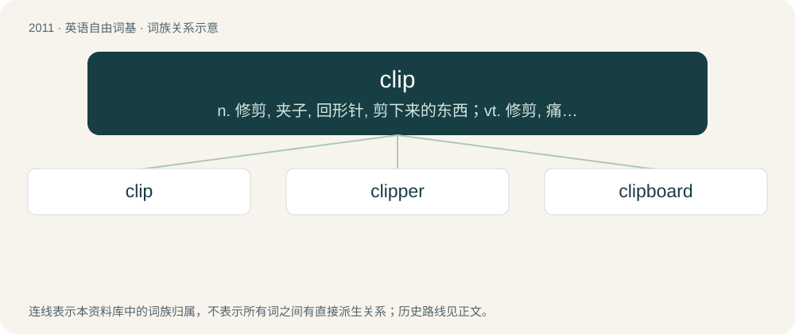

# 2124 · clip — n. 修剪, 夹子, 回形针, 剪下来的东西；vt. 修剪, 痛打, 夹牢, 剪报；vi. 剪报

[总目录](../00_总目录_按常用程度.md)

**类型**：英语自由词基　｜　**来源语言**：见词源记录

## 核心含义与来源

- 核心含义：n. 修剪, 夹子, 回形针, 剪下来的东西；vt. 修剪, 痛打, 夹牢, 剪报；vi. 剪报
- 英文含义：To grip tightly.
- 词形：clip

**多个词源／构词路径**：同一拼写可能有不同来源；以下按词性和含义分别列出。

**来源记录 1**（动词；To grip tightly.）

From Middle English clippen, cleppen, clüppen, from Old English clyppan (“to hug, embrace, cherish, clasp”), from Proto-Germanic \*klumpijaną, from Proto-Indo-European \*glemb-, \*glembʰ- (“lump, clump, clod, clamp”). Cognate with Old Frisian kleppa, klippa (“to hug, embrace”), Middle High German klimpen, klimpfen (“to contract tightly, constrict, squeeze”).

**来源记录 2**（动词；To cut, especially with scissors or shears as opposed to a knife etc.）

From Middle English clippen, from Old Norse klippa (“to clip, cut the hair, shear sheep”). Cognate with Icelandic klippa (“to clip”), Swedish klippa (“to clip”), Danish klippe (“to clip”), Norwegian Bokmål klippe (“to clip”).

## 词族图

## 单词速览（常用到不常用）

| 单词 | 音标 | 释义 |
|---|---|---|
| [clip](#w-1) | /klɪp/ | n. 修剪, 夹子, 回形针, 剪下来的东西；vt. 修剪, 痛打, 夹牢, 剪报；vi. 剪报 |
| [clipper](#w-2) | 英 /ˈklɪp.ə/；美 /ˈklɪp.ɚ/ | n. 大剪刀；\[电\] 截割器 |
| [clipboard](#w-3) | /ˈklipbɒːd/ | n. 有纸夹的写字板, 剪贴板；\[计\] 剪贴板 |

## 逐词详解

### 1. clip

**词性**：动词　｜　**音标**：/klɪp/

**中文释义**：n. 修剪, 夹子, 回形针, 剪下来的东西；vt. 修剪, 痛打, 夹牢, 剪报；vi. 剪报

**英文义项**：To grip tightly. / To fasten with a clip.

**词源与演化**：

From Middle English clippen, cleppen, clüppen, from Old English clyppan (“to hug, embrace, cherish, clasp”), from Proto-Germanic \*klumpijaną, from Proto-Indo-European \*glemb-, \*glembʰ- (“lump, clump, clod, clamp”). Cognate with Old Frisian kleppa, klippa (“to hug, embrace”), Middle High German klimpen, klimpfen (“to contract tightly, constrict, squeeze”).

**例句**：

> Please clip the photos to the pages where they will go.

该用例对应义项：To fasten with a clip.

### 2. clipper

**词性**：名词　｜　**音标**：英 /ˈklɪp.ə/；美 /ˈklɪp.ɚ/

**中文释义**：n. 大剪刀；\[电\] 截割器

**英文义项**：Anything or anyone that clips. / A tool used for clipping something, such as hair, coins, or fingernails.

**构词拆分**：clip (“cut, shorten”) + -er (suffix forming agent nouns)

**词源与演化**：

From Middle English clipper, equivalent to clip (“cut, shorten”) + -er (suffix forming agent nouns). The type of sailing ship is probably also from clip, in the sense of “move or run rapidly”. Perhaps influenced by Middle Dutch klepper (“swift horse”), from kleppen (“to clap”), which is onomatopoeic.

**例句**：

> Do you have a nail clipper I could use?

### 3. clipboard

**词性**：名词　｜　**音标**：/ˈklipbɒːd/

**中文释义**：n. 有纸夹的写字板, 剪贴板；\[计\] 剪贴板

**英文义项**：A flat piece of rigid material, such as card or plastic, with a clip at one end under which papers can be held. / A buffer in memory where the user can store data temporarily while transferring it from one place within an application to another or between applications.

**构词拆分**：clip + board

**词源与演化**：

From clip + board.

**例句**：

> Tom entered the conference room, carrying a clipboard.
