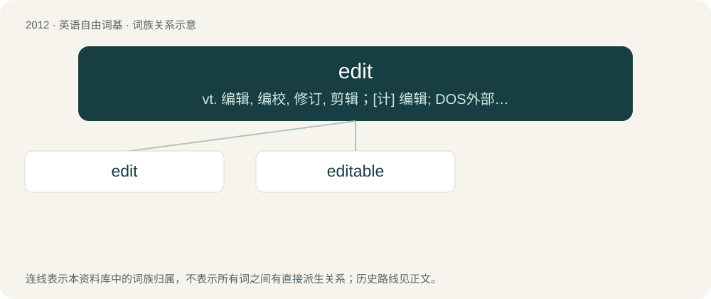

# 2125 · edit — vt. 编辑, 编校, 修订, 剪辑；\[计\] 编辑; DOS外部命令:该命令是一个用于编辑文本文件的全屏幕编辑程序

[总目录](../00_总目录_按常用程度.md)

**类型**：英语自由词基　｜　**来源语言**：见词源记录

## 核心含义与来源

- 核心含义：vt. 编辑, 编校, 修订, 剪辑；\[计\] 编辑; DOS外部命令:该命令是一个用于编辑文本文件的全屏幕编辑程序
- 英文含义：A change to the text of a document.
- 词形：edit

**来源记录 1**（名词；A change to the text of a document.）

Back-formation from editor, influenced by French éditer (“edit, publish”) and Latin editus.

## 词族图

## 单词速览（常用到不常用）

| 单词 | 音标 | 释义 |
|---|---|---|
| [edit](#w-1) | 英 /ˈɛdɪt/；美 /ˈɛdɪt/ | vt. 编辑, 编校, 修订, 剪辑；\[计\] 编辑; DOS外部命令:该命令是一个用于编辑文本文件的全屏幕编辑程序 |
| [editable](#w-2) | /ˈeditəbl/ | a. 可编辑的 |

## 逐词详解

### 1. edit

**词性**：名词　｜　**音标**：英 /ˈɛdɪt/；美 /ˈɛdɪt/

**中文释义**：vt. 编辑, 编校, 修订, 剪辑；\[计\] 编辑; DOS外部命令:该命令是一个用于编辑文本文件的全屏幕编辑程序

**英文义项**：A change to the text of a document. / A change in the text of a file, a website or the code of software.

**词源与演化**：

Back-formation from editor, influenced by French éditer (“edit, publish”) and Latin editus.

**例句**：

> An early edit of the film included a romantic subplot.

该用例对应义项：An edited piece of media, especially video footage.

### 2. editable

**词性**：形容词　｜　**音标**：/ˈeditəbl/

**中文释义**：a. 可编辑的

**英文义项**：Capable of being edited.

**构词拆分**：edit + -able

**词源与演化**：

From edit + -able.

**例句**：

> This page is editable by anyone.

该用例对应义项：Capable of being edited.
