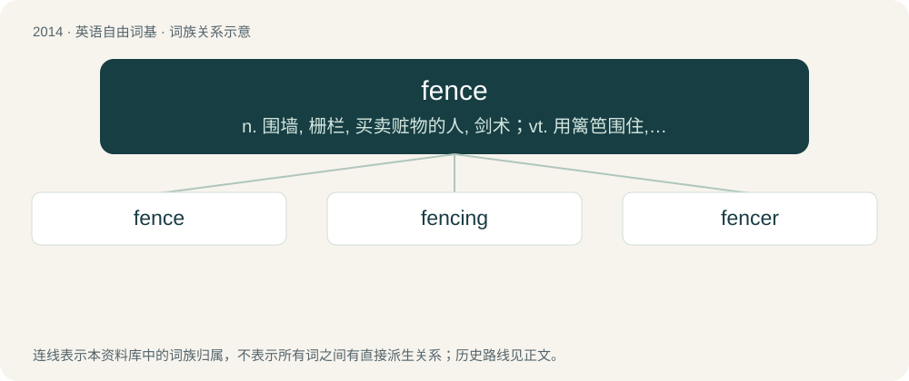

# 2128 · fence — n. 围墙, 栅栏, 买卖赃物的人, 剑术；vt. 用篱笆围住, 练习剑术, 防护；vi. 击剑, 搪塞

[总目录](../00_总目录_按常用程度.md)

**类型**：英语自由词基　｜　**来源语言**：见词源记录

## 核心含义与来源

- 核心含义：n. 围墙, 栅栏, 买卖赃物的人, 剑术；vt. 用篱笆围住, 练习剑术, 防护；vi. 击剑, 搪塞
- 英文含义：A thin artificial barrier that separates two pieces of land or forms a perimeter enclosing the lands of a house, building, etc.
- 词形：fence

**来源记录 1**（名词；A thin artificial barrier that separates two pieces of land or forms a perimeter enclosing the lands of a house, building, etc.）

From Middle English fence, fens, short for defence, defens (“the act of defending”), from Old French defens, defense (see defence). The sense "enclosure" arises in the mid 15th century. Also from the 15th century is use as a verb in the sense "to enclose with a fence". The generalized sense "to defend, screen, protect" arises ca. 1500. The sense "to fight with swords (rapiers)" is from the 1590s (Shakespeare). Displaced native Old English heġe (compare Modern English hedge).

## 词族图

## 单词速览（常用到不常用）

| 单词 | 音标 | 释义 |
|---|---|---|
| [fence](#w-1) | /fɛns/ | n. 围墙, 栅栏, 买卖赃物的人, 剑术；vt. 用篱笆围住, 练习剑术, 防护；vi. 击剑, 搪塞 |
| [fencing](#w-2) | /ˈfɛnsɪŋ/ | n. 围墙, 剑术；\[法\] 围栏, 买卖赃物, 辩论 |
| [fencer](#w-3) | 英 /ˈfɛnsə/；美 /ˈfɛnsəɹ/ | n. 剑术师, 剑术家, 篱笆匠 |

## 逐词详解

### 1. fence

**词性**：名词　｜　**音标**：/fɛns/

**中文释义**：n. 围墙, 栅栏, 买卖赃物的人, 剑术；vt. 用篱笆围住, 练习剑术, 防护；vi. 击剑, 搪塞

**英文义项**：A thin artificial barrier that separates two pieces of land or forms a perimeter enclosing the lands of a house, building, etc. / Someone who hides or buys and sells stolen goods, a criminal middleman for transactions of stolen goods.

**词源与演化**：

From Middle English fence, fens, short for defence, defens (“the act of defending”), from Old French defens, defense (see defence). The sense "enclosure" arises in the mid 15th century. Also from the 15th century is use as a verb in the sense "to enclose with a fence". The generalized sense "to defend, screen, protect" arises ca. 1500. The sense "to fight with swords (rapiers)" is from the 1590s (Shakespeare). Displaced native Old English heġe (compare Modern English hedge).

**例句**：

> What I want him to do now is to paint the fence.

### 2. fencing

**词性**：名词　｜　**音标**：/ˈfɛnsɪŋ/

**中文释义**：n. 围墙, 剑术；\[法\] 围栏, 买卖赃物, 辩论

**英文义项**：The art or sport of duelling with swords, especially with the 17th- to 18th-century European dueling swords and the practice weapons descended from them (sport fencing). / Material used to make fences, fences used as barriers or an enclosure.

**构词拆分**：fence + -ing

**词源与演化**：

From Middle English fensing, equivalent to fence + -ing.

**例句**：

> Fencing was erected around the field to keep the horses in.

该用例对应义项：Material used to make fences, fences used as barriers or an enclosure.

### 3. fencer

**词性**：名词　｜　**音标**：英 /ˈfɛnsə/；美 /ˈfɛnsəɹ/

**中文释义**：n. 剑术师, 剑术家, 篱笆匠

**英文义项**：A participant in the sport of fencing. / A person who makes, installs, repairs, or maintains fences.

**构词拆分**：From fence + -er.

**词源与演化**：

From fence + -er.
