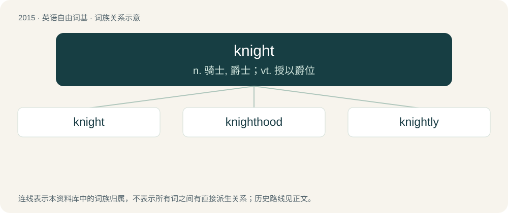

# 2129 · knight — n. 骑士, 爵士；vt. 授以爵位

[总目录](../00_总目录_按常用程度.md)

**类型**：英语自由词基　｜　**来源语言**：见词源记录

## 核心含义与来源

- 核心含义：n. 骑士, 爵士；vt. 授以爵位
- 英文含义：An armored and mounted warrior of the Middle Ages.
- 词形：knight

**多个词源／构词路径**：同一拼写可能有不同来源；以下按词性和含义分别列出。

**来源记录 1**（名词；An armored and mounted warrior of the Middle Ages.）

From Middle English knight, knyght, kniht, from Old English cniht (“boy; servant, knight”), from Proto-West Germanic \*kneht.

**来源记录 2**（动词；To confer knighthood upon.）

From Middle English knighten, kniȝten, from the noun. Cognate with Middle High German knehten.

## 词族图

## 单词速览（常用到不常用）

| 单词 | 音标 | 释义 |
|---|---|---|
| [knight](#w-1) | 英 /ˈnaɪ̯t/；/ˈnɐɪ̯t/ | n. 骑士, 爵士；vt. 授以爵位 |
| [knighthood](#w-2) | /ˈnaithud/ | n. 骑士身分, 骑士气质, 骑士 |
| [knightly](#w-3) | /ˈnaɪtli/ | a. 骑士的, 勇敢的, 侠义的 |

## 逐词详解

### 1. knight

**词性**：名词　｜　**音标**：英 /ˈnaɪ̯t/；/ˈnɐɪ̯t/

**中文释义**：n. 骑士, 爵士；vt. 授以爵位

**英文义项**：An armored and mounted warrior of the Middle Ages. / A person on whom a knighthood has been conferred by a monarch.

**词源与演化**：

From Middle English knight, knyght, kniht, from Old English cniht (“boy; servant, knight”), from Proto-West Germanic \*kneht.

**用法示例／搭配（非完整句）**：

> King Arthur and the Knights of the Round Table

该用例对应义项：An armored and mounted warrior of the Middle Ages.

### 2. knighthood

**词性**：名词　｜　**音标**：/ˈnaithud/

**中文释义**：n. 骑士身分, 骑士气质, 骑士

**英文义项**：An honour whereby one is made into a knight, and whereafter one is entitled to be called Sir. / The quality of being a knight.

**构词拆分**：knight + -hood

**词源与演化**：

From Middle English knyghthode, knyȝthod, from Old English cnihthād, from Proto-West Germanic \*knehtahaidu, equivalent to knight + -hood. Cognate with Dutch knechtheid, dialectal German Knechtheit.

**例句**：

> He's got an OBE and MBE, and his recent work should entitle him to a knighthood.

该用例对应义项：An honour whereby one is made into a knight, and whereafter one is entitled to be called Sir.

### 3. knightly

**词性**：形容词　｜　**音标**：/ˈnaɪtli/

**中文释义**：a. 骑士的, 勇敢的, 侠义的

**英文义项**：Of or pertaining to a knight or knights. / Befitting a knight; formally courteous (as a knight); chivalrous, gallant and courtly.

**构词拆分**：knight + -ly (adjectival suffix)

**词源与演化**：

From Middle English knyghtly, knightlich; equivalent to knight + -ly (adjectival suffix). Cognate with Old English cnihtlīċ (“boyish”), Dutch knechtelijk (“servile”), German knechtlich (“menial”).

**用法示例／搭配（非完整句）**：

> knightly combat

该用例对应义项：Befitting a knight; formally courteous (as a knight); chivalrous, gallant and courtly.
