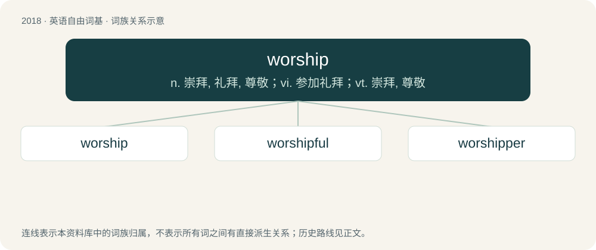

# 2131 · worship — n. 崇拜, 礼拜, 尊敬；vi. 参加礼拜；vt. 崇拜, 尊敬

[总目录](../00_总目录_按常用程度.md)

**类型**：英语自由词基　｜　**来源语言**：见词源记录

## 核心含义与来源

- 核心含义：n. 崇拜, 礼拜, 尊敬；vi. 参加礼拜；vt. 崇拜, 尊敬
- 英文含义：The devotion accorded to a deity or to a sacred object.
- 词形：worship

**来源记录 1**（名词；The devotion accorded to a deity or to a sacred object.）

Inherited from Middle English worschippe /worthschipe, inherited from Old English weorþsċiepe. Cognate with Scots worschip (“worship”). By surface analysis, wor(th) + -ship.

## 词族图

## 单词速览（常用到不常用）

| 单词 | 音标 | 释义 |
|---|---|---|
| [worship](#w-1) | 英 /ˈwɜː.ʃɪp/；美 /ˈwɝ.ʃɪp/ | n. 崇拜, 礼拜, 尊敬；vi. 参加礼拜；vt. 崇拜, 尊敬 |
| [worshipful](#w-2) | 英 /ˈwɜːʃɪpfl̩/；美 /ˈwɝʃɪpfl̩/ | a. 崇拜的, 尊敬的, 尊贵的 |
| [worshipper](#w-3) | 英 /ˈwɜːʃɪpə/；美 /ˈwɝʃɪpɚ/ | n. 礼拜者, 崇拜者, 爱慕者 |

## 逐词详解

### 1. worship

**词性**：名词　｜　**音标**：英 /ˈwɜː.ʃɪp/；美 /ˈwɝ.ʃɪp/

**中文释义**：n. 崇拜, 礼拜, 尊敬；vi. 参加礼拜；vt. 崇拜, 尊敬

**英文义项**：The devotion accorded to a deity or to a sacred object. / The adoration (or latria) owed to God alone, as greater than the hyperdulia that is given to Saint Mary only and the veneration (or dulia) accorded to all other Roman Catholic saints.

**构词拆分**：By surface analysis, wor(th) + -ship

**词源与演化**：

Inherited from Middle English worschippe /worthschipe, inherited from Old English weorþsċiepe. Cognate with Scots worschip (“worship”). By surface analysis, wor(th) + -ship.

**例句**：

> Polytheistic theology and worship had to go underground.

该用例对应义项：The devotion accorded to a deity or to a sacred object.

### 2. worshipful

**词性**：形容词　｜　**音标**：英 /ˈwɜːʃɪpfl̩/；美 /ˈwɝʃɪpfl̩/

**中文释义**：a. 崇拜的, 尊敬的, 尊贵的

**英文义项**：Tending to worship; showing reverence. / Used as respectful form of address or honorific title for a person or body of persons, now especially in the name of a livery company.

**构词拆分**：worship + -ful

**词源与演化**：

From Middle English worshipful; equivalent to worship + -ful.

### 3. worshipper

**词性**：名词　｜　**音标**：英 /ˈwɜːʃɪpə/；美 /ˈwɝʃɪpɚ/

**中文释义**：n. 礼拜者, 崇拜者, 爱慕者

**英文义项**：A person who worships, especially at a place of assembly for religious services.

**构词拆分**：worship + -er

**词源与演化**：

Inherited from Middle English wirshiper, worchyppar, worscheper, worschepour, worschiper, worschippar, worshipore; equivalent to worship + -er.

**例句**：

> The temple was filled with worshippers.

该用例对应义项：A person who worships, especially at a place of assembly for religious services.
