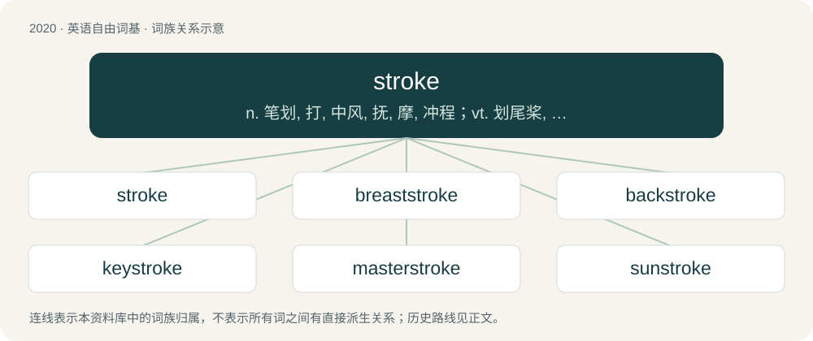

# 2132 · stroke — n. 笔划, 打, 中风, 抚, 摩, 冲程；vt. 划尾桨, 抚, 摩, 划去；\[计\] 笔划

[总目录](../00_总目录_按常用程度.md)

**类型**：英语自由词基　｜　**来源语言**：见词源记录

## 核心含义与来源

- 核心含义：n. 笔划, 打, 中风, 抚, 摩, 冲程；vt. 划尾桨, 抚, 摩, 划去；\[计\] 笔划
- 英文含义：An act of hitting; a blow, a hit.
- 词形：stroke

**多个词源／构词路径**：同一拼写可能有不同来源；以下按词性和含义分别列出。

**来源记录 1**（名词；An act of hitting; a blow, a hit.）

The noun is derived from Middle English strok, stroke (“blow from a weapon, cut”), from Old English strāc, from Proto-West Germanic \*straik, from Proto-Germanic \*straikaz (“stroke”), from Proto-Indo-European \*streyg- (“to rub, stroke; to shear; to strike”). Sense 3.5.2.2 (“the oblique, slash, or virgule (‘/’)”) is a contraction of oblique stroke, a variant of oblique which was originally used in telegraphy. The verb is derived from the noun. Cognates \* German Streich (“stroke”) \* Middle Low German strēk (“stroke, trick, prank”) \* Scots strak, strake, straik (“blow, stroke”)

**来源记录 2**（动词；To move one's hand or an object (such as a broom or brush) along (a surface) in one direction, touching it lightly; to caress.）

The verb is derived from Middle English stroken, straken (“to caress, fondle, pat, rub, smooth, stroke; to pass something over (someone or something); to brush or rub against;”) \[and other forms\], from Old English strācian (“to stroke”), from Proto-West Germanic \*straikōn (“to caress, stroke”), from \*straik (“a line, stroke; a dash”) (see further at etymology 1) + \*-ōn (suffix forming verbs from nouns). The noun is derived from the verb. Cognates \* German streicheln (“to stroke, fondle”) \* German Low German straken, strieken, strakeln, striekeln (“to stroke; caress; fondle”) \* Middle Low German strēken, Middle Dutch strēken (modern Dutch streeken) \* Old High German strīhhan, streihhōn, Middle High German strīchen (modern German streichen (“to stroke; to rub; to spread; to apply; to paint; to cancel; to cross out, strike out; to delete; to discard”)) \* Saterland Frisian strookje (“to stroke; caress”) \* West Frisian streakje (“to stroke; caress”)

## 词族图

## 单词速览（常用到不常用）

| 单词 | 音标 | 释义 |
|---|---|---|
| [stroke](#w-1) | 英 /stɹəʊk/；美 /stɹoʊk/ | n. 笔划, 打, 中风, 抚, 摩, 冲程；vt. 划尾桨, 抚, 摩, 划去；\[计\] 笔划 |
| [breaststroke](#w-2) | 美 /ˈbɹɛstˌstɹoʊk/ | n. 俯泳 |
| [backstroke](#w-3) | 美 /ˈbækˌstɹoʊk/ | n. 还击, 反手击球, 仰泳；vi. 还击, 反手击球, 仰泳；vt. 用反手击 |
| [keystroke](#w-4) | /ˈkiːstrəuk/ | n. 键击；\[计\] 按键, 击键 |
| [masterstroke](#w-5) | /ˈmɑːstəstrəuk/ | n. 巧妙动作, 神技, 卓越成就 |
| [sunstroke](#w-6) | 美 /ˈsʌnˌstɹoʊk/ | n. 中暑；\[医\] 日射病, 中暑 |

## 逐词详解

### 1. stroke

**词性**：名词　｜　**音标**：英 /stɹəʊk/；美 /stɹoʊk/

**中文释义**：n. 笔划, 打, 中风, 抚, 摩, 冲程；vt. 划尾桨, 抚, 摩, 划去；\[计\] 笔划

**英文义项**：An act of hitting; a blow, a hit. / An act of striking with a weapon; a blow.

**词源与演化**：

The noun is derived from Middle English strok, stroke (“blow from a weapon, cut”), from Old English strāc, from Proto-West Germanic \*straik, from Proto-Germanic \*straikaz (“stroke”), from Proto-Indo-European \*streyg- (“to rub, stroke; to shear; to strike”). Sense 3.5.2.2 (“the oblique, slash, or virgule (‘/’)”) is a contraction of oblique stroke, a variant of oblique which was originally used in telegraphy. The verb is derived from the noun. Cognates \* German Streich (“stroke”) \* Middle Low German strēk (“stroke, trick, prank”) \* Scots strak, strake, straik (“blow, stroke”)

**例句**：

> For the pistons of a four-stroke engine, the exhaust stroke follows the power stroke.

该用例对应义项：A single movement or thrust of a reciprocating device (such as a piston or connecting rod).

### 2. breaststroke

**词性**：名词　｜　**音标**：美 /ˈbɹɛstˌstɹoʊk/

**中文释义**：n. 俯泳

**英文义项**：A swimming stroke in which the swimmer lies face down, the arms being swept forward, outward and back under the water and the legs are kicked like a frog's

**构词拆分**：breast + stroke

**词源与演化**：

From breast + stroke.

**例句**：

> I can do the breaststroke but not the backstroke.

### 3. backstroke

**词性**：名词　｜　**音标**：美 /ˈbækˌstɹoʊk/

**中文释义**：n. 还击, 反手击球, 仰泳；vi. 还击, 反手击球, 仰泳；vt. 用反手击

**英文义项**：A backhanded stroke or blow. / A stroke swum lying on one's back, while rotating both arms through the water as to propel the swimmer backwards.

**构词拆分**：back + stroke

**词源与演化**：

From back + stroke.

**例句**：

> No matter how hard I practiced, I wasn't able to do the backstroke.

### 4. keystroke

**词性**：名词　｜　**音标**：/ˈkiːstrəuk/

**中文释义**：n. 键击；\[计\] 按键, 击键

**英文义项**：The act of pressing an input key on a computer keyboard, typewriter, or similar input device. / A keyboard shortcut.

**构词拆分**：key + stroke

**词源与演化**：

From key + stroke.

### 5. masterstroke

**词性**：名词　｜　**音标**：/ˈmɑːstəstrəuk/

**中文释义**：n. 巧妙动作, 神技, 卓越成就

**英文义项**：An action which demonstrates great skill or artistry.

**构词拆分**：master + stroke

**词源与演化**：

From master + stroke.

### 6. sunstroke

**词性**：名词　｜　**音标**：美 /ˈsʌnˌstɹoʊk/

**中文释义**：n. 中暑；\[医\] 日射病, 中暑

**英文义项**：Heat stroke caused by an excessive exposure to the sun's rays.

**构词拆分**：sun + stroke

**词源与演化**：

From sun + stroke.
