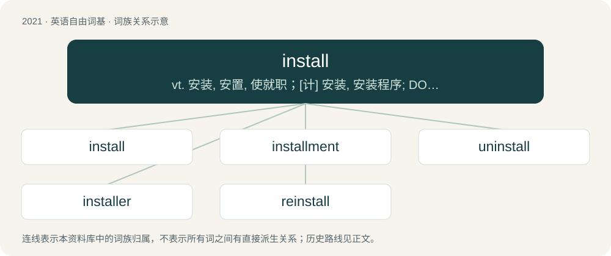

# 2133 · install — vt. 安装, 安置, 使就职；\[计\] 安装, 安装程序; DOS内部命令:安装常驻程序

[总目录](../00_总目录_按常用程度.md)

**类型**：英语自由词基　｜　**来源语言**：见词源记录

## 核心含义与来源

- 核心含义：vt. 安装, 安置, 使就职；\[计\] 安装, 安装程序; DOS内部命令:安装常驻程序
- 英文含义：To connect, set up or prepare something for use
- 词形：install

**来源记录 1**（动词；To connect, set up or prepare something for use）

From Middle English installen, from Old French installer, from Medieval Latin īnstallō (“to install, put in place, establish”), from in- + stallum (“stall”), from Frankish \*stall (“stall, position, place”), from Proto-Germanic \*stallaz (“place, position”), from Proto-Indo-European \*stel-, \*stAlǝn-, \*stAlǝm- (“stem, trunk”). Cognate with Old High German stal (“location, stall”), Old English steall (“position, stall”), Old English onstellan (“to institute, create, originate, establish, give the example of”), Middle High German anstalt (“institute”), German anstellen (“to conduct, employ”), German einstellen (“to set, adjust, position”), Dutch aanstellen (“to appoint, commission, institute”), Dutch instellen (“to set up, establish”). More at in, stall.

## 词族图

## 单词速览（常用到不常用）

| 单词 | 音标 | 释义 |
|---|---|---|
| [install](#w-1) | 英 /ɪnˈstɔːl/；美 /ɪnˈstɔl/ | vt. 安装, 安置, 使就职；\[计\] 安装, 安装程序; DOS内部命令:安装常驻程序 |
| [installment](#w-2) | 英 /ɪnˈstɔːl.mənt/；/ɪnˈstɔl.mənt/ | 【英文】The act of installing; installation. |
| [uninstall](#w-3) |  | 取消装载 |
| [installer](#w-4) |  | n. 安装者 |
| [reinstall](#w-5) | /.riːinˈstɔːl/ | vt. 使从新正式就职；重新设置, 重新安装 |

## 逐词详解

### 1. install

**词性**：动词　｜　**音标**：英 /ɪnˈstɔːl/；美 /ɪnˈstɔl/

**中文释义**：vt. 安装, 安置, 使就职；\[计\] 安装, 安装程序; DOS内部命令:安装常驻程序

**英文义项**：To connect, set up or prepare something for use / To transfer software onto a device's permanent storage and put it in a state where it is ready to be run when needed, usually decompressing it if necessary and performing any necessary pre-first-run configuration.

**词源与演化**：

From Middle English installen, from Old French installer, from Medieval Latin īnstallō (“to install, put in place, establish”), from in- + stallum (“stall”), from Frankish \*stall (“stall, position, place”), from Proto-Germanic \*stallaz (“place, position”), from Proto-Indo-European \*stel-, \*stAlǝn-, \*stAlǝm- (“stem, trunk”). Cognate with Old High German stal (“location, stall”), Old English steall (“position, stall”), Old English onstellan (“to institute, create, originate, establish, give the example of”), Middle High German anstalt (“institute”), German anstellen (“to conduct, employ”), German einstellen (“to set, adjust, position”), Dutch aanstellen (“to appoint, commission, institute”), Dutch instellen (“to set up, establish”). More at in, stall.

**例句**：

> I haven't installed the new operating system yet because of all the bugs.

该用例对应义项：To transfer software onto a device's permanent storage and put it in a state where it is ready to be run when needed, usually decompressing it if necessary and performing any necessary pre-first-run configuration.

### 2. installment

**词性**：名词　｜　**音标**：英 /ɪnˈstɔːl.mənt/；/ɪnˈstɔl.mənt/

**英文义项**：The act of installing; installation.

**构词拆分**：install + -ment

**词源与演化**：

From install + -ment, install from Old French installer, from Medieval Latin installare, from Medieval Latin in- and Medieval Latin stallum, stall from a Germanic source (compare Old High German stal).

### 3. uninstall

**词性**：动词

**中文释义**：取消装载

**英文义项**：To completely remove hardware or software from a computer system.

**构词拆分**：un- + install

**词源与演化**：

From un- + install.

**例句**：

> Go into the Device Manager and uninstall all the Universal Serial Bus controllers.

### 4. installer

**词性**：名词

**中文释义**：n. 安装者

**英文义项**：One who installs. / A program that installs software in a computer and prepares it for use.

**构词拆分**：install + -er

**词源与演化**：

From install + -er.

**例句**：

> Tom ran the game installer and waited for the game to finish installing.

### 5. reinstall

**词性**：名词　｜　**音标**：/.riːinˈstɔːl/

**中文释义**：vt. 使从新正式就职；重新设置, 重新安装

**英文义项**：reinstallation

**构词拆分**：re- + install

**词源与演化**：

From re- + install.

**例句**：

> I tried removing and reinstalling the software, but the reinstall failed.

该用例对应义项：reinstallation
