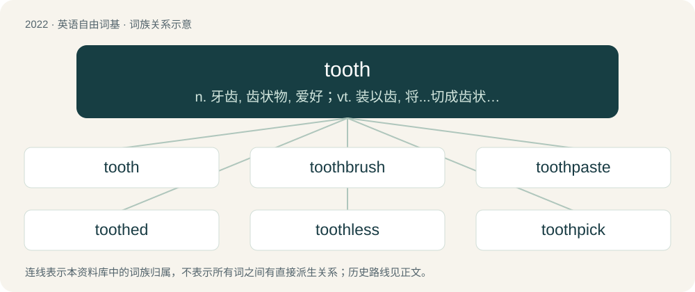

# 2134 · tooth — n. 牙齿, 齿状物, 爱好；vt. 装以齿, 将...切成齿状；vi. 啮合

[总目录](../00_总目录_按常用程度.md)

**类型**：英语自由词基　｜　**来源语言**：见词源记录

## 核心含义与来源

- 核心含义：n. 牙齿, 齿状物, 爱好；vt. 装以齿, 将...切成齿状；vi. 啮合
- 英文含义：A hard, calcareous structure present in the mouth of many vertebrate animals, generally used for biting and chewing food.
- 词形：tooth

**来源记录 1**（名词；A hard, calcareous structure present in the mouth of many vertebrate animals, generally used for biting and chewing food.）

From Middle English toth, tothe, tooth, from Old English tōþ, from Proto-West Germanic \*tanþ, from Proto-Germanic \*tanþs, from Proto-Indo-European \*h₃dónts (“tooth”). Doublet of dent, dens, tind, and tine. Related to tusk. Cognates Cognate with Scots tuith (“tooth”), North Frisian Ter, teän, tosch, toske, tuis, tus, tusch, täis (“tooth”), Saterland Frisian Tusk (“tooth”), West Frisian tosk (“tooth”), Bavarian Zåhn (“tooth”), Dutch tand (“tooth”), German Zahn (“tooth”), Limburgish tandj (“tooth”), Luxembourgish Zant (“tooth”), Vilamovian cōn (“tooth”), Yiddish צאָן (tson, “tooth”), Danish and Swedish tand (“tooth”), Faroese tonn (“tooth”), Icelandic tönn (“tooth”), Norn \*tann, \*tant (“tooth”), Norwegian Bokmål tann (“tooth”), Norwegian Nynorsk tann, tonn (“tooth”), Breton and Welsh dant (“tooth”), Cornish dans (“tooth”), Irish déad (“tooth”), Scottish Gaelic deud (“tooth”), Asturian, Leonese, Mirandese, and Spanish diente (“tooth”), Aragonese dien (“tooth”), Catalan and French dent (“tooth”), Galician, Italian, and Portuguese dente (“tooth”), Romanian dinte (“tooth”), Latin dēns (“tooth”), Ancient Greek ὀδούς (odoús), ὀδών (odṓn, “tooth”), Lithuanian dantis (“tooth”), Belarusian дзясна́ (dzjasná, “gum”), Bulgarian and Russian десна (desna, “gum”), Czech dáseň (“gum”), Polish dziąsło (“gum”), Serbo-Croatian dȇsni (“gum”), Slovak ďasno (“gum”), Slovene dlesni (“gum”), Ukrainian я́сна (jásna, “gum”), Armenian ատամ (atam, “tooth”), Ossetian дӕндаг (dændag, “tooth”), Baluchi دنتان (dantán), دتھاں (datʰāⁿ, “tooth”), Central Kurdish ددان (ddan, “tooth”), Northern Kurdish didan, diran (“tooth”), Persian دندان (dandân, “tooth”), Sanskrit दत् (dat), दन्त (danta, “tooth”).

## 词族图

## 单词速览（常用到不常用）

| 单词 | 音标 | 释义 |
|---|---|---|
| [tooth](#w-1) | 英 /tuːθ/；美 /tuθ/ | n. 牙齿, 齿状物, 爱好；vt. 装以齿, 将...切成齿状；vi. 啮合 |
| [toothbrush](#w-2) | 英 /ˈtuːθ.bɹʌʃ/；美 /ˈtuθ.bɹʌʃ/ | n. 牙刷 |
| [toothpaste](#w-3) | 英 /ˈtuːθpeɪst/；美 /ˈtuθpeɪst/ | n. 牙膏；\[化\] 牙膏 |
| [toothed](#w-4) | /tuːθt/ | a. 有齿的, 锯齿的, 锯齿状的 |
| [toothless](#w-5) | 美 /ˈtuθləs/ | a. 无齿的；\[医\] 无牙的 |
| [toothpick](#w-6) | /ˈtuːθ.pɪk/ | n. 牙签 |
| [sawtooth](#w-7) | /ˈsɔːtuːθ/ | n. 锯齿 |
| [toothy](#w-8) | /ˈtuː.θi/ | a. 露齿的 |
| [houndstooth](#w-9) | 英 /ˈhaʊndstuːθ/ | n. & adj.\[纺\]犬牙织纹(的), 犬牙花纹(的) |

## 逐词详解

### 1. tooth

**词性**：名词　｜　**音标**：英 /tuːθ/；美 /tuθ/

**中文释义**：n. 牙齿, 齿状物, 爱好；vt. 装以齿, 将...切成齿状；vi. 啮合

**英文义项**：A hard, calcareous structure present in the mouth of many vertebrate animals, generally used for biting and chewing food. / A sharp projection on the blade of a saw or similar implement.

**词源与演化**：

From Middle English toth, tothe, tooth, from Old English tōþ, from Proto-West Germanic \*tanþ, from Proto-Germanic \*tanþs, from Proto-Indo-European \*h₃dónts (“tooth”). Doublet of dent, dens, tind, and tine. Related to tusk. Cognates Cognate with Scots tuith (“tooth”), North Frisian Ter, teän, tosch, toske, tuis, tus, tusch, täis (“tooth”), Saterland Frisian Tusk (“tooth”), West Frisian tosk (“tooth”), Bavarian Zåhn (“tooth”), Dutch tand (“tooth”), German Zahn (“tooth”), Limburgish tandj (“tooth”), Luxembourgish Zant (“tooth”), Vilamovian cōn (“tooth”), Yiddish צאָן (tson, “tooth”), Danish and Swedish tand (“tooth”), Faroese tonn (“tooth”), Icelandic tönn (“tooth”), Norn \*tann, \*tant (“tooth”), Norwegian Bokmål tann (“tooth”), Norwegian Nynorsk tann, tonn (“tooth”), Breton and Welsh dant (“tooth”), Cornish dans (“tooth”), Irish déad (“tooth”), Scottish Gaelic deud (“tooth”), Asturian, Leonese, Mirandese, and Spanish diente (“tooth”), Aragonese dien (“tooth”), Catalan and French dent (“tooth”), Galician, Italian, and Portuguese dente (“tooth”), Romanian dinte (“tooth”), Latin dēns (“tooth”), Ancient Greek ὀδούς (odoús), ὀδών (odṓn, “tooth”), Lithuanian dantis (“tooth”), Belarusian дзясна́ (dzjasná, “gum”), Bulgarian and Russian десна (desna, “gum”), Czech dáseň (“gum”), Polish dziąsło (“gum”), Serbo-Croatian dȇsni (“gum”), Slovak ďasno (“gum”), Slovene dlesni (“gum”), Ukrainian я́сна (jásna, “gum”), Armenian ատամ (atam, “tooth”), Ossetian дӕндаг (dændag, “tooth”), Baluchi دنتان (dantán), دتھاں (datʰāⁿ, “tooth”), Central Kurdish ددان (ddan, “tooth”), Northern Kurdish didan, diran (“tooth”), Persian دندان (dandân, “tooth”), Sanskrit दत् (dat), दन्त (danta, “tooth”).

**例句**：

> I have a sweet tooth: I love sugary treats.

该用例对应义项：Liking, fondness (compare toothsome).

### 2. toothbrush

**词性**：名词　｜　**音标**：英 /ˈtuːθ.bɹʌʃ/；美 /ˈtuθ.bɹʌʃ/

**中文释义**：n. 牙刷

**英文义项**：A brush, used with toothpaste, for cleaning the teeth.

**构词拆分**：tooth + brush

**词源与演化**：

From tooth + brush. Compare Saterland Frisian Tuskebäärsel (“toothbrush”), West Frisian toskboarstel (“toothbrush”), Dutch tandenborstel (“toothbrush”), German Zahnbürste (“toothbrush”), Danish tandbørste (“toothbrush”), Swedish tandborste (“toothbrush”), Icelandic tannbursti (“toothbrush”).

**例句**：

> My toothbrush fell to the floor while I was brushing my teeth.

### 3. toothpaste

**词性**：名词　｜　**音标**：英 /ˈtuːθpeɪst/；美 /ˈtuθpeɪst/

**中文释义**：n. 牙膏；\[化\] 牙膏

**英文义项**：A paste, normally used with a toothbrush, for cleaning the teeth.

**构词拆分**：tooth + paste

**词源与演化**：

From tooth + paste. Compare Saterland Frisian Tuskepasta (“toothpaste”), West Frisian toskpoetserguod (“toothpaste”), Dutch tandpasta (“toothpaste”), German Zahnpasta, Zahnpaste (“toothpaste”), Danish tandpasta (“toothpaste”), Swedish tandpasta (“toothpaste”), Icelandic tannkrem (“toothpaste”).

**例句**：

> The child chose a strawberry-flavored toothpaste.

该用例对应义项：A paste, normally used with a toothbrush, for cleaning the teeth.

### 4. toothed

**词性**：形容词　｜　**音标**：/tuːθt/

**中文释义**：a. 有齿的, 锯齿的, 锯齿状的

**英文义项**：Having teeth. / Having projections resembling an animal's teeth.

**构词拆分**：tooth + -ed

**词源与演化**：

From tooth + -ed.

**例句**：

> The sperm whale is a toothed whale.

该用例对应义项：Having teeth.

### 5. toothless

**词性**：形容词　｜　**音标**：美 /ˈtuθləs/

**中文释义**：a. 无齿的；\[医\] 无牙的

**英文义项**：Having no teeth. / Weak; having no ability to enforce something.

**构词拆分**：tooth + -less

**词源与演化**：

From Middle English tothles, from Old English tōþlēas, from Proto-Germanic \*tanþlausaz (“toothless”), equivalent to tooth + -less. Cognate with Dutch tandeloos (“toothless”), German Low German tannlos (“toothless”), German zahnlos (“toothless”), Danish tandløs (“toothless”), Swedish tandlös (“toothless”), Icelandic tannlaus (“toothless”).

**例句**：

> The treaty was toothless because of the lack of participation from the undersigned.

该用例对应义项：Weak; having no ability to enforce something.

### 6. toothpick

**词性**：名词　｜　**音标**：/ˈtuːθ.pɪk/

**中文释义**：n. 牙签

**英文义项**：A small, usually wooden, stick, often pointed at both ends, for removing food residue from between the teeth. / A very thin individual.

**构词拆分**：tooth + pick

**词源与演化**：

From tooth + pick.

**例句**：

> Mary smiled at me with a toothpick in the corner of her mouth.

### 7. sawtooth

**词性**：名词　｜　**音标**：/ˈsɔːtuːθ/

**中文释义**：n. 锯齿

**英文义项**：A tooth of a saw: any of its series of projections, each with a cutting edge. / Something else that is shaped like such a tooth (for example, a roof or each peaked portion thereof; a curve or waveform on a graph).

**构词拆分**：saw + tooth

**词源与演化**：

From saw + tooth.

### 8. toothy

**词性**：形容词　｜　**音标**：/ˈtuː.θi/

**中文释义**：a. 露齿的

**英文义项**：Having prominent teeth. / With the fellator's teeth scraping the fellatee's penis.

**构词拆分**：tooth + -y

**词源与演化**：

From tooth + -y.

**例句**：

> Hot take, maybe I'm a bit of a masochist but I enjoy some toothy head from time to time.

该用例对应义项：With the fellator's teeth scraping the fellatee's penis.

### 9. houndstooth

**词性**：名词　｜　**音标**：英 /ˈhaʊndstuːθ/

**中文释义**：n. & adj.\[纺\]犬牙织纹(的), 犬牙花纹(的)

**英文义项**：A two-colour fabric pattern of broken checks. / Fabric with a houndstooth pattern; an item of clothing made with such fabric.

**构词拆分**：hound + -s- + tooth

**词源与演化**：

From hound + -s- + tooth, from its appearance. Although the pattern itself is archaeologically found from time immemorial, the modern term is first attested in 1936.
