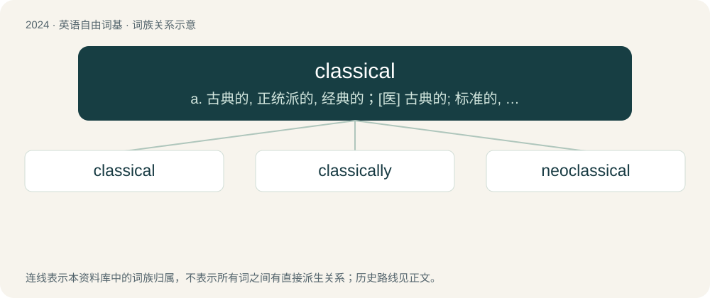

# 2135 · classical — a. 古典的, 正统派的, 经典的；\[医\] 古典的; 标准的, 典型的

[总目录](../00_总目录_按常用程度.md)

**类型**：英语自由词基　｜　**来源语言**：见词源记录

## 核心含义与来源

- 核心含义：a. 古典的, 正统派的, 经典的；\[医\] 古典的; 标准的, 典型的
- 英文含义：Of or relating to the first class or rank, especially in literature or art.
- 词形：classical

**来源记录 1**（形容词；Of or relating to the first class or rank, especially in literature or art.）

See classic § Etymology for history. By surface analysis, class + -ical or classic + -al or class + -ic + -al

## 词族图

## 单词速览（常用到不常用）

| 单词 | 音标 | 释义 |
|---|---|---|
| [classical](#w-1) | 英 /ˈklæs.ɪ.k(ə)l/ | a. 古典的, 正统派的, 经典的；\[医\] 古典的; 标准的, 典型的 |
| [classically](#w-2) | /ˈklæsikəli/ | adv. 古典主义地, 拟古地 |
| [neoclassical](#w-3) | /ˈniːəuklæsikəl/ | a. 新古典主义的 |

## 逐词详解

### 1. classical

**词性**：形容词　｜　**音标**：英 /ˈklæs.ɪ.k(ə)l/

**中文释义**：a. 古典的, 正统派的, 经典的；\[医\] 古典的; 标准的, 典型的

**英文义项**：Of or relating to the first class or rank, especially in literature or art. / Of or pertaining to established principles in a discipline.

**构词拆分**：classic + -al + class + -ical + class + -ic + -al；classic + -al；class + -ic + -al

**词源与演化**：

See classic § Etymology for history. By surface analysis, class + -ical or classic + -al or class + -ic + -al

**用法示例／搭配（非完整句）**：

> classical dance

该用例对应义项：Conforming to the best authority in literature and art; chaste; pure; refined

### 2. classically

**词性**：副词　｜　**音标**：/ˈklæsikəli/

**中文释义**：adv. 古典主义地, 拟古地

**英文义项**：In a classical manner; according to the manner of classical authors. / In the manner of classes; according to a regular order of classes or sets.

**构词拆分**：classical + -ly

**词源与演化**：

From classical + -ly.

**例句**：

> Classically, cases like this can only be solved through painstaking investigation.

该用例对应义项：Usually or typically, based on past experience.

### 3. neoclassical

**词性**：形容词　｜　**音标**：/ˈniːəuklæsikəl/

**中文释义**：a. 新古典主义的

**英文义项**：Of or pertaining to a style of architecture based on classical models, especially such a style of the 18th century. / Of or relating to various art styles, as in sculpture and ballet, inspired by older classical forms and conventions.

**构词拆分**：neo- + classical

**词源与演化**：

From neo- + classical.

**例句**：

> The English word "psychopathy" is a neoclassical compound from Ancient Greek roots.

该用例对应义项：Being a recent construction based on older, classical elements.
