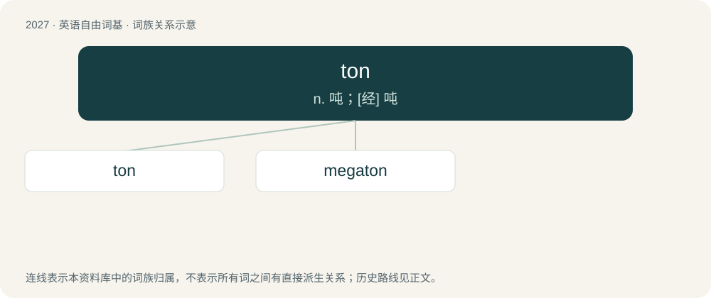

# 2136 · ton — n. 吨；\[经\] 吨

[总目录](../00_总目录_按常用程度.md)

**类型**：英语自由词基　｜　**来源语言**：见词源记录

## 核心含义与来源

- 核心含义：n. 吨；\[经\] 吨
- 英文含义：The short ton of 2000 pounds (about 907 kg), 20 hundredweights of 100 pounds avoirdupois each.
- 词形：ton

**多个词源／构词路径**：同一拼写可能有不同来源；以下按词性和含义分别列出。

**来源记录 1**（名词；The short ton of 2000 pounds (about 907 kg), 20 hundredweights of 100 pounds avoirdupois each.）

Variant of tun (“cask”), influenced by Old French tonne (“ton”).

**来源记录 2**（名词；Fashion, the current style, the vogue.）

Borrowed from French ton (“manner”), from Latin tonus. Doublet of tone, tune, and tonus.

## 词族图

## 单词速览（常用到不常用）

| 单词 | 音标 | 释义 |
|---|---|---|
| [ton](#w-1) | /tʌn/ | n. 吨；\[经\] 吨 |
| [megaton](#w-2) | 美 /ˈmɛɡəˌtʌn/ | n. 兆吨 |

## 逐词详解

### 1. ton

**词性**：名词　｜　**音标**：/tʌn/

**中文释义**：n. 吨；\[经\] 吨

**英文义项**：The short ton of 2000 pounds (about 907 kg), 20 hundredweights of 100 pounds avoirdupois each. / The long ton of 2240 pounds (about 1016 kg), 20 hundredweights of 112 pounds avoirdupois each.

**词源与演化**：

Variant of tun (“cask”), influenced by Old French tonne (“ton”).

**例句**：

> Their main problem is that they somehow believe that a 12-ton unit can handle this entire building.

该用例对应义项：A unit of thermal power equal to 12,000 BTU/h (about 3.5 kW), approximating the idealized rate of cooling provided by uniform isothermal melting of 1 short ton of ice per day at 0°C.

### 2. megaton

**词性**：名词　｜　**音标**：美 /ˈmɛɡəˌtʌn/

**中文释义**：n. 兆吨

**英文义项**：A measure of the strength of an explosion or a bomb based on how many million tons of TNT would be needed to produce the same energy. (A derived unit for TNT equivalent.) / One million short tons (10⁶ × 2000 lb).

**构词拆分**：mega- + ton

**词源与演化**：

From mega- + ton.
