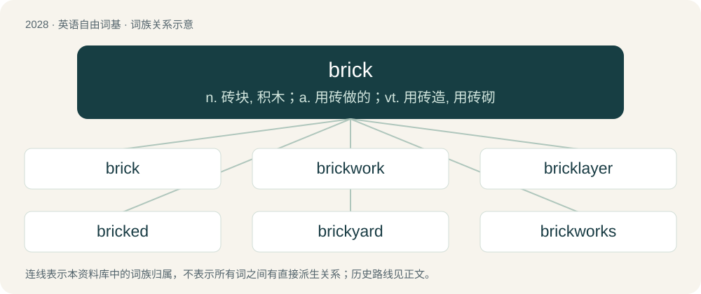

# 2137 · brick — n. 砖块, 积木；a. 用砖做的；vt. 用砖造, 用砖砌

[总目录](../00_总目录_按常用程度.md)

**类型**：英语自由词基　｜　**来源语言**：见词源记录

## 核心含义与来源

- 核心含义：n. 砖块, 积木；a. 用砖做的；vt. 用砖造, 用砖砌
- 英文含义：A hardened rectangular block of mud, clay etc., used for building.
- 词形：brick

**来源记录 1**（名词；A hardened rectangular block of mud, clay etc., used for building.）

From Late Middle English brik, bryke, bricke, from Middle Low German and Middle Dutch bricke ("cracked or broken brick; tile-stone"; modern Dutch brik), ultimately related to Proto-West Germanic \*brekan (“to break”), whence also Old French briche and French brique (“brick”). Compare also German Low German Brickje (“small board, tray”). Related to break. The social media slang sense derives from memes about building up one's feed “brick by brick”, analogizing bricks with reels that inform the algorithm. The sense of a helpful, reliable person comes from Lycurgus referring to the army as the walls of Sparta, every man a brick.

## 词族图

## 单词速览（常用到不常用）

| 单词 | 音标 | 释义 |
|---|---|---|
| [brick](#w-1) | /ˈbɹɪk/ | n. 砖块, 积木；a. 用砖做的；vt. 用砖造, 用砖砌 |
| [brickwork](#w-2) | 美 /ˈbɹɪk.wɝk/ | n. 砖建筑物, 砌砖；\[机\] 砌砖工作 |
| [bricklayer](#w-3) | /ˈbrikleiə/ | n. 砌砖工人 |
| [bricked](#w-4) | /bɹɪkt/ | vt. 用砖建造、砌或铺（brick的过去式与过去分词形式） |
| [brickyard](#w-5) | 美 /ˈbɹɪkˌjɑɹd/ | n. 砖厂 |
| [brickworks](#w-6) |  | (brickwork 的复数) n. 砖建筑物, 砌砖；\[机\] 砌砖工作 |
| [brickman](#w-7) |  | \[人名\] 布里克曼 |
| [bricker](#w-8) | /ˈbɹɪkɚ/ | \[人名\] 布里克 |
| [bricklaying](#w-9) | /ˈbrikleiiŋ/ | n. 砌砖, 砌砖工作 |

## 逐词详解

### 1. brick

**词性**：名词　｜　**音标**：/ˈbɹɪk/

**中文释义**：n. 砖块, 积木；a. 用砖做的；vt. 用砖造, 用砖砌

**英文义项**：A hardened rectangular block of mud, clay etc., used for building. / Such hardened mud, clay, etc. considered collectively, as a building material.

**词源与演化**：

From Late Middle English brik, bryke, bricke, from Middle Low German and Middle Dutch bricke ("cracked or broken brick; tile-stone"; modern Dutch brik), ultimately related to Proto-West Germanic \*brekan (“to break”), whence also Old French briche and French brique (“brick”). Compare also German Low German Brickje (“small board, tray”). Related to break. The social media slang sense derives from memes about building up one's feed “brick by brick”, analogizing bricks with reels that inform the algorithm. The sense of a helpful, reliable person comes from Lycurgus referring to the army as the walls of Sparta, every man a brick.

**例句**：

> We can't win if we keep throwing up bricks from three-point land.

该用例对应义项：A shot which misses, particularly one which bounces directly out of the basket because of a too-flat trajectory, as if the ball were a heavier object.

### 2. brickwork

**词性**：名词　｜　**音标**：美 /ˈbɹɪk.wɝk/

**中文释义**：n. 砖建筑物, 砌砖；\[机\] 砌砖工作

**英文义项**：A structure, or portion of a structure, that is made out of bricks. / The quality of the construction of a brick structure.

**构词拆分**：From brick + -work.

**词源与演化**：

From brick + -work.

**例句**：

> Ziri needs to remove the ivy without damaged the brickwork.

### 3. bricklayer

**词性**：名词　｜　**音标**：/ˈbrikleiə/

**中文释义**：n. 砌砖工人

**英文义项**：A craftsman who builds walls and suchlike out of bricks.

**构词拆分**：brick + layer

**词源与演化**：

From Middle English brekelayeer, brekelayer, equivalent to brick + layer.

**例句**：

> The bricklayer calculated that he would need 500 bricks for the wall.

### 4. bricked

**词性**：形容词　｜　**音标**：/bɹɪkt/

**中文释义**：vt. 用砖建造、砌或铺（brick的过去式与过去分词形式）

**英文义项**：Not functional, broken, especially permanently. / Having a hard-on or erection.

**构词拆分**：From brick + -ed.

**词源与演化**：

From brick + -ed.

**例句**：

> My computer crashed while installing the driver and now my hardware is bricked.

### 5. brickyard

**词性**：名词　｜　**音标**：美 /ˈbɹɪkˌjɑɹd/

**中文释义**：n. 砖厂

**英文义项**：A place where bricks are, or once were, produced or distributed.

**构词拆分**：brick + yard

**词源与演化**：

From brick + yard.

### 6. brickworks

**词性**：名词

**中文释义**：(brickwork 的复数) n. 砖建筑物, 砌砖；\[机\] 砌砖工作

**英文义项**：A place where bricks are manufactured, particularly organised as a factory.

**构词拆分**：brick + works

**词源与演化**：

From brick + works.

### 7. brickman

**词性**：名词

**中文释义**：\[人名\] 布里克曼

**英文义项**：A brickmaker. / A bricklayer.

**构词拆分**：brick + -man

**词源与演化**：

From brick + -man.

### 8. bricker

**词性**：名词　｜　**音标**：/ˈbɹɪkɚ/

**中文释义**：\[人名\] 布里克

**英文义项**：A brickmaker. / A bricklayer.

**构词拆分**：From brick + -er.

**词源与演化**：

From brick + -er.

### 9. bricklaying

**词性**：名词　｜　**音标**：/ˈbrikleiiŋ/

**中文释义**：n. 砌砖, 砌砖工作

**英文义项**：The act of building a wall by laying bricks, usually with cement between the surfaces of the bricks.

**构词拆分**：brick + laying

**词源与演化**：

From brick + laying.

**例句**：

> Carpentry and bricklaying are examples of manual labor.
