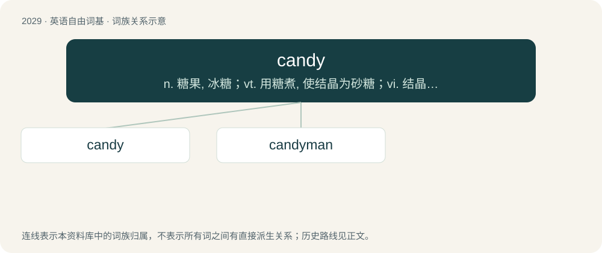

# 2138 · candy — n. 糖果, 冰糖；vt. 用糖煮, 使结晶为砂糖；vi. 结晶为砂糖

[总目录](../00_总目录_按常用程度.md)

**类型**：英语自由词基　｜　**来源语言**：见词源记录

## 核心含义与来源

- 核心含义：n. 糖果, 冰糖；vt. 用糖煮, 使结晶为砂糖；vi. 结晶为砂糖
- 英文含义：Crystallized sugar formed by boiling down sugar syrup.
- 词形：candy

**来源记录 1**（名词；Crystallized sugar formed by boiling down sugar syrup.）

From Middle English sugre candy, from Old French sucre candi (literally “candied sugar”), from Arabic سُكَّر قَنْدِي (sukkar qandī), from Arabic قَنْد (qand, “rock candy”), from Persian کند (kand) from Sanskrit खण्ड (khaṇḍa, “piece, fragment, candied sugar, dried molasses”), root खण्ड् (khaṇḍ, “to divide, break into pieces”), or from Proto-Dravidian \*kaṇṭu; compare Tamil கண்டு (kaṇṭu, “hard candy”).

## 词族图

## 单词速览（常用到不常用）

| 单词 | 音标 | 释义 |
|---|---|---|
| [candy](#w-1) | /ˈkæn.di/ | n. 糖果, 冰糖；vt. 用糖煮, 使结晶为砂糖；vi. 结晶为砂糖 |
| [candyman](#w-2) |  | n. 杀人蜂（或译追命传说, 电影名）；甜心宝贝（或译甜蜜爱人, 歌曲名） |

## 逐词详解

### 1. candy

**词性**：名词　｜　**音标**：/ˈkæn.di/

**中文释义**：n. 糖果, 冰糖；vt. 用糖煮, 使结晶为砂糖；vi. 结晶为砂糖

**英文义项**：Crystallized sugar formed by boiling down sugar syrup. / Edible, sweet-tasting confectionery containing sugar, or sometimes artificial sweeteners, and often flavored with fruit, chocolate, nuts, herbs and spices, or artificial flavors.

**词源与演化**：

From Middle English sugre candy, from Old French sucre candi (literally “candied sugar”), from Arabic سُكَّر قَنْدِي (sukkar qandī), from Arabic قَنْد (qand, “rock candy”), from Persian کند (kand) from Sanskrit खण्ड (khaṇḍa, “piece, fragment, candied sugar, dried molasses”), root खण्ड् (khaṇḍ, “to divide, break into pieces”), or from Proto-Dravidian \*kaṇṭu; compare Tamil கண்டு (kaṇṭu, “hard candy”).

**用法示例／搭配（非完整句）**：

> candy kid; candy raver

该用例对应义项：An accessory (bracelet, etc.) made from pony beads, associated with the rave scene.

### 2. candyman

**词性**：名词

**中文释义**：n. 杀人蜂（或译追命传说, 电影名）；甜心宝贝（或译甜蜜爱人, 歌曲名）

**英文义项**：A male confectioner. / A male drug dealer.

**构词拆分**：From candy + -man.

**词源与演化**：

From candy + -man.
