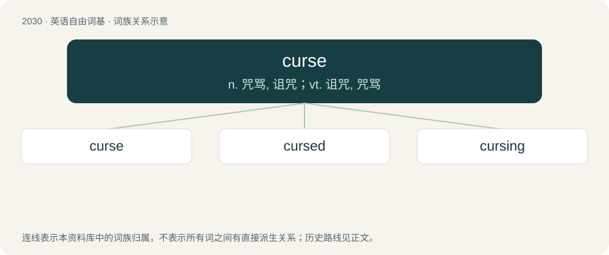

# 2139 · curse — n. 咒骂, 诅咒；vt. 诅咒, 咒骂

[总目录](../00_总目录_按常用程度.md)

**类型**：英语自由词基　｜　**来源语言**：见词源记录

## 核心含义与来源

- 核心含义：n. 咒骂, 诅咒；vt. 诅咒, 咒骂
- 英文含义：A supernatural detriment or hindrance; a bane.
- 词形：curse

**多个词源／构词路径**：同一拼写可能有不同来源；以下按词性和含义分别列出。

**来源记录 1**（名词；A supernatural detriment or hindrance; a bane.）

From Middle English curse, kors, cors, curs, from Old English cors, curs (“curse”), of unknown origin.

**来源记录 2**（动词；To place a curse upon (a person or object).）

From Middle English cursen, corsen, coursen, from Old English corsian, cursian (“to curse”), from the noun (see above).

## 词族图

## 单词速览（常用到不常用）

| 单词 | 音标 | 释义 |
|---|---|---|
| [curse](#w-1) | 英 /kɜːs/；美 /kɝs/ | n. 咒骂, 诅咒；vt. 诅咒, 咒骂 |
| [cursed](#w-2) | 英 /ˈkɜːsɪd/；美 /ˈkɝsɪd/ | a. 被诅咒的 |
| [cursing](#w-3) | 英 /ˈkɜːsɪŋ/；美 /ˈkɝsɪŋ/ | v. 诅咒（curse的ing形式） |

## 逐词详解

### 1. curse

**词性**：名词　｜　**音标**：英 /kɜːs/；美 /kɝs/

**中文释义**：n. 咒骂, 诅咒；vt. 诅咒, 咒骂

**英文义项**：A supernatural detriment or hindrance; a bane. / A prayer or imprecation that harm may befall someone.

**词源与演化**：

From Middle English curse, kors, cors, curs, from Old English cors, curs (“curse”), of unknown origin.

**例句**：

> A witch put a curse on his whole family.

该用例对应义项：an evil spell

### 2. cursed

**词性**：形容词　｜　**音标**：英 /ˈkɜːsɪd/；美 /ˈkɝsɪd/

**中文释义**：a. 被诅咒的

**英文义项**：Under some divine harm, malady, or other curse. / hateful; damnable; accursed

**构词拆分**：curse + -ed

**词源与演化**：

From Middle English cursed, cursd, curst, corsed, curset, cursyd, equivalent to curse + -ed.

**例句**：

> That cursed bird keeps stealing my milk!

该用例对应义项：hateful; damnable; accursed

### 3. cursing

**词性**：名词　｜　**音标**：英 /ˈkɜːsɪŋ/；美 /ˈkɝsɪŋ/

**中文释义**：v. 诅咒（curse的ing形式）

**英文义项**：The act of one who curses.

**构词拆分**：curse + -ing

**词源与演化**：

From Middle English cursing, cursyng, cursunge, from Old English cursung (“cursing”), equivalent to curse + -ing.

**例句**：

> Sami couldn't blame Layla for losing her shit and cursing at Farid.
