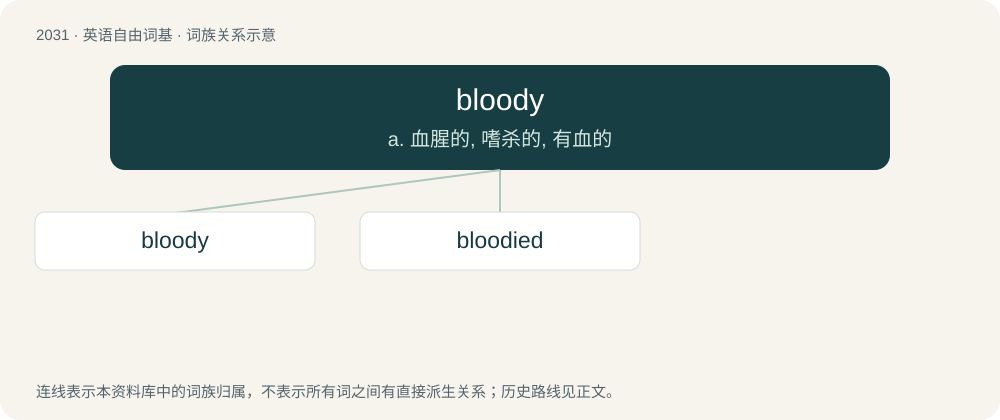

# 2141 · bloody — a. 血腥的, 嗜杀的, 有血的

[总目录](../00_总目录_按常用程度.md)

**类型**：英语自由词基　｜　**来源语言**：见词源记录

## 核心含义与来源

- 核心含义：a. 血腥的, 嗜杀的, 有血的
- 英文含义：Covered in blood.
- 词形：bloody

**多个词源／构词路径**：同一拼写可能有不同来源；以下按词性和含义分别列出。

**来源记录 1**（形容词；Covered in blood.）

From Middle English blody, blodi, from Old English blōdiġ, blōdeġ (“bloody”), from Proto-West Germanic \*blōdag, from Proto-Germanic \*blōþagaz (“bloody”), equivalent to blood + -y. Cognate with Saterland Frisian bläidich, blöidig, blouderch (“bloody”), West Frisian bloedich (“bloody”), Dutch bloedig (“bloody”), German Low German blödig (“bloody”), German blutig (“bloody”), Danish blodig (“bloody”), Swedish blodig (“bloody”), Faroese blóðigur (“bloody”), Icelandic blóðugur (“bloody”). See Wikipedia for thoughts on sense evolution.

**来源记录 2**（动词；To stain with blood.）

From Middle English \*blodien, \*blodegen (attested as blodeke, bi-blodgi), from Old English blōdgian, blōdegian (“to bloody, make bloody”), from Proto-West Germanic \*blōdagōn (“to make bloody”), from Proto-Germanic \*blōþagōną (“to make bloody”). Cognate with Middle High German bluotigen (“to make bloody”), Swedish blodga (“to make bloody”), Icelandic blóðga (“to bloody”).

## 词族图

## 单词速览（常用到不常用）

| 单词 | 音标 | 释义 |
|---|---|---|
| [bloody](#w-1) | /ˈblʌ.di/ | a. 血腥的, 嗜杀的, 有血的 |
| [bloodied](#w-2) | /ˈblʌdid/ | v. 血污的( bloody的过去式和过去分词 ); 流血的; 屠杀的; 残忍的 |

## 逐词详解

### 1. bloody

**词性**：形容词　｜　**音标**：/ˈblʌ.di/

**中文释义**：a. 血腥的, 嗜杀的, 有血的

**英文义项**：Covered in blood. / Characterised by bloodshed.

**构词拆分**：blood + -y

**词源与演化**：

From Middle English blody, blodi, from Old English blōdiġ, blōdeġ (“bloody”), from Proto-West Germanic \*blōdag, from Proto-Germanic \*blōþagaz (“bloody”), equivalent to blood + -y. Cognate with Saterland Frisian bläidich, blöidig, blouderch (“bloody”), West Frisian bloedich (“bloody”), Dutch bloedig (“bloody”), German Low German blödig (“bloody”), German blutig (“bloody”), Danish blodig (“bloody”), Swedish blodig (“bloody”), Faroese blóðigur (“bloody”), Icelandic blóðugur (“bloody”). See Wikipedia for thoughts on sense evolution.

**例句**：

> All that remained of his right hand after the accident was a bloody stump.

该用例对应义项：Covered in blood.

### 2. bloodied

**词性**：形容词　｜　**音标**：/ˈblʌdid/

**中文释义**：v. 血污的( bloody的过去式和过去分词 ); 流血的; 屠杀的; 残忍的

**英文义项**：Covered or stained with blood

**构词拆分**：From bloody + -ed.

**词源与演化**：

From bloody + -ed.

**例句**：

> The xylophone's piercing high notes have bloodied ears around the world.
