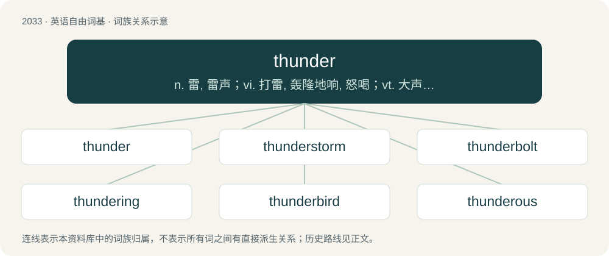

# 2143 · thunder — n. 雷, 雷声；vi. 打雷, 轰隆地响, 怒喝；vt. 大声喊出, 轰隆地发出

[总目录](../00_总目录_按常用程度.md)

**类型**：英语自由词基　｜　**来源语言**：见词源记录

## 核心含义与来源

- 核心含义：n. 雷, 雷声；vi. 打雷, 轰隆地响, 怒喝；vt. 大声喊出, 轰隆地发出
- 英文含义：The loud rumbling, cracking, or crashing sound caused by expansion of rapidly heated air around a lightning bolt.
- 词形：thunder

**多个词源／构词路径**：同一拼写可能有不同来源；以下按词性和含义分别列出。

**来源记录 1**（名词；The loud rumbling, cracking, or crashing sound caused by expansion of rapidly heated air around a lightning bolt.）

From Middle English thunder, thonder, thundre, thonre, thunnere, þunre, from Old English þunor (“thunder”), from Proto-West Germanic \*þunr, from Proto-Germanic \*þunraz, from Proto-Indo-European \*(s)ten-, \*(s)tenh₂- (“to thunder”). Compare astound, astonish, stun. Germanic cognates include West Frisian tonger, Dutch donder, German Donner, Old Norse Þórr (English Thor), Danish torden, Norwegian Nynorsk tore. Other cognates include Persian تندر (tondar), Latin tonō, detonō, Ancient Greek στένω (sténō), στενάζω (stenázō), στόνος (stónos), Στέντωρ (Sténtōr), Irish torann, Welsh taran, Gaulish Taranis. Doublet of donner, Thunor, and Thor.

**来源记录 2**（动词；To produce thunder; to sound, rattle, or roar, as a discharge of atmospheric electricity.）

From Middle English thundren, from Old English þunrian (“to thunder”), from Proto-West Germanic \*þunrōn, from Proto-Germanic \*þunrōną (“to thunder”).

## 词族图

## 单词速览（常用到不常用）

| 单词 | 音标 | 释义 |
|---|---|---|
| [thunder](#w-1) | 英 /ˈθʌndə/；美 /ˈθʌndɚ/ | n. 雷, 雷声；vi. 打雷, 轰隆地响, 怒喝；vt. 大声喊出, 轰隆地发出 |
| [thunderstorm](#w-2) | 英 /ˈθʌn.dəˌstɔːm/；美 /ˈθʌn.dɚˌstɔɹm/ | n. 雷暴雨 |
| [thunderbolt](#w-3) | /ˈθʌndə(ɹ)ˌboʊlt/ | n. 霹雳, 雷电, 晴天霹雳, 怒喝 |
| [thundering](#w-4) | /ˈθʌndəriŋ/ | a. 雷鸣般的, 雷一般响亮的, 非常的；adv. 非常, 异常 |
| [thunderbird](#w-5) | 英 /ˈθʌndə.bɜːd/；美 /ˈθʌndɚ.bɝd/ | interj. 妙哇! |
| [thunderous](#w-6) | 英 /ˈθʌn.də.ɹəs/；美 /ˈθʌn.dɚ.əs/ | a. 将要打雷的, 像打雷的 |
| [thunderclap](#w-7) | 美 /ˈθʌndɚˌklæp/ | n. 雷声, 霹雳, 晴天霹雳 |
| [thunderstruck](#w-8) | 英 /ˈθʌn.də.stɹʌk/；美 /ˈθʌn.dɚ.stɹʌk/ | a. 惊愕的, 吓呆的, 遭雷击的 |

## 逐词详解

### 1. thunder

**词性**：名词　｜　**音标**：英 /ˈθʌndə/；美 /ˈθʌndɚ/

**中文释义**：n. 雷, 雷声；vi. 打雷, 轰隆地响, 怒喝；vt. 大声喊出, 轰隆地发出

**英文义项**：The loud rumbling, cracking, or crashing sound caused by expansion of rapidly heated air around a lightning bolt. / A deep, rumbling noise resembling thunder.

**词源与演化**：

From Middle English thunder, thonder, thundre, thonre, thunnere, þunre, from Old English þunor (“thunder”), from Proto-West Germanic \*þunr, from Proto-Germanic \*þunraz, from Proto-Indo-European \*(s)ten-, \*(s)tenh₂- (“to thunder”). Compare astound, astonish, stun. Germanic cognates include West Frisian tonger, Dutch donder, German Donner, Old Norse Þórr (English Thor), Danish torden, Norwegian Nynorsk tore. Other cognates include Persian تندر (tondar), Latin tonō, detonō, Ancient Greek στένω (sténō), στενάζω (stenázō), στόνος (stónos), Στέντωρ (Sténtōr), Irish torann, Welsh taran, Gaulish Taranis. Doublet of donner, Thunor, and Thor.

**例句**：

> Off in the distance, he heard the thunder of hoofbeats, signalling a stampede.

该用例对应义项：A deep, rumbling noise resembling thunder.

### 2. thunderstorm

**词性**：名词　｜　**音标**：英 /ˈθʌn.dəˌstɔːm/；美 /ˈθʌn.dɚˌstɔɹm/

**中文释义**：n. 雷暴雨

**英文义项**：A storm consisting of thunder and lightning produced by a cumulonimbus, usually accompanied with heavy rain, wind, and sometimes hail; and in rarer cases sleet, freezing rain, or snow.

**构词拆分**：thunder + storm

**词源与演化**：

From thunder + storm.

**例句**：

> Communications have been cut off for two hours because of a thunderstorm.

### 3. thunderbolt

**词性**：名词　｜　**音标**：/ˈθʌndə(ɹ)ˌboʊlt/

**中文释义**：n. 霹雳, 雷电, 晴天霹雳, 怒喝

**英文义项**：A flash of lightning accompanied by a crash of thunder. / An event that is terrible, horrific or unexpected.

**构词拆分**：thunder + bolt

**词源与演化**：

From thunder + bolt.

**例句**：

> News of the actress’s death came as a thunderbolt to her fans.

该用例对应义项：An event that is terrible, horrific or unexpected.

### 4. thundering

**词性**：形容词　｜　**音标**：/ˈθʌndəriŋ/

**中文释义**：a. 雷鸣般的, 雷一般响亮的, 非常的；adv. 非常, 异常

**英文义项**：Of, pertaining to, or accompanied by thunder. / Producing a noise or effect like thunder; thunderous.

**构词拆分**：thunder + -ing

**词源与演化**：

From Middle English thonderynge, þoundryng, equivalent to thunder + -ing.

**例句**：

> The day was stormy, and what was worse still, it was thundering.

### 5. thunderbird

**词性**：名词　｜　**音标**：英 /ˈθʌndə.bɜːd/；美 /ˈθʌndɚ.bɝd/

**中文释义**：interj. 妙哇!

**英文义项**：A mythological bird, often associated with stormy weather, especially in various indigenous North American mythologies. / The golden whistler, an Australian insectivorous songbird (Pachycephala pectoralis, formerly Pachycephala gutturalis), whose male is conspicuously marked with black and yellow, and has a black crescent on the breast.

**构词拆分**：thunder + bird

**词源与演化**：

From thunder + bird.

**例句**：

> The Mozilla Foundation released the latest version of its email/news-client software, "Thunderbird 2.0.0.14" on May 1st.

### 6. thunderous

**词性**：形容词　｜　**音标**：英 /ˈθʌn.də.ɹəs/；美 /ˈθʌn.dɚ.əs/

**中文释义**：a. 将要打雷的, 像打雷的

**英文义项**：Very loud; that sounds like thunder; thundersome. Also in metaphorical expressions, signifying fury.

**构词拆分**：thunder + -ous

**词源与演化**：

From thunder + -ous.

**例句**：

> Mary rose from her seat and walked on stage to thunderous applause.

### 7. thunderclap

**词性**：名词　｜　**音标**：美 /ˈθʌndɚˌklæp/

**中文释义**：n. 雷声, 霹雳, 晴天霹雳

**英文义项**：A sudden, loud thunder caused by a nearby lightning strike; a shock of thunder, as opposed to a reverberating rumble. / A very loud fart.

**构词拆分**：thunder + clap

**词源与演化**：

From thunder + clap.

**例句**：

> After the thunderclap, the rain began pouring down.

### 8. thunderstruck

**词性**：形容词　｜　**音标**：英 /ˈθʌn.də.stɹʌk/；美 /ˈθʌn.dɚ.stɹʌk/

**中文释义**：a. 惊愕的, 吓呆的, 遭雷击的

**英文义项**：Astonished, amazed or so suddenly surprised as to be unable to speak.

**构词拆分**：thunder + struck

**词源与演化**：

From thunder + struck. Compare synonymous and cognate Latin attonitus. Also compare typologically Ancient Greek ἐμβρόντητος (embróntētos) (&lt; βροντή (brontḗ)) (whence Greek εμβρόντητος (emvróntitos)); Czech ohromený (&lt; ohromit), Bulgarian като ударен от гръм (kato udaren ot grăm), Russian как гро́мом поражённый (kak grómom poražónnyj) (akin to гром (grom)). See also German wie vom Donner gerührt.

**例句**：

> I was thunderstruck by my friend's words.
