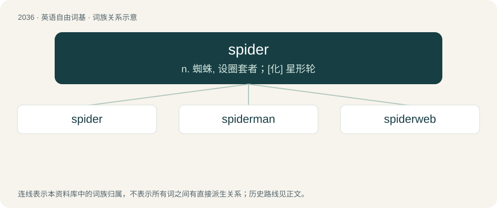

# 2145 · spider — n. 蜘蛛, 设圈套者；\[化\] 星形轮

[总目录](../00_总目录_按常用程度.md)

**类型**：英语自由词基　｜　**来源语言**：见词源记录

## 核心含义与来源

- 核心含义：n. 蜘蛛, 设圈套者；\[化\] 星形轮
- 英文含义：Any of various eight-legged, predatory arthropods, of the order Araneae, most of which spin webs to catch prey.
- 词形：spider

**来源记录 1**（名词；Any of various eight-legged, predatory arthropods, of the order Araneae, most of which spin webs to catch prey.）

Inherited from Middle English spithre, spider, from Old English spīþra (“spider”), from Proto-West Germanic \*spinþrijō, from Proto-Germanic \*spinnaną (“to spin”). Mostly displaced attercop (“spider, unpleasant person”), now a dialectal term. Compare typologically Proto-Slavic \*mězgyrь (whence Russian мизги́рь (mizgírʹ)) (akin to Latvian mežģīt), Turkish örümcek (akin to örmek).

## 词族图

## 单词速览（常用到不常用）

| 单词 | 音标 | 释义 |
|---|---|---|
| [spider](#w-1) | 英 /ˈspaɪ̯də/；美 /ˈspaɪ̯dɚ/ | n. 蜘蛛, 设圈套者；\[化\] 星形轮 |
| [spiderman](#w-2) | /ˈspaidəmæn/ | n. &lt;主英&gt;高空作业的建筑工人 |
| [spiderweb](#w-3) | 英 /ˈspaɪ̯dəwɛb/；美 /ˈspaɪ̯dɚwɛb/ | n. 蜘蛛网 |

## 逐词详解

### 1. spider

**词性**：动词　｜　**音标**：英 /ˈspaɪ̯də/；美 /ˈspaɪ̯dɚ/

**中文释义**：n. 蜘蛛, 设圈套者；\[化\] 星形轮

**英文义项**：To move like a spider. / To cover a surface like a cobweb.

**词源与演化**：

Inherited from Middle English spithre, spider, from Old English spīþra (“spider”), from Proto-West Germanic \*spinþrijō, from Proto-Germanic \*spinnaną (“to spin”). Mostly displaced attercop (“spider, unpleasant person”), now a dialectal term. Compare typologically Proto-Slavic \*mězgyrь (whence Russian мизги́рь (mizgírʹ)) (akin to Latvian mežģīt), Turkish örümcek (akin to örmek).

**例句**：

> The online dictionary is regularly spidered by search engines.

该用例对应义项：To follow links on the World Wide Web in order to gather information.

### 2. spiderman

**词性**：名词　｜　**音标**：/ˈspaidəmæn/

**中文释义**：n. &lt;主英&gt;高空作业的建筑工人

**英文义项**：A steeplejack. / A free climber.

**构词拆分**：spider + man

**词源与演化**：

From spider + man; in reference to Spider-Man, a superhero who can climb walls.

**例句**：

> Sami was wearing a blue Spiderman shirt.

### 3. spiderweb

**词性**：名词　｜　**音标**：英 /ˈspaɪ̯dəwɛb/；美 /ˈspaɪ̯dɚwɛb/

**中文释义**：n. 蜘蛛网

**英文义项**：The net-like construct of a spider containing sticky strands to catch prey. / Something that resembles a spider's web in being mesh-like, entrapping, or fragile.

**构词拆分**：spider + web

**词源与演化**：

From Middle English spiþere webb, equivalent to spider + web.

**例句**：

> In the dark, Rodolfo jumped when his hand brushed against a spiderweb.
