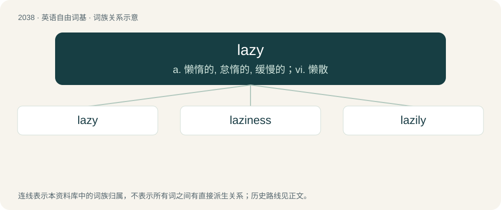

# 2147 · lazy — a. 懒惰的, 怠惰的, 缓慢的；vi. 懒散

[总目录](../00_总目录_按常用程度.md)

**类型**：英语自由词基　｜　**来源语言**：见词源记录

## 核心含义与来源

- 核心含义：a. 懒惰的, 怠惰的, 缓慢的；vi. 懒散
- 英文含义：Unwilling to do work or make an effort; disinclined to exertion.
- 词形：lazy

**来源记录 1**（形容词；Unwilling to do work or make an effort; disinclined to exertion.）

Attested since 1540, origin uncertain. Probably from Low German and Middle Low German lasich (“slack, feeble, lazy”), from las, from Old Saxon lask, from Proto-Germanic \*lasiwaz, \*laskaz (“feeble, weak”), from Proto-Indo-European \*las- (“weak”). Akin to Dutch leuzig (“lazy”), German lässig (“casual, nonchalant, laid-back, easy-going”), Old Norse lasinn (“limpy, tired, weak”), Old English lesu, lysu (“false, evil, base”). More at lush. An alternative etymology traces lazy to Early Modern English laysy, a derivative of lay (plural lays + -y) in the same way that tipsy is derived from tip. See lay.

## 词族图

## 单词速览（常用到不常用）

| 单词 | 音标 | 释义 |
|---|---|---|
| [lazy](#w-1) | 英 /ˈleɪ̯zi(ː)/ | a. 懒惰的, 怠惰的, 缓慢的；vi. 懒散 |
| [laziness](#w-2) | 美 /ˈleɪ.zi.nəs/ | n. 怠惰, 无精打采 |
| [lazily](#w-3) | /ˈleizili/ | adv. 懒洋洋地 |

## 逐词详解

### 1. lazy

**词性**：形容词　｜　**音标**：英 /ˈleɪ̯zi(ː)/

**中文释义**：a. 懒惰的, 怠惰的, 缓慢的；vi. 懒散

**英文义项**：Unwilling to do work or make an effort; disinclined to exertion. / Causing or characterised by idleness; relaxed or leisurely.

**构词拆分**：lays + -y

**词源与演化**：

Attested since 1540, origin uncertain. Probably from Low German and Middle Low German lasich (“slack, feeble, lazy”), from las, from Old Saxon lask, from Proto-Germanic \*lasiwaz, \*laskaz (“feeble, weak”), from Proto-Indo-European \*las- (“weak”). Akin to Dutch leuzig (“lazy”), German lässig (“casual, nonchalant, laid-back, easy-going”), Old Norse lasinn (“limpy, tired, weak”), Old English lesu, lysu (“false, evil, base”). More at lush. An alternative etymology traces lazy to Early Modern English laysy, a derivative of lay (plural lays + -y) in the same way that tipsy is derived from tip. See lay.

**例句**：

> I love staying inside and reading on a lazy Sunday.

该用例对应义项：Causing or characterised by idleness; relaxed or leisurely.

### 2. laziness

**词性**：名词　｜　**音标**：美 /ˈleɪ.zi.nəs/

**中文释义**：n. 怠惰, 无精打采

**英文义项**：The quality of being lazy

**构词拆分**：lazy + -ness

**词源与演化**：

From lazy + -ness.

**例句**：

> This is the most common kind of laziness: that of the mind.

### 3. lazily

**词性**：副词　｜　**音标**：/ˈleizili/

**中文释义**：adv. 懒洋洋地

**英文义项**：In a lazy manner. / In a slow manner.

**构词拆分**：lazy + -ly

**词源与演化**：

From lazy + -ly.

**例句**：

> She lazily scrubbed the pot, but without some real elbow grease it wasn't going to get clean.

该用例对应义项：In a lazy manner.
