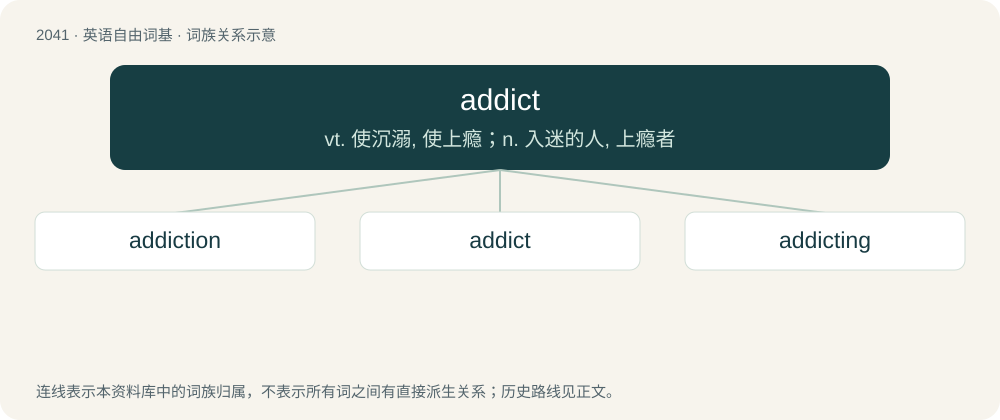

# 2150 · addict — vt. 使沉溺, 使上瘾；n. 入迷的人, 上瘾者

[总目录](../00_总目录_按常用程度.md)

**类型**：英语自由词基　｜　**来源语言**：见词源记录

## 核心含义与来源

- 核心含义：vt. 使沉溺, 使上瘾；n. 入迷的人, 上瘾者
- 英文含义：A person who is addicted, especially to a harmful drug.
- 词形：addict

**来源记录 1**（名词；A person who is addicted, especially to a harmful drug.）

Borrowed from Latin addictus, past participle of addīcō (“deliver; devote; surrender”), from ad- (“to, towards, at”) + dīcō (“say; declare”)

## 词族图

## 单词速览（常用到不常用）

| 单词 | 音标 | 释义 |
|---|---|---|
| [addiction](#w-1) | /əˈdɪkˌʃən/ | n. 入迷, 瘾；\[医\] 瘾, 癖嗜 |
| [addict](#w-2) | /ˈæd.ɪkt/ | vt. 使沉溺, 使上瘾；n. 入迷的人, 上瘾者 |
| [addicting](#w-3) | /əˈdɪktɪŋ/ | n. 有瘾的人；入迷的人；vt. 使沉溺；使上瘾 |

## 逐词详解

### 1. addiction

**词性**：名词　｜　**音标**：/əˈdɪkˌʃən/

**中文释义**：n. 入迷, 瘾；\[医\] 瘾, 癖嗜

**英文义项**：A state that is characterized by compulsive drug use or compulsive engagement in rewarding behavior, despite negative consequences. / The state of being addicted; devotion; inclination.

**构词拆分**：addict + -ion

**词源与演化**：

From addict + -ion; compare (Latin) addictio (“an adjudging, an award”).

**例句**：

> Under Roman law addiction was the justification for slavery.

该用例对应义项：(Roman law) a formal award by a magistrate of a thing or person to another person (as the award of a debtor to his creditor); a surrender to a master

### 2. addict

**词性**：名词　｜　**音标**：/ˈæd.ɪkt/

**中文释义**：vt. 使沉溺, 使上瘾；n. 入迷的人, 上瘾者

**英文义项**：A person who is addicted, especially to a harmful drug. / An adherent or fan (of something).

**词源与演化**：

Borrowed from Latin addictus, past participle of addīcō (“deliver; devote; surrender”), from ad- (“to, towards, at”) + dīcō (“say; declare”)

**例句**：

> He is an addict when it comes to chocolate cookies.

该用例对应义项：A person who is addicted, especially to a harmful drug.

### 3. addicting

**词性**：形容词　｜　**音标**：/əˈdɪktɪŋ/

**中文释义**：n. 有瘾的人；入迷的人；vt. 使沉溺；使上瘾

**英文义项**：Causing addiction.

**构词拆分**：addict + -ing

**词源与演化**：

From addict + -ing.

**例句**：

> This website is more addicting than Facebook, and infinitely more useful.
