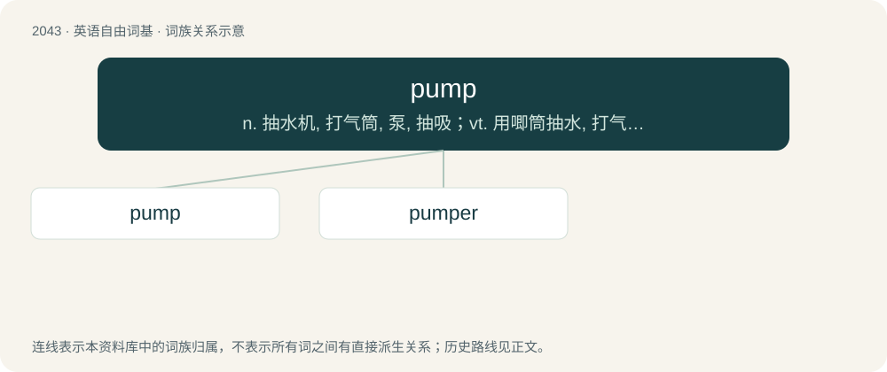

# 2153 · pump — n. 抽水机, 打气筒, 泵, 抽吸；vt. 用唧筒抽水, 打气, 盘问, 倾注, 使疲惫；vi. 抽水, 上下(或往复)运动

[总目录](../00_总目录_按常用程度.md)

**类型**：英语自由词基　｜　**来源语言**：见词源记录

## 核心含义与来源

- 核心含义：n. 抽水机, 打气筒, 泵, 抽吸；vt. 用唧筒抽水, 打气, 盘问, 倾注, 使疲惫；vi. 抽水, 上下(或往复)运动
- 英文含义：A device for moving or compressing a liquid or gas.
- 词形：pump

**多个词源／构词路径**：同一拼写可能有不同来源；以下按词性和含义分别列出。

**来源记录 1**（名词；A device for moving or compressing a liquid or gas.）

From Middle English pumpe, possibly from Middle Dutch pompe (“pipe, water conduit”) or Middle Low German pumpe (“pump”), probably ultimately imitative. Compare Dutch pompen, German pumpen, and Danish pompe; also Spanish bomba (“pump”).

**来源记录 2**（名词；A low-top shoe with a rubber sole and a canvas upper; a low-top canvas sneaker.）

The etymology of the term is unclear and disputed. One possibility is that it comes from pomp (“ornamentation”). Another is that it refers to the sound made by the foot moving inside the shoe when dancing. The Oxford English Dictionary claims that it appeared in the 16th century, and lists its origin as "obscure". It has also been linked to the Dutch pampoesje, possibly borrowed from Javanese pampus, ultimately from Persian پاپوش (pâpuš), borrowed from Arabic بَابُوش (bābūš).

## 词族图

## 单词速览（常用到不常用）

| 单词 | 音标 | 释义 |
|---|---|---|
| [pump](#w-1) | /pʌmp/ | n. 抽水机, 打气筒, 泵, 抽吸；vt. 用唧筒抽水, 打气, 盘问, 倾注, 使疲惫；vi. 抽水, 上下(或往复)运动 |
| [pumper](#w-2) | 英 /ˈpʌmpə/；美 /ˈpʌmpɚ/ | n. 消防车, 使用唧筒者, 唧筒式抽水机 |

## 逐词详解

### 1. pump

**词性**：名词　｜　**音标**：/pʌmp/

**中文释义**：n. 抽水机, 打气筒, 泵, 抽吸；vt. 用唧筒抽水, 打气, 盘问, 倾注, 使疲惫；vi. 抽水, 上下(或往复)运动

**英文义项**：A device for moving or compressing a liquid or gas. / An instance of the action of a pump; one stroke of a pump; any action similar to pumping.

**词源与演化**：

From Middle English pumpe, possibly from Middle Dutch pompe (“pipe, water conduit”) or Middle Low German pumpe (“pump”), probably ultimately imitative. Compare Dutch pompen, German pumpen, and Danish pompe; also Spanish bomba (“pump”).

**例句**：

> It takes thirty pumps to get 10 litres; he did 50 pumps of the weights.

该用例对应义项：An instance of the action of a pump; one stroke of a pump; any action similar to pumping.

### 2. pumper

**词性**：名词　｜　**音标**：英 /ˈpʌmpə/；美 /ˈpʌmpɚ/

**中文释义**：n. 消防车, 使用唧筒者, 唧筒式抽水机

**英文义项**：One who pumps something. / A fire engine with a water tank and pump.

**构词拆分**：From pump + -er.

**词源与演化**：

From pump + -er.
