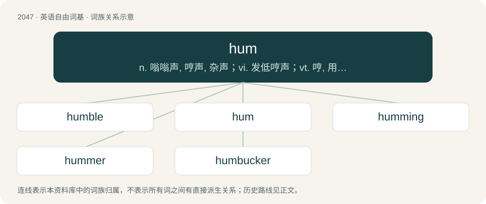

# 2156 · hum — n. 嗡嗡声, 哼声, 杂声；vi. 发低哼声；vt. 哼, 用哼声表示

[总目录](../00_总目录_按常用程度.md)

**类型**：英语自由词基　｜　**来源语言**：见词源记录

## 核心含义与来源

- 核心含义：n. 嗡嗡声, 哼声, 杂声；vi. 发低哼声；vt. 哼, 用哼声表示
- 英文含义：A hummed tune, i.e. created orally with lips closed.
- 词形：hum

**多个词源／构词路径**：同一拼写可能有不同来源；以下按词性和含义分别列出。

**来源记录 1**（名词；A hummed tune, i.e. created orally with lips closed.）

From Middle English hummen (“to hum, buzz, drone, make a murmuring sound to cover embarrassment”); akin to Dutch hommelen (“to bumble, buzz”), dialectal Dutch hommen (“to buzz, hum”), Middle High German hummen (“to hum”), probably ultimately of imitative origin.

**来源记录 2**（名词；Synonym of see hum (“blood cockles, ark clams”).）

Borrowed from Hokkien 蚶 (ham).

## 词族图

## 单词速览（常用到不常用）

| 单词 | 音标 | 释义 |
|---|---|---|
| [humble](#w-1) | 英 /ˈhʌmbəl/ | 【英文】To hum. |
| [hum](#w-2) | /ˈhʌm/ | n. 嗡嗡声, 哼声, 杂声；vi. 发低哼声；vt. 哼, 用哼声表示 |
| [humming](#w-3) | /ˈhʌmɪŋ/ | a. 发嗡嗡声的, 哼着唱的, 精力旺盛的, 热气腾腾的, (酒)起泡的；\[电\] 交流声 |
| [hummer](#w-4) | /ˈhʌmə/ | n. 发哼哼声的人, 发嗡嗡声的东西, 蜂鸣器；\[电\] 蜂音器 |
| [humbucker](#w-5) |  | 【英文】A pickup, on an electric guitar, that has a pair of coils of reverse polarity connected in series in order to reduce buzzing noise caused by mains frequency. |

## 逐词详解

### 1. humble

**词性**：动词　｜　**音标**：英 /ˈhʌmbəl/

**英文义项**：To hum.

**构词拆分**：hum + -le

**词源与演化**：

From Middle English \*humblen, \*humbelen (suggested by humblynge (“a humming, a faint rumbling”)), frequentative of Middle English hummen (“to hum”), equivalent to hum + -le.

### 2. hum

**词性**：名词　｜　**音标**：/ˈhʌm/

**中文释义**：n. 嗡嗡声, 哼声, 杂声；vi. 发低哼声；vt. 哼, 用哼声表示

**英文义项**：A hummed tune, i.e. created orally with lips closed. / An often indistinct sound resembling human humming.

**词源与演化**：

From Middle English hummen (“to hum, buzz, drone, make a murmuring sound to cover embarrassment”); akin to Dutch hommelen (“to bumble, buzz”), dialectal Dutch hommen (“to buzz, hum”), Middle High German hummen (“to hum”), probably ultimately of imitative origin.

**例句**：

> They could hear a hum coming from the kitchen and found the dishwasher on.

该用例对应义项：An often indistinct sound resembling human humming.

### 3. humming

**词性**：形容词　｜　**音标**：/ˈhʌmɪŋ/

**中文释义**：a. 发嗡嗡声的, 哼着唱的, 精力旺盛的, 热气腾腾的, (酒)起泡的；\[电\] 交流声

**英文义项**：Making a hum sound. / Very bad-smelling.

**构词拆分**：From hum + -ing.

**词源与演化**：

From hum + -ing.

**例句**：

> There was a strange humming sound coming from behind the boat.

### 4. hummer

**词性**：名词　｜　**音标**：/ˈhʌmə/

**中文释义**：n. 发哼哼声的人, 发嗡嗡声的东西, 蜂鸣器；\[电\] 蜂音器

**英文义项**：One who hums. / A Humvee.

**构词拆分**：hum + -er

**词源与演化**：

From hum + -er.

**例句**：

> The newlyweds took a hummer limo back to their casino resort.

该用例对应义项：A type of vehicle resembling a jeep but bulkier.

### 5. humbucker

**词性**：名词

**英文义项**：A pickup, on an electric guitar, that has a pair of coils of reverse polarity connected in series in order to reduce buzzing noise caused by mains frequency.

**构词拆分**：From hum (“noise”) + buck (“resist, overcome”) + -er.

**词源与演化**：

From hum (“noise”) + buck (“resist, overcome”) + -er.
