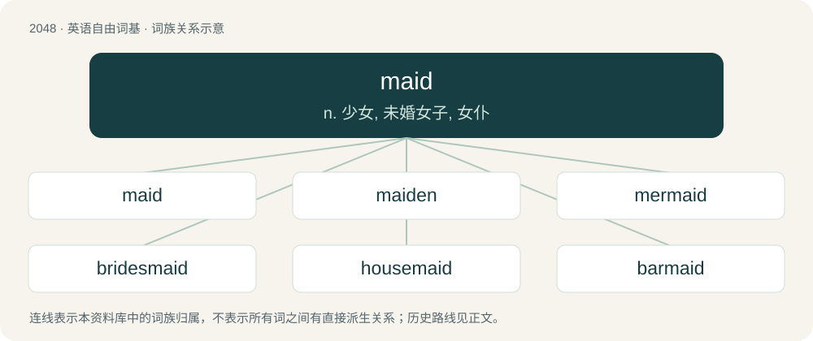

# 2157 · maid — n. 少女, 未婚女子, 女仆

[总目录](../00_总目录_按常用程度.md)

**类型**：英语自由词基　｜　**来源语言**：见词源记录

## 核心含义与来源

- 核心含义：n. 少女, 未婚女子, 女仆
- 英文含义：A girl or an unmarried young woman; maiden.
- 词形：maid

**来源记录 1**（名词；A girl or an unmarried young woman; maiden.）

From Middle English mayde, maide, abbreviation of Middle English maiden from Old English mæġden (Old English mǣden). Ultimately from Proto-West Germanic \*magaþ, from Proto-Germanic \*magaþs (“girl, virgin”).

## 词族图

## 单词速览（常用到不常用）

| 单词 | 音标 | 释义 |
|---|---|---|
| [maid](#w-1) | 英 /meɪd/ | n. 少女, 未婚女子, 女仆 |
| [maiden](#w-2) | 英 /ˈmeɪdən/ | n. 年轻未婚女子, 少女, 处女；a. 未婚的, 处女的, 初次的, 无经验的 |
| [mermaid](#w-3) | 英 /ˈmɜːˌmeɪd/；美 /ˈmɝ.meɪd/ | n. 美人鱼, 善泳的女子 |
| [bridesmaid](#w-4) | /ˈbɹaɪdzˌmeɪd/ | n. 女傧相 |
| [housemaid](#w-5) | 美 /ˈhaʊsˌmeɪd/ | n. 女佣 |
| [barmaid](#w-6) | 英 /ˈbɑː(ɹ).meɪd/ | n. 酒吧女侍, 酒吧女招待 |
| [chambermaid](#w-7) | 英 /ˈt͡ʃeɪm.bə.meɪd/；美 /ˈt͡ʃeɪm.bəɹ.meɪd/ | n. 女服务员 |
| [handmaid](#w-8) | 美 /ˈhændˌmeɪd/ | n. 侍女, 女仆 |
| [maidservant](#w-9) | 英 /ˈmeɪdˌsɜː.vənt/；美 /ˈmeɪdˌsɝ.vənt/ | n. 女仆, 女佣 |
| [nursemaid](#w-10) | /ˈnəːsmeid/ | n. 保姆 |

## 逐词详解

### 1. maid

**词性**：名词　｜　**音标**：英 /meɪd/

**中文释义**：n. 少女, 未婚女子, 女仆

**英文义项**：A girl or an unmarried young woman; maiden. / An adult or adolescent female servant or cleaner (short for maidservant). (In feudal times this could be anyone from a high-ranking assistant to a low-ranking cleaner.)

**词源与演化**：

From Middle English mayde, maide, abbreviation of Middle English maiden from Old English mæġden (Old English mǣden). Ultimately from Proto-West Germanic \*magaþ, from Proto-Germanic \*magaþs (“girl, virgin”).

**例句**：

> Tom's acknowledgement that he stole the ring cleared the maid of suspicion.

### 2. maiden

**词性**：形容词　｜　**音标**：英 /ˈmeɪdən/

**中文释义**：n. 年轻未婚女子, 少女, 处女；a. 未婚的, 处女的, 初次的, 无经验的

**英文义项**：Virgin. / Without offspring.

**构词拆分**：maid + -en

**词源与演化**：

From Middle English mayden, meiden, from Old English mæġden (“girl”), originally a diminutive of mæġeþ (“girl”) via diminutive suffix -en, from Proto-West Germanic \*magaþ, from Proto-Germanic \*magaþs. Equivalent to maid + -en.

**例句**：

> He bowled a record twelve maiden overs in his spell of 8-33 in 21 overs.

该用例对应义项：Being an over in which no runs are scored.

### 3. mermaid

**词性**：名词　｜　**音标**：英 /ˈmɜːˌmeɪd/；美 /ˈmɝ.meɪd/

**中文释义**：n. 美人鱼, 善泳的女子

**英文义项**：A mythological creature with a woman's head and upper body, and a tail of a fish. / Coloured a brilliant turquoise.

**构词拆分**：mer- + maid

**词源与演化**：

From Middle English mermayde (“maid of the sea”), from mere (“sea, lake”) + maid, equivalent to mer- + maid. Cognate with Dutch meermeid (“mermaid”), Middle High German mermaget, mermeit (“mermaid”, &gt; German Meermagd, Meermädchen (“mermaid”)). Compare Old English meremenn, meremennen, meremenin (“mermaid, siren”).

**用法示例／搭配（非完整句）**：

> a mermaid smoothie

该用例对应义项：Coloured a brilliant turquoise.

### 4. bridesmaid

**词性**：名词　｜　**音标**：/ˈbɹaɪdzˌmeɪd/

**中文释义**：n. 女傧相

**英文义项**：A woman who attends a bride during her wedding ceremony, as part of the main wedding party. / A person or team that perennially finishes well, but never first.

**构词拆分**：bride + -s- + maid

**词源与演化**：

From bride + -s- + maid. In the sports and entertainment sense: in reference to the saying always a bridesmaid, never a bride.

**例句**：

> I'd love to be your bridesmaid at the wedding.

该用例对应义项：A woman who attends a bride during her wedding ceremony, as part of the main wedding party.

### 5. housemaid

**词性**：名词　｜　**音标**：美 /ˈhaʊsˌmeɪd/

**中文释义**：n. 女佣

**英文义项**：A female domestic worker responsible for cleaning a house. / A housewife.

**构词拆分**：house + maid

**词源与演化**：

From house + maid.

**例句**：

> That's what I call a self-evident proposition, as the dog's-meat man said, when the housemaid told him he warn't a gentleman.

### 6. barmaid

**词性**：名词　｜　**音标**：英 /ˈbɑː(ɹ).meɪd/

**中文释义**：n. 酒吧女侍, 酒吧女招待

**英文义项**：A woman who serves in a bar.

**构词拆分**：bar + maid

**词源与演化**：

From bar + maid.

**例句**：

> Mr. Carter called for some more beer and told the barmaid to put a little gin in it.

### 7. chambermaid

**词性**：名词　｜　**音标**：英 /ˈt͡ʃeɪm.bə.meɪd/；美 /ˈt͡ʃeɪm.bəɹ.meɪd/

**中文释义**：n. 女服务员

**英文义项**：A maid who handles the chores in a hotel room or (chiefly historically) a bedroom in a wealthy household.

**构词拆分**：chamber + maid

**词源与演化**：

From chamber + maid.

**例句**：

> A chambermaid holding a duster is waiting outside the door.

### 8. handmaid

**词性**：名词　｜　**音标**：美 /ˈhændˌmeɪd/

**中文释义**：n. 侍女, 女仆

**英文义项**：A moth of the species Dysauxes ancilla.

**构词拆分**：By surface analysis, compound of hand + maid

**词源与演化**：

Inherited from Middle English handemayde, hand-maide, handmaide, handmayd, hand mayde, hand-mayde, haundmaid, hondemayde, hondmaide, hond-mayde. By surface analysis, compound of hand + maid, the first component in the sense of "ready at hand".

### 9. maidservant

**词性**：名词　｜　**音标**：英 /ˈmeɪdˌsɜː.vənt/；美 /ˈmeɪdˌsɝ.vənt/

**中文释义**：n. 女仆, 女佣

**英文义项**：A female servant; a maid.

**构词拆分**：maid + servant

**词源与演化**：

From Middle English maide servant; equivalent to maid + servant.

**例句**：

> Also if he strike out a tooth of his manservant or maidservant, he shall in like manner make them free.

### 10. nursemaid

**词性**：动词　｜　**音标**：/ˈnəːsmeid/

**中文释义**：n. 保姆

**英文义项**：To tend to as a nursemaid. / To care for or look after.

**构词拆分**：nurse + maid

**词源与演化**：

From nurse + maid.

**例句**：

> I don't believe I have to nursemaid these two rookies through their entire probationary period.

该用例对应义项：To care for or look after.
