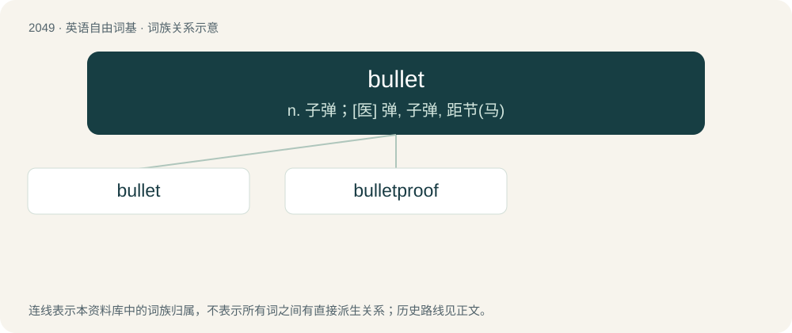

# 2158 · bullet — n. 子弹；\[医\] 弹, 子弹, 距节(马)

[总目录](../00_总目录_按常用程度.md)

**类型**：英语自由词基　｜　**来源语言**：见词源记录

## 核心含义与来源

- 核心含义：n. 子弹；\[医\] 弹, 子弹, 距节(马)
- 英文含义：A projectile, usually of metal, shot from a gun at high speed.
- 词形：bullet

**多个词源／构词路径**：同一拼写可能有不同来源；以下按词性和含义分别列出。

**来源记录 1**（名词；A projectile, usually of metal, shot from a gun at high speed.）

From Middle English bullet (“an official tag or badge of registration or identification”), from Old French bullete, diminutive of boule (“ball”). Later influenced by Middle French boulette and French boulet.

**来源记录 2**（名词；A young or little bull; a male calf.）

From bull + -et.

## 词族图

## 单词速览（常用到不常用）

| 单词 | 音标 | 释义 |
|---|---|---|
| [bullet](#w-1) | 英 /ˈbʊlɪt/ | n. 子弹；\[医\] 弹, 子弹, 距节(马) |
| [bulletproof](#w-2) | 英 /ˈbʊlɪtpɹuːf/；美 /ˈbʊlɪtpɹuf/ | a. 防弹的 |

## 逐词详解

### 1. bullet

**词性**：名词　｜　**音标**：英 /ˈbʊlɪt/

**中文释义**：n. 子弹；\[医\] 弹, 子弹, 距节(马)

**英文义项**：A projectile, usually of metal, shot from a gun at high speed. / An entire round of unfired ammunition for a firearm, including the projectile, the cartridge casing, the propellant charge, etc.

**词源与演化**：

From Middle English bullet (“an official tag or badge of registration or identification”), from Old French bullete, diminutive of boule (“ball”). Later influenced by Middle French boulette and French boulet.

**例句**：

> John's not going to any of his top schools; he got a bullet from the last of them yesterday.

该用例对应义项：A rejection letter, as for employment, admission to a school or a competition.

### 2. bulletproof

**词性**：形容词　｜　**音标**：英 /ˈbʊlɪtpɹuːf/；美 /ˈbʊlɪtpɹuf/

**中文释义**：a. 防弹的

**英文义项**：Capable of withstanding a direct shot by a bullet fired from a gun. / Reliable, infallible, sturdy or error-tolerant.

**构词拆分**：bullet + -proof

**词源与演化**：

From bullet + -proof.

**用法示例／搭配（非完整句）**：

> bulletproof hosting

该用例对应义项：Reliable, infallible, sturdy or error-tolerant.
