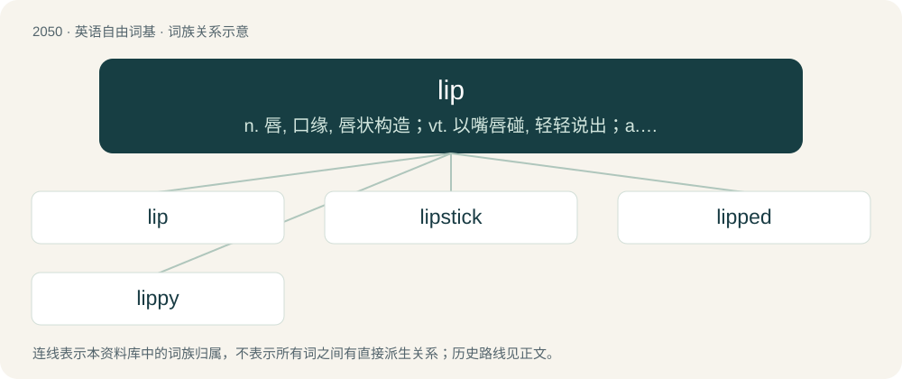

# 2159 · lip — n. 唇, 口缘, 唇状构造；vt. 以嘴唇碰, 轻轻说出；a. 口头上的

[总目录](../00_总目录_按常用程度.md)

**类型**：英语自由词基　｜　**来源语言**：见词源记录

## 核心含义与来源

- 核心含义：n. 唇, 口缘, 唇状构造；vt. 以嘴唇碰, 轻轻说出；a. 口头上的
- 英文含义：Either of the two fleshy protrusions around the opening of the mouth.
- 词形：lip

**来源记录 1**（名词；Either of the two fleshy protrusions around the opening of the mouth.）

From Middle English lippe, from Old English lippa, lippe (“lip”), from Proto-West Germanic \*lippjō (“lip”), from Proto-Germanic \*lepô, from Proto-Indo-European \*leb- (“to hang loosely, droop, sag”). Cognate with Saterland Frisian Lippe (“lip”), West Frisian lippe (“lip”), Dutch lip (“lip”), German Lippe and Lefze (“lip”), Low German Lippe (“lip”), Luxembourgish Lëps (“lip”), Vilamovian łyp (“lip”), Yiddish ליפּ (lip, “lip”), Danish læbe (“lip”), Norwegian Bokmål leppe (“lip”), Norwegian Nynorsk leppa, leppe, lippa, lippe (“lip”), Swedish läpp (“lip”), Latin labium (“lip”).

## 词族图

## 单词速览（常用到不常用）

| 单词 | 音标 | 释义 |
|---|---|---|
| [lip](#w-1) | 英 /lɪp/ | n. 唇, 口缘, 唇状构造；vt. 以嘴唇碰, 轻轻说出；a. 口头上的 |
| [lipstick](#w-2) | 英 /ˈlɪpstɪk/；美 /ˈlɪpˌstɪk/ | n. 口红, 唇膏；\[机\] 口红 |
| [lipped](#w-3) | 英 /lɪpt/ | a. 有嘴的, 长着嘴唇的 |
| [lippy](#w-4) | 英 /ˈlɪpi/ | a. 爱顶嘴的, 无礼的 |

## 逐词详解

### 1. lip

**词性**：名词　｜　**音标**：英 /lɪp/

**中文释义**：n. 唇, 口缘, 唇状构造；vt. 以嘴唇碰, 轻轻说出；a. 口头上的

**英文义项**：Either of the two fleshy protrusions around the opening of the mouth. / A part of the body that resembles a lip, such as the edge of a wound or the labia.

**词源与演化**：

From Middle English lippe, from Old English lippa, lippe (“lip”), from Proto-West Germanic \*lippjō (“lip”), from Proto-Germanic \*lepô, from Proto-Indo-European \*leb- (“to hang loosely, droop, sag”). Cognate with Saterland Frisian Lippe (“lip”), West Frisian lippe (“lip”), Dutch lip (“lip”), German Lippe and Lefze (“lip”), Low German Lippe (“lip”), Luxembourgish Lëps (“lip”), Vilamovian łyp (“lip”), Yiddish ליפּ (lip, “lip”), Danish læbe (“lip”), Norwegian Bokmål leppe (“lip”), Norwegian Nynorsk leppa, leppe, lippa, lippe (“lip”), Swedish läpp (“lip”), Latin labium (“lip”).

**例句**：

> Don’t give me any lip!

该用例对应义项：Backtalk; verbal impertinence.

### 2. lipstick

**词性**：名词　｜　**音标**：英 /ˈlɪpstɪk/；美 /ˈlɪpˌstɪk/

**中文释义**：n. 口红, 唇膏；\[机\] 口红

**英文义项**：Makeup for the lips. / A stick of this makeup.

**构词拆分**：lip + stick

**词源与演化**：

From lip + stick.

**例句**：

> I'd like three lipsticks in this shade.

该用例对应义项：A stick of this makeup.

### 3. lipped

**词性**：形容词　｜　**音标**：英 /lɪpt/

**中文释义**：a. 有嘴的, 长着嘴唇的

**英文义项**：Having a raised lip. / Having some specific type of lip.

**构词拆分**：From lip + -ed.

**词源与演化**：

From lip + -ed.

**例句**：

> We met a yellow-lipped woman.

该用例对应义项：Having some specific type of lip.

### 4. lippy

**词性**：形容词　｜　**音标**：英 /ˈlɪpi/

**中文释义**：a. 爱顶嘴的, 无礼的

**英文义项**：Having prominent lips. / Having a tendency to talk back in a cheeky or impertinent manner.

**构词拆分**：lip (“fleshy protrusion around the opening of the mouth; (slang) verbal impertinence, backtalk”) + -y (suffix forming adjectives with the sense of ‘having the quality of’)

**词源与演化**：

From lip (“fleshy protrusion around the opening of the mouth; (slang) verbal impertinence, backtalk”) + -y (suffix forming adjectives with the sense of ‘having the quality of’).

**例句**：

> Don't give me any lip! I don't like how lippy you've been acting lately! Clean your room.

该用例对应义项：Having a tendency to talk back in a cheeky or impertinent manner.
