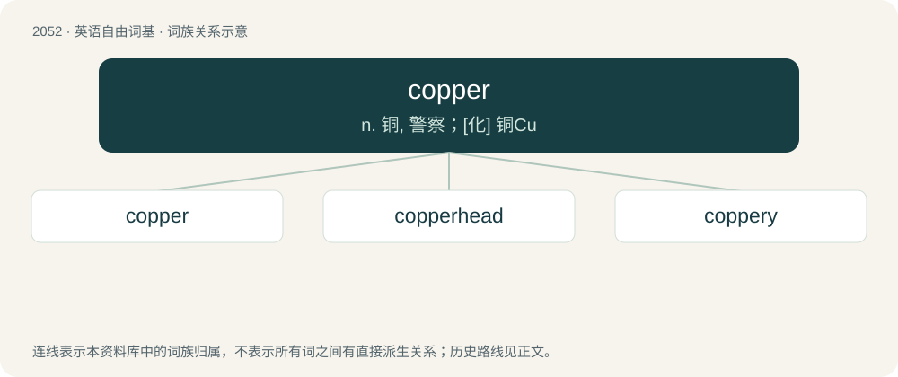

# 2160 · copper — n. 铜, 警察；\[化\] 铜Cu

[总目录](../00_总目录_按常用程度.md)

**类型**：英语自由词基　｜　**来源语言**：见词源记录

## 核心含义与来源

- 核心含义：n. 铜, 警察；\[化\] 铜Cu
- 英文含义：A reddish-brown metallic chemical element (symbol Cu) with the atomic number 29; also, the metal made up of this element.
- 词形：copper

**多个词源／构词路径**：同一拼写可能有不同来源；以下按词性和含义分别列出。

**来源记录 1**（名词；A reddish-brown metallic chemical element (symbol Cu) with the atomic number 29; also, the metal made up of this element.）

The noun is inherited from Middle English coper, copper (“copper ore; copper metal; bronze”), from Old English coper, copor (“copper”), from Late Latin cuprum (“copper”), a contraction of Latin aes Cyprium (literally “Cyprian brass or copper”), ultimately from Ancient Greek Κῠ́προς (Kŭ́pros, “Cyprus”) (a major source of copper during the Near East’s Bronze Age), from the name of a Northwest Semitic goddess from the root כ־ב־ר/ك ب ر (k b r) (“related to being big, large; great; or old”). Doublet of kobo. The adjective is from an attributive use of the noun. The verb is also derived from the noun. cognates \* Dutch koper (“copper”) \* German Kupfer (“copper”) \* Icelandic kopar (“copper”) Compare typologically Argentina (&lt; Latin argentum, an opposite semantic shift); turquoise (akin to Turk).

**来源记录 2**（名词；A police officer, especially one in uniform.）

The noun is probably derived from cop (“(informal, dated) to arrest or capture (someone)”) + -er (suffix forming agent nouns), although cop is attested slightly later. The verb is derived from the noun.

**来源记录 3**（名词；A component of the cop (“conical ball of thread wound on to the spindle”) in a spinning machine.）

From cop (“ball of thread wound on to a spindle in a spinning machine”) + -er (suffix denoting things relating to the words to which the suffix is attached to).

## 词族图

## 单词速览（常用到不常用）

| 单词 | 音标 | 释义 |
|---|---|---|
| [copper](#w-1) | 英 /ˈkɒpə/；美 /ˈkɑpəɹ/ | n. 铜, 警察；\[化\] 铜Cu |
| [copperhead](#w-2) | /ˈkɒpəhed/ | n. 铜头(蝮)蛇, 南北战争时同情南方的北方人；\[医\] 铜头蛇(蝮属) |
| [coppery](#w-3) | 英 /ˈkɒpəɹi/；美 /ˈkɑpəɹi/ | a. 含铜的, 铜一样的, 铜制的；\[建\] 似铜的, 含铜的, 铜的 |

## 逐词详解

### 1. copper

**词性**：名词　｜　**音标**：英 /ˈkɒpə/；美 /ˈkɑpəɹ/

**中文释义**：n. 铜, 警察；\[化\] 铜Cu

**英文义项**：A reddish-brown metallic chemical element (symbol Cu) with the atomic number 29; also, the metal made up of this element. / The reddish-brown colour of copper (etymology 1, noun sense 1).

**词源与演化**：

The noun is inherited from Middle English coper, copper (“copper ore; copper metal; bronze”), from Old English coper, copor (“copper”), from Late Latin cuprum (“copper”), a contraction of Latin aes Cyprium (literally “Cyprian brass or copper”), ultimately from Ancient Greek Κῠ́προς (Kŭ́pros, “Cyprus”) (a major source of copper during the Near East’s Bronze Age), from the name of a Northwest Semitic goddess from the root כ־ב־ר/ك ب ر (k b r) (“related to being big, large; great; or old”). Doublet of kobo. The adjective is from an attributive use of the noun. The verb is also derived from the noun. cognates \* Dutch koper (“copper”) \* German Kupfer (“copper”) \* Icelandic kopar (“copper”) Compare typologically Argentina (&lt; Latin argentum, an opposite semantic shift); turquoise (akin to Turk).

**例句**：

> Mum would heat the water in a copper in the kitchen and transfer it to the tin bath.

该用例对应义项：A large pot, originally made of copper but later often of iron, filled with water and heated over a fire for cooking, washing clothes, etc.

### 2. copperhead

**词性**：名词　｜　**音标**：/ˈkɒpəhed/

**中文释义**：n. 铜头(蝮)蛇, 南北战争时同情南方的北方人；\[医\] 铜头蛇(蝮属)

**英文义项**：A venomous pit viper of species Agkistrodon contortrix, found in parts of North America. / A water moccasin (Agkistrodon piscivorus)

**构词拆分**：copper + head

**词源与演化**：

From copper + head.

### 3. coppery

**词性**：形容词　｜　**音标**：英 /ˈkɒpəɹi/；美 /ˈkɑpəɹi/

**中文释义**：a. 含铜的, 铜一样的, 铜制的；\[建\] 似铜的, 含铜的, 铜的

**英文义项**：Resembling the metal copper, especially in color. / Containing copper, especially if abundantly.

**构词拆分**：copper + -y

**词源与演化**：

From copper + -y.

**用法示例／搭配（非完整句）**：

> an especially coppery grade of brass

该用例对应义项：Containing copper, especially if abundantly.
