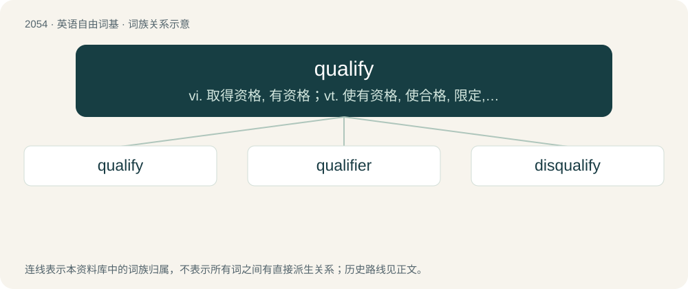

# 2161 · qualify — vi. 取得资格, 有资格；vt. 使有资格, 使合格, 限定, 限制, 准予

[总目录](../00_总目录_按常用程度.md)

**类型**：英语自由词基　｜　**来源语言**：见词源记录

## 核心含义与来源

- 核心含义：vi. 取得资格, 有资格；vt. 使有资格, 使合格, 限定, 限制, 准予
- 英文含义：To describe or characterize something by listing its qualities.
- 词形：qualify

**来源记录 1**（动词；To describe or characterize something by listing its qualities.）

Borrowed from Middle French qualifier (“to qualify”). Equivalent to quality + -fy.

## 词族图

## 单词速览（常用到不常用）

| 单词 | 音标 | 释义 |
|---|---|---|
| [qualify](#w-1) | 英 /ˈkwɒl.ɪ.faɪ/；美 /ˈkwɑ.lɪ.faɪ/ | vi. 取得资格, 有资格；vt. 使有资格, 使合格, 限定, 限制, 准予 |
| [qualifier](#w-2) | 英 /ˈkwɒl.ɪ.faɪ.ə/；美 /ˈkwɑ.lɪ.faɪ.ɚ/ | n. 取得资格的人, 限定语；\[计\] 限定词 |
| [disqualify](#w-3) | 英 /dɪsˈkwɒlɪfaɪ/；美 /dɪsˈkwɔləfaɪ/ | vt. 使不适合, 取消...资格 |

## 逐词详解

### 1. qualify

**词性**：动词　｜　**音标**：英 /ˈkwɒl.ɪ.faɪ/；美 /ˈkwɑ.lɪ.faɪ/

**中文释义**：vi. 取得资格, 有资格；vt. 使有资格, 使合格, 限定, 限制, 准予

**英文义项**：To describe or characterize something by listing its qualities. / To successfully fall under some category or description by meeting requisite conditions.

**构词拆分**：quality + -fy

**词源与演化**：

Borrowed from Middle French qualifier (“to qualify”). Equivalent to quality + -fy.

**用法示例／搭配（非完整句）**：

> to qualify seven balls you need at least fourteen catches

该用例对应义项：To throw and catch each object at least twice.

### 2. qualifier

**词性**：名词　｜　**音标**：英 /ˈkwɒl.ɪ.faɪ.ə/；美 /ˈkwɑ.lɪ.faɪ.ɚ/

**中文释义**：n. 取得资格的人, 限定语；\[计\] 限定词

**英文义项**：One who qualifies for something, especially a contestant who qualifies for a stage in a competition. / A preliminary stage of a competition.

**构词拆分**：qualify + -er

**词源与演化**：

From qualify + -er.

**例句**：

> The tournament was won by a late qualifier.

该用例对应义项：a contestant who meets certain requirements and so qualifies to take part in the next stage of competition

### 3. disqualify

**词性**：动词　｜　**音标**：英 /dɪsˈkwɒlɪfaɪ/；美 /dɪsˈkwɔləfaɪ/

**中文释义**：vt. 使不适合, 取消...资格

**英文义项**：To make ineligible for something. / To exclude from consideration by the explicit revocation of a previous qualification.

**构词拆分**：dis- + qualify

**词源与演化**：

From dis- + qualify.

**例句**：

> If you swim incorrectly the judges will disqualify you.
