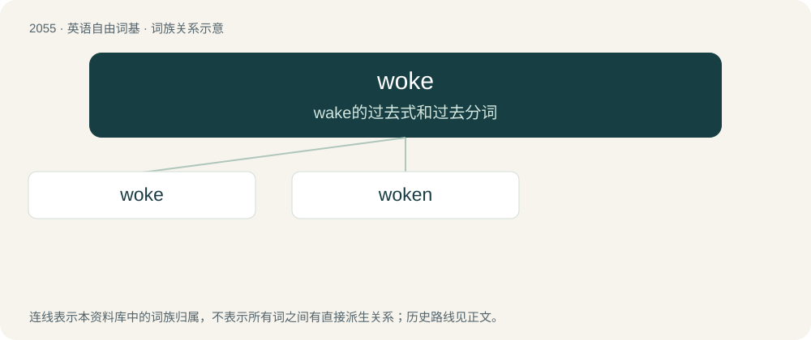

# 2162 · woke — wake的过去式和过去分词

[总目录](../00_总目录_按常用程度.md)

**类型**：英语自由词基　｜　**来源语言**：见词源记录

## 核心含义与来源

- 核心含义：wake的过去式和过去分词
- 英文含义：Awake: conscious and not asleep.
- 词形：woke

**来源记录 1**（形容词；Awake: conscious and not asleep.）

Shortened from woken or woken up, or derived from dialectal use of woke (past participle of wake). The sense of being aware of social injustice dates to at least the 1930s. The derogatory use has been most commonly used as of the 2020s.

## 词族图

## 单词速览（常用到不常用）

| 单词 | 音标 | 释义 |
|---|---|---|
| [woke](#w-1) | 英 /wəʊk/；美 /woʊk/ | wake的过去式和过去分词 |
| [woken](#w-2) | 英 /ˈwəʊ.kən/；美 /ˈwoʊ.kən/ | wake的过去分词 |

## 逐词详解

### 1. woke

**词性**：形容词　｜　**音标**：英 /wəʊk/；美 /woʊk/

**中文释义**：wake的过去式和过去分词

**英文义项**：Awake: conscious and not asleep. / Alert, aware of what is going on, or well-informed, especially of racial and other social justice issues.

**词源与演化**：

Shortened from woken or woken up, or derived from dialectal use of woke (past participle of wake). The sense of being aware of social injustice dates to at least the 1930s. The derogatory use has been most commonly used as of the 2020s.

**例句**：

> When I woke up this morning, the rain had turned into snow.

### 2. woken

**词性**：动词　｜　**音标**：英 /ˈwəʊ.kən/；美 /ˈwoʊ.kən/

**中文释义**：wake的过去分词

**英文义项**：To make or become woke or woker.

**构词拆分**：From woke + -en.

**词源与演化**：

From woke + -en.

**例句**：

> If Sam had woken up earlier, he wouldn't have missed the bus.
